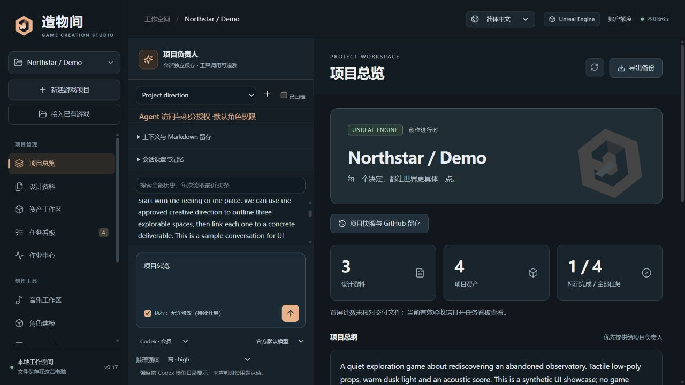

<p align="center"></p>

# 造物间 · ZAOWU

**把游戏设计、AI 创作与项目交付放在同一个工作空间。**

[English](README_EN.md) · [使用指南](docs/USER_GUIDE.md) · [技术手册](docs/TECHNICAL_OVERVIEW.md) · [版本记录](CHANGELOG.md)

造物间是运行在个人电脑上的游戏创作与项目管理工作台。可接入已有 Unreal Engine 或 Unity 工程，与 AI 讨论设计，创建美术、音乐和模型方案，并用任务、资产版本与执行记录追踪项目进展。

造物间目前包含大模型agent（现支持codex会员、GPT api、Deepseek api连接）、WebUI美术、Suno音乐、Tripo建模四个模块，可以使用AI会话先对游戏想法进行验证拓展，同时初步定下游戏玩法与剧情方向，可让AI生成美术与音乐提示词，进而使用WebUI对游戏概念美术进行设计(出平面图后可以转送至Tripo进行图生建模)，并使用Suno生成游戏配乐，游戏资产都可在工作台进行管理验证。

**0.19.0 实验版 · Windows 优先 · 本机单用户 · 简体中文 / English · MIT 源码许可**



## 从已有项目继续创作

1. **接入工程**：选择主工程及附加资料目录，识别资产、设计和当前实现依据，原文件保留在原处。
2. **讨论与规划**：总负责人、音乐负责人、建模负责人各有会话、项目资料与工具范围。
3. **创作与处理**：保存免费方案，按需使用本机工具或经确认的云端生成，将产出纳入版本化资产。
4. **交付与留存**：关联任务和确切资产版本，记录验收依据，再创建可校验的工程快照。

## 主要功能

| 工作区 | 能力 |
| --- | --- |
| 首次使用 | 自带 Python 的 Windows 安装候选、系统目录选择、SUNO 原包装配、WebUI 硬件预检和免费练习项目 |
| 项目与设计 | Unreal / Unity 项目，最多8个来源目录，设计文档、历史版本、只读项目分析与可恢复缓存归档 |
| AI 与会话 | Codex 会员、本机官方 App Server、OpenAI / DeepSeek API、会话记忆、上下文回查和 Markdown 留存 |
| 会话控制 | “允许修改”按会话持续保存，手动关闭；模型与推理强度选择，Codex 按返回的能力目录显示 |
| 美术 | 本机 WebUI 模型/LoRA/产出管理、图片生成与参考图编辑、图片预览和有限编辑 |
| 音乐 | Suno.cn Skill、音乐专职对话、模型选择、方案与作业管理，成功音轨接入资产 |
| 建模 | Blender 参数化低模角色、可编辑源文件/GLB/预览、Tripo 文生或图生3D接入 |
| 项目管理 | 统一作业中心、任务依赖、候选采用、固定版本与 SHA-256 交付、不可变验收历史 |
| 额度与留存 | 支持服务的只读额度查询、过滤工程快照、哈希校验与独立恢复、GitHub 分支/LFS发布准备 |
| 界面 | 中英文切换、原创矢量标志、深色创作空间、分页目录与长消息分段读取 |

## 第一次使用

推荐下载 `ZAOWU-0.19.0-windows-x64-setup.exe`，或完整解压自带 Python 的 Windows ZIP 后打开 `ZAOWU.exe`。基础管理无需另装 Python/Node；程序与数据分离。安装包未签名，详见[应用与装配指南](docs/WINDOWS_APP_AND_SETUP.md)。以下 Install 入口保留给源码发行物。

发布后可从本仓库的 **Releases** 选择以下附件；下载是否可用以实际发布页面为准：

| 发行物 | 适合谁 | 自带 Python |
| --- | --- | --- |
| Windows `setup.exe` | 希望通过图形安装开始使用的人 | 是 |
| Windows `windows-x64.zip` | 希望完整解压后直接使用的人 | 是 |
| `game-creation-workbench-0.19.0.zip` | 需要源码与预构建界面的开发者 | 否 |

每个附件均提供 `.sha256` 校验文件。GitHub 自动生成的 Source code 归档不包含应用运行时或已构建界面。

使用源码发行 ZIP 时，解压到可写文件夹后双击 **Install-Workbench.cmd**。缺少Python时按窗口指引确认安装，基础依赖准备完成后自动启动；界面版本与哈希匹配时，核心项目管理不需要Node/npm。

浏览器中的“快速上手”会指导检查基础、选择功能、预览装配清单和创建免费练习项目。Codex、Node、Git、Blender及原版 SUNO Skill 提供固定来源装配；账号授权、引擎许可和 WebUI 模型由本人选择与完成。没有 AI 账号也能先使用设计、任务和本地资产管理。完整步骤见[首次使用指南](docs/QUICK_START_AND_SETUP.md)。

以后双击`Start-Workbench.cmd`，使用`Stop-Workbench.cmd`正常停止；基础依赖异常时先停止再运行`Repair-Workbench.cmd`。安装需要网络，部分系统确认需本人完成。数据目录继续保留。

开发者从源码安装时可运行`./scripts/Setup.ps1 -InstallMissing -RebuildUI`；推荐Python 3.12、Node.js 24与npm。就绪地址为 <http://127.0.0.1:8765>。

VS Code：完成安装后打开“运行和调试”，选择“工作台：运行与调试”，按 **F5**。前端热更新可另开终端运行 `npm run dev`，使用 `5173` 的本机API代理。

已有Python环境时，也可以手动安装：

```text
python -m venv .venv
```

激活虚拟环境后执行：

```text
python -m pip install -r requirements.lock.txt
npm ci
npm run build
python -X utf8 -m backend.run
```

源码 ZIP 另含已构建界面，手动运行入口可以省去前端构建；它仍需Python依赖，且不是独立安装器。安装、中文路径、数据目录和旧版停止方式见 [运行指南](docs/RUNTIME_AND_DIAGNOSTICS_GUIDE.md)。非Windows平台尚无完整实际验收。

## 连接与使用

在“模型与引擎”配置文本服务，在各创作工作区配置可选工具。没有全部服务的账号，也可以先管理项目、设计、任务和本地资产。

- **Codex**：通过本机官方 `codex app-server` 登录与执行。会员额度与OpenAI API账单分别处理；不复制会员凭据。
- **OpenAI / DeepSeek**：使用自己的API Key及账号可用模型。推理强度支持依模型而异；不支持时明确报错，不自动重提。
- **WebUI / Blender**：使用自行安装的本机工具；模型文件不随项目资料包备份。
- **Suno.cn / Tripo**：默认先保存方案；云端生成需人工确认或独立积分授权。对话模型用量与创作服务积分分别计费。

“执行：允许修改”保存在当前会话，刷新或重开后保持，取消勾选后关闭。新建、复制和资料恢复后的会话默认关闭。它不自动授予工作台全功能、Codex整机访问或SUNO/Tripo自动积分；这些权限仍各自管理。具体操作见 [会话控制](docs/CONVERSATION_CONTROLS.md)。

## 当前验证与限制

本轮 215 项 Python 测试、语言检查与生产构建通过；公开上传准备见[检查记录](docs/GITHUB_READINESS_2026-10-28.md)。私有解释器、原生选择回填/取消、原版 SUNO 包装配和本机硬件预检的历史实测见[0.19装配记录](docs/verification/setup-v0.19.json)；会话控制记录保留在[0.17](docs/verification/conversation-controls-v0.17.json)。

Unreal、Blender、WebUI和Codex会员有各自历史实测；Unity运行、SUNO/Tripo真实收费生成、部分API和真实GitHub上传仍待独立验收。生成文件、任务标记完成与游戏可玩性分别核验。完整范围见 [开发状态](docs/DEVELOPMENT_STATUS.md)。

本版已有未签名的 Windows 私有 Python 安装候选，尚无自动升级回退、通用桌面鼠标键盘代理或原生资产引用图；主界面及3D查看器仍有构建分块体积提示。后续重点为迁移恢复、真实工程基准和受控服务验收。

## 数据与权限

Windows 应用默认数据目录为 `%LOCALAPPDATA%/ZAOWU/data`，源码默认为 `.workbench/`，可通过 `WORKBENCH_DATA` 指定其他目录。更新源码不要删除运行数据；资料包不包含密钥，但可能包含私有设计、对话与资产。`.env.example`仅作变量参考，程序不会自动加载`.env`。

服务只监听本机，不提供多用户认证或公网托管能力。工作台全功能、整机访问与两家自动积分分别授权；整机权限可使用其他程序，积分开关不是系统级消费隔离。收费结果未知时不自动重试。见 [安全与数据边界](SECURITY.md)。

## 开发与贡献

```text
python -X utf8 -m pytest -q
npm run build
python -X utf8 scripts/check_release.py
python -X utf8 scripts/package_release.py
```

默认验证不调用真实模型、收费服务或游戏引擎。新增文件需先加入计划公开的Git清单，才能被发布检查与打包收集。CI配置覆盖Windows/Ubuntu测试和构建，实际远端状态需上传后确认。

[参与开发](CONTRIBUTING.md) · [技术架构](docs/TECHNICAL_OVERVIEW.md) · [Agent权限](docs/AGENT_ACCESS_GUIDE.md) · [项目留存](docs/PROJECT_RETENTION_GUIDE.md) · [GitHub发布](docs/GITHUB_RELEASE.md) · [主页文案](docs/GITHUB_HOME_PAGE.md)

## 许可

源码采用 [MIT License](LICENSE)，依赖声明见 [第三方许可](THIRD_PARTY_NOTICES.md)。供应商服务、模型、引擎与用户资产各自遵循原有许可。本项目不是 OpenAI、DeepSeek、Epic、Unity、SUNO 或 Tripo 的官方产品。

## 独立游戏创作同好交流

项目持续更新，根据反馈更新新工具模块、插件、token管理工具等。

造物间（AI协作游戏开发）QQ群：1079128787
