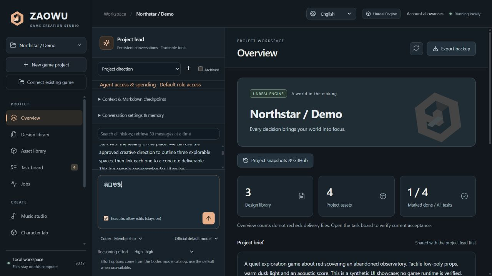

<p align="center"></p>

# ZAOWU · Game Creation Workbench

**One local workspace for game design, AI creation and project delivery.**

[简体中文](README.md) · [User guide](docs/USER_GUIDE.md) · [Technical guide](docs/TECHNICAL_OVERVIEW.md) · [Changelog](CHANGELOG.md)

ZAOWU connects an existing Unreal Engine or Unity project with AI conversations, design documents, creative tools, versioned assets and reviewable task delivery. Keep the reasoning behind decisions alongside the files and execution records.

**v0.19.0 experimental · Windows first · Local, single user · Chinese / English UI · MIT source license**



## A workflow that starts with your existing game

1. Connect your game and supporting folders. Index designs and assets while original files stay in place.
2. Discuss with the project, music or modeling lead. Each conversation has its own history, memory and tool scope.
3. Save a plan, use local tools or explicitly authorized cloud generation, then register outputs as versioned assets.
4. Adopt a candidate, review the exact asset version, record acceptance and create a verifiable project snapshot.

## Features

| Area | Available capabilities |
| --- | --- |
| Projects | Unreal / Unity selection, up to eight source folders, design revisions, read-only analysis and recoverable cache archiving |
| AI conversations | Codex membership through the official local App Server, OpenAI / DeepSeek APIs, context retrieval and Markdown checkpoints |
| Conversation controls | Persistent editing switch per conversation, model selection and reasoning effort; Codex options follow its returned model catalog |
| Art and music | Local WebUI models, LoRAs and outputs; image workflows; Suno.cn skill, music plans and successful track import |
| Modeling | Local Blender parametric low-poly characters, editable sources and GLB previews; Tripo text/image-to-3D integration |
| Delivery | Unified jobs, task dependencies, candidate adoption, pinned asset hashes and immutable acceptance history |
| Retention | Supported account-usage queries, filtered project snapshots, SHA-256 verification, independent restore and GitHub branch/LFS publishing preparation |

## Quick start

For the Windows app, open `ZAOWU-0.19.0-windows-x64-setup.exe`, or extract the complete Windows ZIP and open `ZAOWU.exe`. Core features need no separate Python or Node installation. [App setup guide](docs/WINDOWS_APP_AND_SETUP.md).

After publication, use this repository's **Releases** page. Artifact availability depends on publication; the supported candidates are:

| Package | Intended use | Python included |
| --- | --- | --- |
| Windows `setup.exe` | Graphical installation | Yes |
| Windows `windows-x64.zip` | Extract the complete app and run | Yes |
| `game-creation-workbench-0.19.0.zip` | Source and prebuilt UI | No |

Each artifact has a `.sha256` file. GitHub's automatic Source code archives do not include the built UI or private runtime. The Windows installer is unsigned; clean-VM validation remains separate work.

For the source ZIP, extract it to a writable folder and double-click **Install-Workbench.cmd**. It prepares core dependencies and guides missing Python installation. A matching prebuilt UI needs no Node/npm for core project management.

The first-run guide helps you choose features, preview fixed tool installations and create a free practice project. Codex, Node, Git, Blender and the original SUNO Skill have setup flows. Complete account authorization, engine licensing and WebUI model selection yourself. Native folder selection covers projects, sources, WebUI and snapshots; Blender uses a file picker. WebUI hardware checks read RAM, known VRAM, drivers and disk space without starting WebUI or downloading models. No AI account is needed for project management. See the [setup guide](docs/QUICK_START_AND_SETUP.md).

Use `Start-Workbench.cmd` for later launches and `Stop-Workbench.cmd` to stop normally. Stop first before using `Repair-Workbench.cmd` for core dependency repair. Network access and some system confirmations are required. For source development, run `./scripts/Setup.ps1 -InstallMissing -RebuildUI` with Python 3.12 and Node.js 24/npm. VS Code's **工作台：运行与调试** configuration supports F5.

Manual installation, after creating and activating a Python virtual environment:

```text
python -m pip install -r requirements.lock.txt
npm ci
npm run build
python -X utf8 -m backend.run
```

The source ZIP includes a built UI for the manual Python entry point. It still needs backend dependencies and is not a standalone installer. Other operating systems have not received full practical acceptance testing. Most detailed documentation is currently Chinese; the application UI supports English.

## Connections and permissions

Configure your own providers in **Models & engines** and optional tools in their workspaces. You can manage projects and local assets without connecting every service. Codex membership usage and API billing are separate. Local WebUI and Blender require your own installations; model files are not bundled in project data backups.

**Execute: allow edits (stays on)** remembers your choice for the current conversation across reloads. Turn it off to return to discussion. New, copied and restored conversations start with editing off. Full workbench access, Codex computer access and automatic SUNO/Tripo spending remain separate grants. See [conversation controls](docs/CONVERSATION_CONTROLS.md).

Reasoning support varies by model. Unsupported settings return an error rather than silently falling back or retrying. Cloud music and modeling normally start as reviewable plans; paid submission requires confirmation or the relevant separate grant.

## Status and boundaries

215 Python tests, language checks and the production build pass locally. See the [upload readiness record](docs/GITHUB_READINESS_2026-10-28.md). Private runtime imports, native picker cancel/selection, original SUNO package setup and local hardware checks have scoped [historical verification](docs/verification/setup-v0.19.json).

Unreal, Blender, WebUI and Codex membership have scoped historical verification. Unity runtime, real paid SUNO/Tripo generation, some APIs and real GitHub publishing still need independent acceptance. A generated asset or completed task does not prove playable gameplay.

An unsigned Windows private-Python installer is available. Automatic upgrade rollback, general desktop mouse/keyboard control and native engine asset-reference analysis are not delivered. The main UI and lazy 3D bundles still trigger build-size warnings.

## Data, development and license

The Windows app stores data in `%LOCALAPPDATA%/ZAOWU/data`; source defaults to `.workbench/`; preserve it when updating source. Configure `WORKBENCH_DATA` for another directory. Never commit runtime data, credentials, logs or third-party game projects. Backups exclude keys but may contain private game content. This is a local single-user tool with no public-service authentication. Computer access is broader than workbench spending switches; unknown paid outcomes are never automatically resubmitted.

```text
python -X utf8 -m pytest -q
npm run build
python -X utf8 scripts/check_release.py
python -X utf8 scripts/package_release.py
```

Default checks use no paid models or game engines. CI is configured for Windows and Ubuntu; its actual remote result must be checked after uploading.

[Contributing](CONTRIBUTING.md) · [Security](SECURITY.md) · [Release guide](docs/GITHUB_RELEASE.md) · [Third-party notices](THIRD_PARTY_NOTICES.md)

Source code is [MIT licensed](LICENSE). Provider services, models, engines and user assets retain their own terms. ZAOWU is not an official product of OpenAI, DeepSeek, Epic, Unity, SUNO or Tripo.
