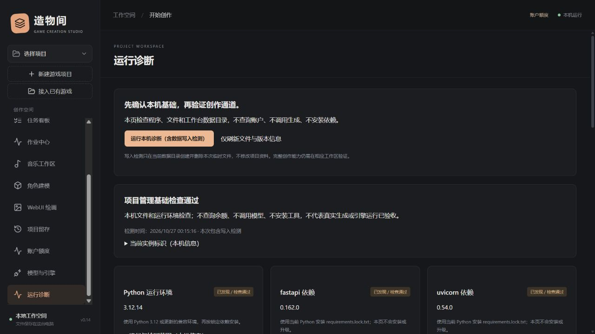

# 运行实例、数据目录与环境诊断

> 0.19 更新：已提供自带 Python 的 Windows x64 安装候选、系统目录/文件选择、原版 SUNO Skill 装配和只读 WebUI 硬件预检。详细步骤与验证边界见[应用与装配指南](WINDOWS_APP_AND_SETUP.md)；下文旧版本验收记录保留其当时范围。

适用版本：0.14.0本机实验版。日期：2026-10-27。

## 1. 在界面诊断

左侧“运行诊断”不需要选择项目。首次打开只发现本机文件、安装版本和数据库结构，不执行写入测试。

点击“运行本机诊断（含数据写入检测）”后，工作台在当前数据目录创建本次临时文件，写入、读取并清理；不会修改项目、移除资产或重建数据库。缺失依赖、磁盘不足、路径问题和损坏数据库会显示需处理项，本页不自动修复或安装。

| 类型 | 检查范围 | 不代表什么 |
| --- | --- | --- |
| 核心环境 | Python版本、核心包元数据与模块文件、构建入口、数据库项目表、数据目录读写 | 不保证所有依赖导入链、数据库每条记录或浏览器功能均已通过 |
| 可选工具 | Node/npm、Git、Codex入口、Suno原版helper、Blender和WebUI目录 | 文件存在不等于登录、API在线、额度充足或真实生成通过 |
| 当前实例 | 版本、协议、实例编号、启动编号、进程与目录指纹 | 不是公网认证或同用户进程隔离 |

路径和检测范围在折叠详情中查看。前往工作区的按钮仅打开配置/核验入口，不自动调用模型。诊断接口本身不执行账号查询；应用既有连接状态读取与此检查分开。



## 2. 正常启动与停止

默认仍可双击`Start-Workbench.cmd`和`Stop-Workbench.cmd`。Windows启动器核对端口服务的源码、数据目录和版本；不符合时拒绝复用，也不停止别的进程。

已有Python环境和构建界面时，启动不会重新安装依赖。源码默认首次缺少环境/界面时仍调用Setup安装和构建；这不是已自带运行时的独立安装包。

需要其他端口或独立数据目录时：

```powershell
./scripts/Start-Workbench.ps1 -NoBrowser -Port 8770 -DataDirectory 'E:\WorkbenchData'
./scripts/Stop-Workbench.ps1 -Port 8770 -DataDirectory 'E:\WorkbenchData'
```

`.cmd`也转交这些参数。停止须使用相同源码和数据目录；同目录但运行版本较旧时，可先停止再启动，启动器不会混用新界面与旧后端。

可以用`-PythonExecutable`选择已安装并具有锁定依赖的真实Python解释器；默认使用源码目录的`.venv`。启动和停止逻辑位于可复用的Python入口，PowerShell只做路径与参数转交。

```text
python -X utf8 -m backend.launcher start --port 8770 --data-directory E:\WorkbenchData --no-browser
python -X utf8 -m backend.launcher stop --port 8770 --data-directory E:\WorkbenchData
```

更换数据目录会使用另一份数据库，**不会自动搬迁旧数据**。已有工程、资产和快照中的路径也不会因此重新绑定。切换前保留原目录和备份；移动源码、数据或工程前先停止对应实例。

同一数据目录只允许一个新版服务初始化，不同端口也不能并行使用同一目录。`.instance.lock`由系统锁定，正常退出或进程结束后释放；文件留在目录中正常，不要删除它来绕过正在运行的服务。旧版不持有此锁，所以升级前仍需先停止旧服务。

## 3. 日志及状态

每次新启动将两份日志写入当前数据目录的`logs/`：`server.启动编号.log`和`server.启动编号.error.log`。复用已有实例不创建新日志或覆盖旧日志；错误信息会给出本次日志位置。旧版日志可能仍在数据目录根部，保留即可，不需删除重置。

启动时使用随机启动编号核对就绪响应，停止时再次核对实例编号；服务重启后，旧停止请求被拒绝。只确认原实例退出，不以强制杀进程解决端口冲突。网络超时或HTTP错误无法单独证明退出，无法核实时会保留未确认状态。

常见处理：

- **另一份源码或数据目录占用端口**：回到它的原目录操作，或给本次服务选择其他端口。
- **版本不一致**：先用对应目录和数据参数正常停止，再重启。
- **核心包缺失**：用实际运行的Python安装`requirements.lock.txt`，不要只给另一个解释器安装。
- **没有生产界面**：源码构建前端；发行包应含`dist/`。只发现文件不等于已验证源码与界面对应。
- **数据库不可读取**：核对目录、磁盘和备份，保留原文件；诊断不会删除它重建。

## 4. 从0.13及更早服务升级

旧服务没有实例指纹，新启动器默认拒绝复用或停止它。先在原浏览器确认项目与端口，结束需要保留的任务。若无法用旧启动入口停止，可由用户在确认后显式执行：

```powershell
./scripts/Stop-Workbench.ps1 -Port 8765 -LegacyConfirmed
```

该选项仅用于小于0.14且缺少身份字段的旧协议，无法核对旧服务实际源码/数据目录，所以不自动启用；不能用于绕过新实例的归属检查。它使用旧版会话入口发送一次正常停止请求，不强制结束进程、不自动重试。

正常停止后保留原数据目录，再从同一源码及数据位置启动新版。没有备份格式升级：本版仍使用格式10资料包和格式2工程快照。

## 5. 服务启动不了时

在源码目录，用已知Python先运行不依赖Web服务的诊断：

```text
python -X utf8 -m backend.diagnostics
python -X utf8 -m backend.instance --identity
```

默认仅检查，不创建数据目录或数据库。需要实际数据写入检测时加`--write-probe`，目标目录必须已经存在。数据位置通过`WORKBENCH_DATA`选择；输出可能含本机路径，公开提交前应脱敏。

Python入口支持`python -m backend.run --port 8770 --data-directory ...`，在导入应用前设置数据位置。服务固定监听127.0.0.1，不提供公网或多用户部署。

开发接口：`GET /api/health`返回不含绝对路径的实例身份；`GET /api/server/session`返回当前实例与本机会话令牌；停止可传`{instance_id}`。`GET /api/diagnostics`只发现文件，`POST /api/diagnostics/check`需`{write_probe:true}`并检查原有本机会话令牌。

## 6. 0.18 首次装配补充

首次可双击Install-Workbench，基础依赖异常时正常停止后用Repair-Workbench。预构建界面版本/哈希匹配时Setup跳过Node/npm，只有源码构建或可选功能需要时才装配Node。原启动器的Python轻量入口、实例归属和数据目录保护保留。固定工具安装进行中会拒绝正常停止，异常退出需核对原系统安装器。完整流程及真实验收边界见[首次指南](QUICK_START_AND_SETUP.md)。
