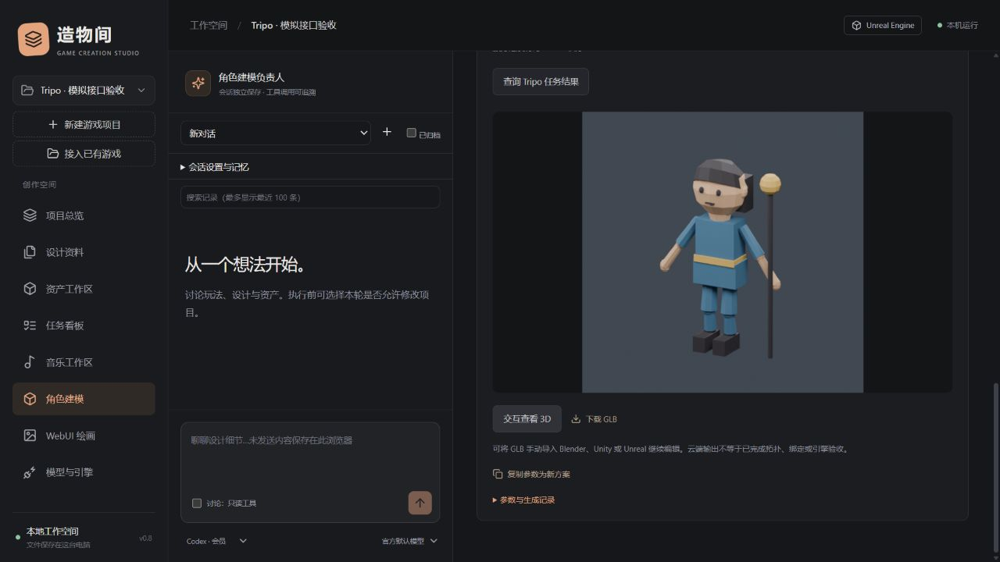

# Tripo 云端建模接入

0.10 更新：默认角色仍只保存方案；用户可按会话授予全功能及独立自动积分，Codex整机另行确认。两家模型可在对应工作区选择，方案创建时冻结，详见 [Agent授权与模型指南](AGENT_ACCESS_GUIDE.md)。下文原有手动确认流程继续可用。

适用版本：0.8.0。本版按 2026-10-26 查阅的 Tripo V3 官方文档实现文生 3D、单图生 3D、任务查询和自包含 GLB 接入；不自动提交绑定、动画、重拓扑、转换等额外任务。

## 配置与使用

1. 重启工作台，选择项目，进入 **角色建模 → Tripo · 云端生成**。原有本机 Blender 参数化建模仍可单独选择。
2. 展开连接配置，选择中国站或全球站，填写 Tripo API Key 并保存。Key 从对应 Tripo 开发者控制台获取，工作台不代登录或复制 Tripo 网页凭据。[官方认证说明](https://developers.tripo3d.ai/en/docs/authentication)
3. 点击 **核验连接与 API 余额**，只查询账号的可用与冻结 API 积分，不创建生成任务。区域与 Key 应匹配；已有方案绑定创建时的区域，不随之后的设置变化自动换区。也可在启动服务前设置 `TRIPO_API_KEY` 环境变量；工作台不会自动加载 `.env` 文件。
4. 与左侧角色建模负责人讨论，明确要求“使用 Tripo”，开启执行后让 AI 保存方案；也可以展开手动表单。保存方案不上传图片、不提交生成。
5. 选择文字或图片生成、模型版本、面数目标、贴图和 PBR。审阅卡片后点击 **确认上传与积分，提交生成**，确认框会列出输入、模型、区域和积分影响。
6. 获得任务 ID 后，点击 **查询 Tripo 任务结果**。本版手动查询，不自动循环提交。关闭工作台不会取消云端任务；重新打开后可以继续查询。
7. 服务返回成功且提供模型时，点击 **下载 GLB 并纳入项目**。工作台先重新查询任务获取当前结果地址，再下载、校验和登记模型；成功后可交互预览或下载 GLB。

云端生成使用 Tripo API 积分，与工作台对话模型的用量分开计算。当前不估算精确费用；余额核验不代表某次任务的费用或生成质量已经验证。[Tripo 计费说明](https://developers.tripo3d.ai/en/docs/billing)

可对建模负责人说：

> 使用 Tripo，为项目设计一名穿蓝色外衣的低模探索者，完整四肢，背旅行背包。采用文生 3D、v3.1-20260211、面数目标 20000、贴图和 PBR。先调用 draft_tripo 保存待确认方案，不提交生成。

## 输入和产出范围

| 项目 | 当前范围 |
| --- | --- |
| 服务 | 中国站 `https://openapi.tripo3d.com/v3`；全球站 `https://openapi.tripo3d.ai/v3`，无任意地址配置 |
| 模型 | H 系列 `v3.1-20260211`、`v3.0-20250812`、`v2.5-20250123`；默认第一项 |
| 文字 | 1–1024 字符，描述形状、材质与风格；文生模式不接受参考图 |
| 图片 | 本项目已有静态图片，推荐至少 256×256；提交时清理元数据并转 PNG，最多 20 MB、3200 万像素；图生模式仅使用图片，提示词留空 |
| 面数 | 工作台限制目标为 500–100000；这是生成请求参数，实际拓扑与面数需验收 |
| 材质 | 可选择贴图与 PBR，PBR 要求同时开启贴图 |
| 模型接入 | 仅自包含 GLB，单文件最多 150 MiB；不自动创建收费格式转换任务 |
| 预览 | GLB 旋转缩放；服务预览图下载成功时转为本机 PNG，最长边不超过 1536 |

图片仅在手动确认后上传给 Tripo，方案创建时保存图片版本哈希，提交前版本变化会拒绝使用旧方案。原图不会被覆盖。[文字生成接口](https://developers.tripo3d.ai/en/docs/generation-text-to-model/standard)、[图片生成接口](https://developers.tripo3d.ai/en/docs/generation-image-to-model/standard)、[文件上传接口](https://developers.tripo3d.ai/en/docs/files)

Tripo 模型不自动拥有本机 Blender 参数化方案或 `.blend` 源文件。可将下载的 GLB 手动导入 Blender、Unity 或 Unreal，再继续处理造型、拓扑、材质、骨骼和动画；生成完成不等于已通过引擎或美术验收。

## 防重复、恢复与失败

本机状态为 `draft → submitting → queued/running → ready → importing → imported`，还可能出现 `unknown`、`failed`、`cancelled` 和 `restored`。

- **提交防重**：同一方案只有一次提交入口，提交中重复点击或并发请求会被拒绝。
- **未知结果**：网络中断、响应无法确认或服务重启后，不会自动重新创建付费任务。先在 Tripo 控制台查作品/任务，核对方案与创建时间。
- **手工关联**：在结果未知且未记录任务 ID 时，可填写控制台的 V3 `task_...` ID，人工确认后关联。工作台只查询并校验任务 ID 与类型，不创建新任务，也不能仅凭类型证明控制台任务参数完全相同。
- **图片上传失败**：若生成请求尚未发出，保留待确认状态，可以修正后重新确认；已尝试发出生成请求时，按未知结果处理。
- **下载失败**：不会重新生成，也不发布未校验的部分资产。可重新查询、重获结果地址并再次下载。
- **云端失败/取消**：保留任务记录；退款或积分处理以 Tripo 账户记录为准，工作台不承诺退款结果。

需要新变体时复制参数保存新方案，未授自动积分时每次仍需单独确认。结果未知的原方案应先核对和恢复，不能用自动重试代替查账。

## Agent 与记录

沿用现有 `modeler` 会话角色和所选对话模型。角色的项目命令默认关闭（显式Codex整机授权除外），新增：

- `get_tripo_jobs`：读取本机保存的方案、任务 ID 和状态；不会发起远程生成或自动查询。
- `draft_tripo`：保存完整参数方案，不上传图片或提交生成。

总负责人也可以使用这两个工具；音乐负责人未获得建模能力。云端提交、恢复和下载由界面动作触发，不在 AI 工具目录中。

`tripo_jobs` 关联项目、提交运行 ID、GLB / 预览资产 ID、区域、参数、任务 ID、状态与结果。结果保存服务进度、服务返回的积分消耗（若有）、参考图哈希与本机文件哈希。短期签名下载地址不持久保存，也不进入工具摘要或项目备份。

生成资产保存在工作台项目数据的 `tripo/{job_id}/`。模型与预览一次性登记到项目，原有游戏资产不会被覆盖。

## 数据和网络边界

API Key 仅由后端使用，Windows 通过现有 DPAPI 加密保存；其他平台使用环境变量。浏览器只获知配置状态，项目备份不包含 Key。清除本机保存的 Key 不会清除操作系统环境变量。

模型下载使用独立无认证请求，不向下载服务转发 API Key。只接受 Tripo 与受支持云存储域名的 HTTPS、公网地址，不跟随重定向；拒绝外部资源未内嵌的 GLB。服务改用其他下载域名或格式时可能需要更新适配，不会静默扩大网络范围。

备份格式 8 保留 Tripo 参数、任务与资产关联，恢复时重映射本机引用。已知远程任务可以在配置正确 Key 后继续查询；恢复的未提交草稿不能直接重复提交，未知提交结果仍保留未知保护。大模型文件可能超过工作台 ZIP 导入的现有 60 MB 上限，应单独备份完整资产。

## 工作台 HTTP 接口

写接口仍要求 `/api/bootstrap` 的 `X-Workbench-Token`。

| 接口 | 说明 |
| --- | --- |
| `GET /api/tripo/config` | 配置状态、区域、模型和默认参数；不返回 Key |
| `PUT /api/tripo/config` | `region`、可选 `key` / `clear_key` |
| `POST /api/tripo/test` | 查询 API 余额，未提交生成 |
| `GET /api/projects/{pid}/tripo` | 本项目最近 100 份方案 |
| `POST /api/projects/{pid}/tripo` | `title`、`mode`、`prompt`、`source_asset_id`、`model`、`face_limit`、`texture`、`pbr` |
| `POST /api/tripo/jobs/{jid}/submit` | `{ "confirmed": true }`，确认费用与上传后提交一次 |
| `POST /api/tripo/jobs/{jid}/refresh` | 查询当前远程状态，不提交新生成 |
| `POST /api/tripo/jobs/{jid}/recover` | `{ "task_id": "task_...", "confirmed": true }`，核对后关联未知结果 |
| `POST /api/tripo/jobs/{jid}/import` | 下载并校验成功任务的 GLB，不创建新任务 |

后端仅调用官方 V3 的 `/generation/text-to-model`、`/generation/image-to-model`、`/files`、`/tasks/{task_id}` 和 `/account/balance`；未接入其他后处理 API。[官方任务查询说明](https://developers.tripo3d.ai/en/docs/task-query)

## 验证范围

当前已进行模拟 HTTP 与本机浏览器流程验证，覆盖权限、参数、确认提交、防并发重复、未知结果恢复、图像哈希、请求认证、下载域名和地址限制、GLB 校验、原位资产与备份恢复。界面样本使用本地 Blender 生成的模型来模拟 Tripo 返回，示例工程标明“模拟接口验收”。

没有使用真实 Tripo Key 提交付费生成，不能把模拟测试标为真实账号生成验收。请配置自己的 API Key，核验余额并审阅方案后再提交第一份真实任务。

