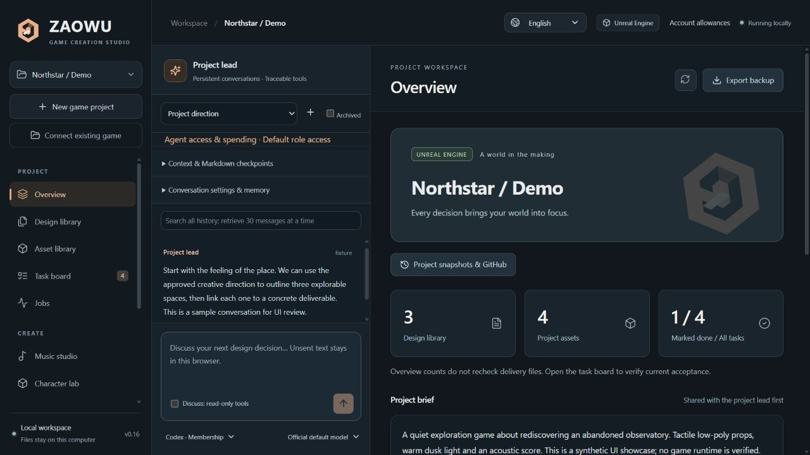
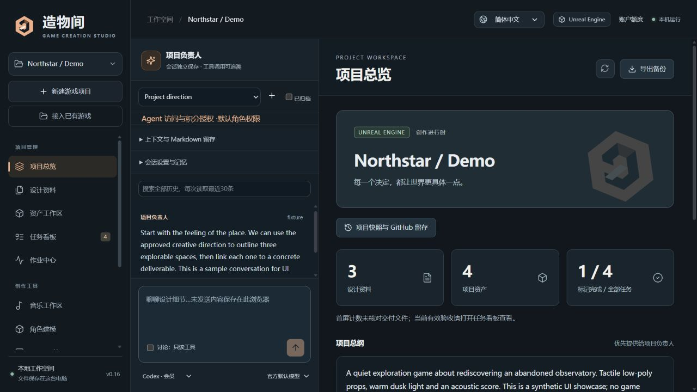
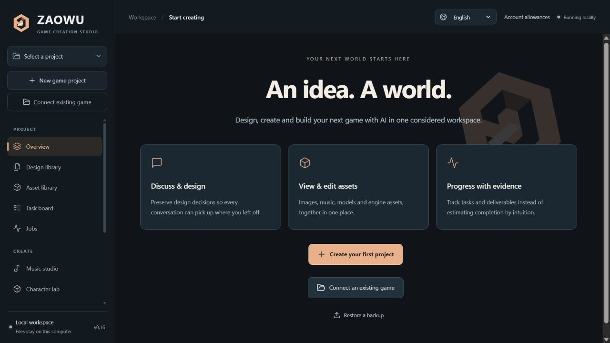

# 界面设计与语言指南

适用版本：0.18.0 实验版。整理日期：2026-10-27。

本版重新设计工作台视觉，并提供可切换的简体中文与英文界面。仍在本机浏览器中运行，使用原有项目、会话、权限和创作流程。

## 使用方式

右上角的语言选择框可选择 **English** 或 **简体中文**。首次访问默认中文，选择会保存在当前浏览器；也可以使用启动页面地址加 `?lang=en` 或 `?lang=zh-CN`，地址中的选择优先于浏览器偏好。两个语言选项使用各自的名称。

切换语言会重新载入页面，并恢复当前页面和已选择的项目；语言框在执行期间禁用。已经保存的项目数据和浏览器持久草稿继续保留。尚未保存的临时表单，例如连接参数或密钥输入，不会自动保存，请先完成需要保留的编辑。禁用浏览器存储时，地址参数仍可切换语言，但无法保证恢复页面和草稿。

英文范围包括导航、表单、提示、任务/作业状态、授权窗口、诊断和工作台自身的常见错误。项目名称、设计正文、原始对话、文件路径、供应商/模型名称及第三方原始响应保持原文；切换界面不会重写资料，也不会自动要求模型改用英文回复。外部工具日志或未识别的服务错误可能仍为其原始语言。

0.17已修正0.16审查发现的草稿/快照说明误翻译，以及项目选择存储被拒绝的加载路径；构建检查新增实际草稿表达式和入口/加载异常场景。历史问题见[进展复核](PROGRESS_REVIEW_v0.16_2026-10-27.md)，本版新增操作见[会话控制](CONVERSATION_CONTROLS.md)。

更新源码后执行 `npm run build`，再按原启动方式重新启动工作台并刷新浏览器。启动、实例核验和数据目录的说明见 [运行指南](RUNTIME_AND_DIAGNOSTICS_GUIDE.md)。

## 视觉与交互

- 深蓝灰工作空间、暖铜强调色、清晰的标题与卡片层次；按钮、表单、状态和弹窗使用统一的视觉语言。
- 左侧按项目管理、创作工具和工作空间分组；保留完整导航与现有功能。导航空间不足时可以滚动。
- 总览优先展示项目标识、统计和总纲；对话与工作区域保持并列，创作与管理共用同一项目上下文。
- 欢迎页集中展示项目入口和创作能力；较短窗口可以滚动至底部入口。
- 支持键盘可见焦点和减少动态效果的系统偏好；窄窗口有响应式布局。本轮实际验收视口为 1280×720，没有完成实体手机验收。

### LOGO

原创矢量标志采用折叠的六边形与开放门户轮廓，中央负形呼应 Z 与创作空间。铜色、浅色切面和深色结构可以在深色背景及小尺寸中辨认。

中文版字标为“造物间”，英文版为 **ZAOWU**。标志同时用于侧栏、欢迎页、项目总览和浏览器图标；源文件为 [mark.svg](../public/brand/mark.svg)，可以无损缩放。界面使用系统字体，不依赖外部字体服务；实际字形随操作系统可用字体变化。

## 开发约定

[i18n.ts](../src/i18n.ts)提供语言解析、`t(source, ...values)`、日期区域、`serverText` 和语言切换。前端中文源文案使用 `tr` 别名调用翻译函数；`{0}` 等占位符保留动态值，不拼接翻译后的句子。

[en.json](../src/locales/en.json)记录前端文案，[server-en.json](../src/locales/server-en.json)记录工作台拥有的服务端呈现文字。`serverText` 只用于明确的状态、说明或错误字段；不要对整个响应、用户正文或聊天内容递归翻译。`presentApi` 仅适配 Blender/Tripo 配置中已有的默认标题/简介字段以及音乐连接提示，不改变业务状态或为配置增加字段。

`localStorage` 的 `workbench-language` 保存偏好；切换前用 `sessionStorage` 的 `workbench-page` 保存当前页面。`lang` 地址参数用于显式选择和存储不可用时的后备入口。语言仅影响当前浏览器呈现，不是账号配置，也不改变 Agent 权限、工具定义或模型提示词。

新增界面文字时同步维护英文目录，运行 `npm run check:i18n`。该检查已接入生产构建，验证中文界面文字是否接入翻译、占位符、英文目录、原始用户数据保护及偏好后备行为。[test_ui_language.py](../tests/test_ui_language.py)另外核对后端直接声明的异常消息模板。

当前合并目录共 1990 条英文映射，前端有 1385 处源文案调用；数量不是覆盖第三方输出的保证。目录随首包加载，主界面压缩前约605 kB，另有约593 kB的按需3D模块；构建仍提示较大分块。后续可以根据实际性能拆分，不将本次视觉改版计为新的首屏性能验收。

## 验证范围

0.17共189项 Python 测试通过，语言检查、TypeScript 和生产构建通过，本轮验证持续执行与推理。此前0.16隔离数据区逐页检查12个主要页面，并验证语言切换后恢复页面、英文新会话默认名称及中文用户资料保持原文；实际保存音乐和Tripo免费草稿，没有提交生成。授权窗口保持默认关闭，没有调用真实模型或消耗积分，没有新增游戏引擎运行验收。

结构化证据见 [studio-ui-v0.16.json](verification/studio-ui-v0.16.json)。下图均使用自制测试项目，不包含真实账号或第三方游戏工程。

0.18新增中英文首次上手界面及按需工具装配，202项测试与生产构建通过。预构建界面带版本和逐文件哈希，匹配后不需Node即可准备核心管理；详见[首次指南](QUICK_START_AND_SETUP.md)。
