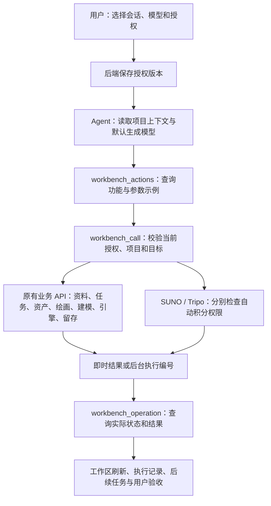
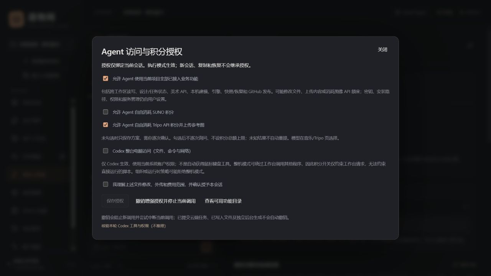

# Agent 授权、功能互通与生成模型

适用版本：0.13.0 实验版。核对日期：2026-10-26。

本版将“讨论/执行”“工作台全功能”“Codex 整机访问”和两家自动积分授权分开。初始仍使用原有角色权限；没有默认开启整机访问或自动收费。本页也记录功能交互分析和剩余限制。

0.11补充：多来源和规则审计新增project.audit、project.maintenance；来源授权与实际缓存归档/恢复由用户审阅具体清单后操作，参见 [多来源指南](MULTI_SOURCE_AND_MAINTENANCE_GUIDE.md)。本页真实Codex目录核验与截图来自0.10，0.11没有重新调用真实模型。

## 1. 功能之间如何协作

此前 Agent 主要负责读资料和保存方案，图片生成、Blender 运行、引擎操作、快照与 GitHub 留存主要从界面触发，跨工作区执行需要人工接续。本版增加可发现的 **76 项项目业务动作**，复用原有界面 API 的校验逻辑。



| 功能组 | 已接通的动作范围 |
| --- | --- |
| 项目/设计/任务/会话 | 读取/更新当前项目、扫描、设计版本与状态、任务依赖/验收说明、会话检索/记忆/复制 |
| 资产/美术 | 信息与哈希、工程文件导入、图片/音频派生编辑与版本恢复、OpenAI/WebUI 生成/编辑、模型/LoRA 目录与产出导入 |
| 音乐/建模 | SUNO 方案/提交/查询；Blender 方案/固定驱动/日志/停止/源文件打开；Tripo 方案/提交/查询/恢复/GLB 接入 |
| 引擎 | 安装当前连接器、调用已实现的属性/预览/材质操作；原有资产目标和版本检查继续生效 |
| 留存 | 资料导出、快照保存/查询/校验/独立恢复、GitHub 预览/上传/核对 |
| 账户/模型 | 额度缓存与只读刷新、用户所选 SUNO/Tripo 模型目录与项目默认值 |

这不增加尚未实现的业务能力，例如任意蓝图图表编辑、自动绑定或窗口鼠标键盘代理。密钥、登录、软件安装路径、授权本身和服务生命周期继续由用户管理，不在动作目录中。项目创建/接入其他工程也仍由界面处理，授权针对当前项目。

## 2. 在界面授权

1. 进入项目，在总负责人、音乐或建模页选中需要授权的会话。
2. 展开左侧 **Agent 访问与积分授权**。
3. 按需要选择权限，阅读说明并勾选确认，点击 **保存授权**。没有保存的选择不会生效，面板会提示。
4. 保存全功能授权后当前页面会打开执行开关。重新打开会话时先检查“讨论/执行”，授权只在执行模式使用；讨论模式仍保留角色的只读目录。
5. “查看可用功能目录”展示已保存授权下的动作及收费状态。Codex 会话可点击“核验本轮 Codex 工具与权限（不推理）”，只检查目录，不生成内容。

| 控制项 | 生效范围 |
| --- | --- |
| 讨论/执行 | 当前页面发送的本轮请求；讨论不启用全功能或写操作 |
| 工作台全功能 | 当前会话可跨本项目工作区使用业务动作；包含设计/任务状态、美术 API、工程文件修改、外传与 GitHub 发布，可能消耗图像 API 额度 |
| SUNO 自动积分 | 允许此会话经工作台提交 SUNO 生成，不再逐次弹出确认；不授予 Tripo 自动积分 |
| Tripo 自动积分 | 允许此会话经工作台上传参考图并提交 Tripo 生成，不授予 SUNO 自动积分 |
| Codex 整台电脑访问 | 仅在所选对话服务为 Codex 且执行模式时启用文件、命令、网络的整机访问；其他 API Agent 不因此获得本机命令通道 |

全功能授权和自动积分按会话保存，直到你更改或撤销；不设累计积分上限。关闭收费开关后 Agent 仍可保存方案，逐次人工确认的原有按钮仍可用。不同角色、复制会话及恢复副本不继承增强授权。

**整机访问的边界：**Codex 通道设置为 `danger-full-access`，在当前系统账户权限下运行，不等于管理员提权或自动获得鼠标键盘工具。工作台仍校验自己的业务动作，但无法阻止整机 Agent 自行运行其他程序或直接访问供应商。因此积分开关只约束工作台请求，不能充当系统级计费隔离。只想委托工作台功能时，可以保持整机开关关闭。官方/组织运行时策略可能拒绝整机模式，应用不会静默降级后继续执行。[官方权限说明](https://learn.chatgpt.com/docs/sandboxing)

### 撤销与停止

点击 **撤销增强授权并停止当前调用** 会更新授权版本，尝试中断当前会话与未完成的工作台请求，后续旧作用域调用被拒绝。停止对话也会取消该对话仍在等待的业务请求。已写入文件、已提交云端任务及已派生的独立 Blender/快照后台作业不会自动回滚或撤销，应到对应工作区核对/停止。

授权变更有执行记录。全功能关闭后恢复原有角色范围；重新手动打开普通执行开关仍可使用该角色原有工具。

## 3. 选择 SUNO 与 Tripo 模型

进入“音乐工作区”的 **SUNO 音乐模型**，或“角色建模 → Tripo”的 **Tripo 项目默认模型**，选择后点击 **保存项目默认模型**。默认值按项目保存，会提供给 Agent 的项目上下文；新方案未显式指定模型时由后端使用项目默认。

| 服务 | 本版接入选项 | 依据 |
| --- | --- | --- |
| SUNO | V6 / `chirp-hawk`；V6 Wild / `chirp-hawk-wild`；V6 Mini / `chirp-goose` | 已安装 Suno.cn Skill 2.4 接口契约，传入 `mv`；不猜测额外模型 |
| Tripo | `v3.1-20260211`、`v3.0-20250812`、`v2.5-20250123` | 当前适配的官方 V3 模型列表，传入 `model` |

目录是本版已核对的支持集合，**不是账户实时可用性目录**。区域、权限、积分和服务更新可能影响实际请求；不把目录可见等同于真实生成验收。不提供编造的积分单价。Tripo 的原有单次方案模型选项也保留，可覆盖项目默认。[Tripo 模型说明](https://developers.tripo3d.ai/en/models/v3-1)

模型在方案创建时冻结并显示在方案/任务中。改变默认值不修改旧方案，换模型请新建方案。旧 SUNO 历史未记录模型时显示“模型未记录”；旧未提交草稿的提交默认是 `chirp-hawk`，确认窗口明确展示，不改写历史结果。格式9保留格式8新增的可选 `generation_models` 字段保存默认值；授权和密钥不随包恢复。

可以这样委托：

> 使用项目所选的音乐和 Tripo 模型，为当前场景保存方案。先核对你的积分授权；获准的通道可以提交，未获准的只保留草稿。记录执行编号并查询状态，创建交付检查任务。不要把排队、生成结束或任务创建当成游戏验收通过。

## 4. 后端约束与审计

- 全功能令牌绑定项目、会话、角色、执行模式和授权版本；聊天请求中的额外 `full/computer/suno` 字段不能自行提升权限。
- 新工具先查询目录、再调用。每个动作固定映射到已有本机路由，调用者不能任意指定 URL、方法或权限管理接口；对象 ID 必须属于当前项目。
- 非整机通道的文件导入仅限当前工程和本项目工作台目录。API Agent 即使共用曾授整机权限的会话，也不会获得 Codex 的电脑访问能力。
- 收费动作分别检查 SUNO/Tripo 授权，并复用原有 draft → submitting 条件更新。已提交或未知的同一记录不能重发；已有同参数未知任务时也阻止自动换标题新建方案重提。这不是语义级重复判定，Agent 仍必须遵守不自动重试未知请求的规则。
- 耗时动作立即返回 `operation_id`，状态与结果保存在独立 `runs` 中，关联上级对话和授权版本；界面在对话/操作运行期间刷新。Agent 可以查询任务，而不应把操作登记当成成功。
- 原生业务函数仍保留自己的任务与产出记录。操作 completed 只表示调用结束，例如结果可能为 queued、unknown、needs_credits 或待登录，必须检查内层状态。
- 重启把运行记录标记中断，未知收费任务不自动重放；授权撤销不保证撤回已发生的外部请求。首次授权、余额查询和实际生成分别验证。
- SUNO 仍仅调用原版 helper，不复制 Skill 凭据；异步结果去掉一次性授权 URL，需用户到音乐页完成登录/账户处理。

## 5. 开发接口

| 接口/工具 | 合约 |
| --- | --- |
| `GET /api/conversations/{cid}/permissions` | 四个布尔项 full/computer/suno/tripo、version、updated |
| `PUT /api/conversations/{cid}/permissions` | 四项布尔、当前 version、acknowledged、computer_ack；新增高权限需明确确认；CSRF 继续生效 |
| `GET /api/conversations/{cid}/actions` | 已保存授权下的目录，包含 allowed/cost/background/target/example |
| `GET/PUT /api/projects/{pid}/generation-models` | GET 目录/来源/selected；PUT 例如 `{"suno":"chirp-goose","tripo":"v3.0-20250812"}` |
| `POST /api/projects/{pid}/mcp/check` | 原有参数加 conversation_id，可以核验真实会话授权；不推理 |
| `workbench_actions` | group 字符串，空字符串列出全部动作 |
| `workbench_call` | action、input_json；后者为 JSON 对象字符串，可含 target_id、data、query |
| `workbench_operation` | operation_id、wait_seconds（0–10），只读取状态，不重新提交原动作 |

获得全功能授权且开启执行后，三个角色均有 21 个应用工具（原有 18 项及上述 3 项）。未授权时原有讨论/执行数量保持：总负责人 12/18、音乐 6/9、建模 8/12。API 模型全功能轮次最多 20 次请求，普通仍为 5 次；达到上限后需要继续对话，不是无限后台调度器。

业务动作示例：

```json
{
  "action": "music.draft",
  "input_json": "{\"data\":{\"title\":\"探索配乐\",\"prompt\":\"安静木吉他\",\"instrumental\":true}}"
}
```

返回方案 ID 后，SUNO 已获自动积分授权的会话可用 `music.submit`，input_json 为 `{"target_id":"方案ID"}`。返回执行编号后查询 `workbench_operation`；没有积分授权时提交被拒绝，保存草稿与人工提交入口仍可使用。

## 6. 验证与尚未解决的问题

新增测试覆盖明确确认、跨角色/跨项目、请求字段伪造、授权版本撤销、停止父对话、独立积分、一次提交/未知克隆保护、模型默认/冻结/备份和一次性授权链接过滤。真实 Codex 运行时已核验全功能音乐会话的 21 项工具目录；使用 read-only 运行策略、未调用模型推理或电脑命令。整机参数映射通过模拟 RPC 测试，未实际执行整机命令。

浏览器流程使用自制项目与模拟对话/SUNO/Tripo，验证两家模型选择、授权分离、跨工作区方案/任务与撤销。本轮没有真实付费生成，不能据此宣称收费供应商的真实模型、积分扣除或产出质量已验收。

仍有以下边界：同项目对话仍串行；生成过程仍需明确查询，不是会自我唤醒的团队调度器；SUNO 音频可显式排队下载登记，但尚无自动引擎导入；跨业务的文档、任务、资产和外部请求不具备一个统一可回滚事务。高权限增加的是可调用范围，不能补齐供应商、引擎或创作质量的验收。

相关实现：`backend/permissions.py`、`generation_models.py`、`workbench_actions.py`、`agent_tools.py`、`chat.py`、`codex.py`；界面：`src/AgentPermissions.tsx`、`GenerationModel.tsx`。使用概览见 [使用手册](USER_GUIDE.md)，架构合约见 [技术手册](TECHNICAL_OVERVIEW.md)。


界面证据（隔离测试工程）：



本轮完整缺口与优先级见 [收尾审查与优化计划](REMAINING_WORK_AND_OPTIMIZATION_PLAN.md)，测试边界见 [0.10 验证记录](verification/agent-access-v0.10.json)。

## 0.12 作业与交付动作

新增 jobs.list、jobs.inspect、jobs.enqueue、jobs.stop、music.outputs、music.import、task.acceptances，共69项业务动作，原应用工具数量保持21项。队列只接续已有SUNO/Tripo任务的查询或显式免费接入，下载不需要生成积分授权。收费提交继续受独立积分开关控制，撤销会话授权也会取消其待执行/进行中队列操作。

task.create/update增加deliveries固定资产ID、版本索引和哈希；含资产的完成更新必须先重新读取并审阅review_token，填写新的验收证据。交付变化要求复核，Agent不能用旧依据自动认定新版合格；旧验收历史保留。本轮使用模拟服务与自制资产，没有重新调用真实Codex推理或收费生成。完整输入与界面流程见 [作业交付指南](JOBS_AND_DELIVERY_GUIDE.md)。

## 0.13 上下文及任务创作

增加context.preview/checkpoint、task.get/creations/draft/adopt、image.submit_draft，共76项业务动作。原21项应用工具名称保持；get_project可分页/分段，普通音乐/建模草稿工具可选task_id，在原权限内保存关联方案。候选采用与验收仍分开。Markdown为项目草稿和使用约定，不是安装Skill或扩大权限的通道。压缩、文件留存、图像费用与来源边界见 [0.13指南](CONTEXT_AND_TASK_WORKFLOW_GUIDE.md)。
