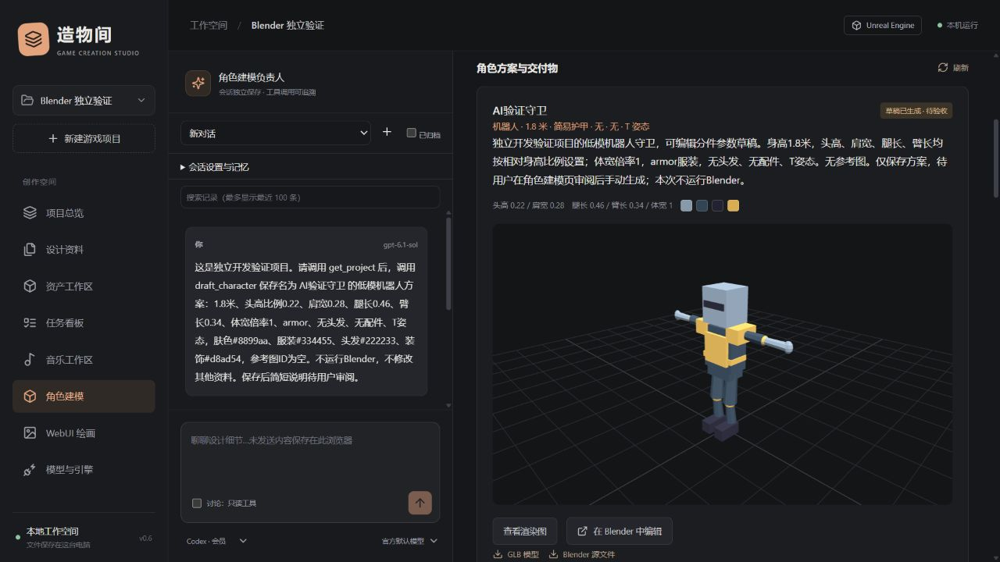

# Blender 参数化角色建模

0.10 补充：下文角色工具与手动生成描述为默认权限。用户明确授予全功能后可经业务动作启动固定建模驱动；另行授予 Codex 整机权限才可使用整机命令。详见 [Agent 授权指南](AGENT_ACCESS_GUIDE.md)。

适用版本：0.6.0 本地实验版。当前实测 Blender 5.2.2 LTS；其他版本尚未逐一验证。

## 使用流程

1. 启动工作台，选择游戏项目，进入 **角色建模**。页面自动发现本机 Blender；未找到时展开连接设置，填写 `blender.exe` 完整路径并保存。也可在启动前设置 `BLENDER_EXECUTABLE` 环境变量。
2. 左侧切换为 **角色建模负责人**，沿用 Codex 会员、OpenAI 或 DeepSeek 对话通道，独立保存会话、记忆和工具记录。
3. 描述造型需求，必要时从项目图片中选择参考图并点击“附图给左侧 AI 讨论”。开启对话的“执行”后，AI 可以保存角色方案；讨论模式只读。
4. 审阅方案卡片的比例、配色、服装和配件。需要修改时点击“复制参数并调整”，在表单修改并保存为新方案。
5. 点击 **按以上参数在 Blender 生成草稿**。本机后台完成建模和渲染，页面轮询真实任务状态；同一时间只运行一个生成任务。可停止生成，最长运行三分钟。
6. 生成成功后查看渲染图或切换交互 3D 预览，下载 GLB / Blender 源文件，或点击 **在 Blender 中编辑**。该按钮会打开可见的本机 Blender 窗口。
7. 如需调整比例或配色，复制原方案生成新版本，原文件保留。手动编辑后另存为，可将 `.blend` 和导出的 GLB 重新导入资产工作区；工作台不会自动监控 Blender 保存动作。

可直接对建模负责人说：

> 为项目设计一名低模遗迹探索者，1.7 米高，蓝色束腰外衣、深色短发、金色腰带和背包，采用 A 姿态。先读取项目约束，调用 draft_character 保存完整参数方案，由我审阅后生成。

也可完全使用右侧表单，不调用收费模型。`brief` 是设计说明，实际几何只受公开参数控制；自由文本不会转换成任意脚本。

## 参数与交付范围

| 参数 | 可用范围 |
| --- | --- |
| 模板 | 人形、大头角色、机器人 |
| 身高 | 1–3 米，几何部件和发饰可能略超出名义高度 |
| 头高 / 身高 | 0.15–0.30 |
| 肩宽 / 身高 | 0.18–0.36 |
| 腿长 / 身高 | 0.35–0.55；头高与腿长合计不超过 0.80 |
| 臂长 / 身高 | 0.20–0.45 |
| 体型宽度倍率 | 0.7–1.4 |
| 服装、头发 | 基础服装 / 束腰外衣 / 简易护甲；无 / 短发 / 齐肩发 |
| 配件、姿态 | 无 / 背包 / 手杖；A / T 姿态 |
| 颜色 | 肤色、服装、头发与靴子、装饰，使用 `#RRGGBB` |

产出是分件低模造型草稿，不包含自动雕刻、细致手指、贴图绘制、UV 展开、连接拓扑、骨骼、蒙皮或动画。参考图帮助 AI 理解需求，不是图片到三维重建服务。导出 GLB 使用内嵌材质；可以下载后人工导入 Unity 或 Unreal，当前不自动写入引擎工程。

## Agent、上下文与执行

角色 ID 为 `modeler`。与其他角色相同，通过 `POST /api/projects/{pid}/conversations` 创建会话，再用 `POST /api/projects/{pid}/chat` 传入 `agent: "modeler"`、`conversation_id` 和所选服务/模型即可调用。项目正式资料、会话记忆、近期历史和完整文档检索沿用现有上下文管理。

- 只读工具：`get_project`、`list_assets`、`read_document`、`search_documents`、`read_history`、`view_asset`、`get_character_jobs`。
- 执行模式新增：`draft_character`、`create_document`、`create_task`。`draft_character` 所有字段的 schema 来自 `backend/modeling.py`，AI 需提供完整参数。
- 总负责人也可以查询并保存方案；音乐负责人没有建模工具。
- 建模负责人的 Codex 项目命令始终关闭。模型工具不直接启动 Blender；本机生成和打开源文件由界面操作触发。

后端使用固定驱动 `connectors/blender/build_character.py`，只解析经过校验的 JSON。后台进程使用出厂配置、关闭脚本自动执行和离线模式，日志保留在该次任务目录。任务状态为 `draft → building → review`，或 `failed / interrupted`；`review` 表示草稿生成成功，尚未美术验收。

生成时先验证参考图所属项目和内容哈希；参考图版本改变会拒绝执行，需重新保存方案。生成结束后检查源文件标识、GLB 头/网格/内嵌资源、PNG 尺寸及统计清单，再一次性登记三份资产。失败不发布部分资产，也不自动重试；停止或服务重启后的未完成任务标为中断。

## 文件与备份

`character_jobs` 保存参数 JSON、上一个方案 ID、运行 ID、GLB / 源文件 / 预览图的资产 ID、结果统计和哈希。生成文件位于本地项目数据的 `modeling/{job_id}/`，不会覆盖绑定的游戏工程。

每次生成都有新方案与新资产，属于版本派生；不会自动把三维几何修改合并到旧方案。`.blend` 资产分类为 `blender`，不会误用引擎材质编辑接口。

项目备份格式 6 包含角色记录与三份产出，恢复时重映射父方案、运行、参考图和交付资产 ID，兼容格式 1–5。正在生成的记录恢复为中断。Blender 安装目录、本机程序路径、运行日志和浏览器未提交表单不随项目导出；手动编辑的外部文件需先导入项目才能备份。

## HTTP 接口

所有写接口沿用 `/api/bootstrap` 返回的本机会话令牌 `X-Workbench-Token`。

| 接口 | 用途 |
| --- | --- |
| `GET /api/blender/config` | 自动发现、版本检查、参数默认值与范围 |
| `PUT /api/blender/config` | `{ "executable": "..." }` 保存路径，空值恢复自动发现 |
| `GET /api/projects/{pid}/characters` | 最近 100 份方案与结果 |
| `POST /api/projects/{pid}/characters` | 直接参数字典，或 `{ "spec": {...}, "parent_id": "..." }` |
| `POST /api/characters/{jid}/build` | `{ "confirmed": true }` 开始本机后台生成；返回 building 后查询列表 |
| `POST /api/characters/{jid}/cancel` | 停止工作台拥有的该次进程 |
| `GET /api/characters/{jid}/logs` | 最后 12000 字节的生成日志 |
| `POST /api/characters/{jid}/open` | 校验源文件哈希后在 Blender 中打开 |

## 验证与故障处理

自动测试使用隔离数据和模拟模型/生成进程，不等同于真实账号请求。可运行下面的独立验证，实际生成三个模板、重开源文件、导入 GLB 并导出/恢复项目：

```powershell
python -X utf8 scripts/verify_blender.py --blender "E:/Blender/blender.exe"
```

验证文件留在 `.dev/blender-check-*/`，正常 `.workbench/` 不参与。当前本机三模板验证已通过；Codex 会员真实保存方案与建模角色两种 MCP 目录核验已通过，结构化结果见 [验证记录](verification/blender-v0.6.json)。这些检查没有证明角色绑定、动画、引擎导入或美术质量达到生产要求。

找不到程序时检查安装路径；缺少离线参数或导出器的其他 Blender 版本可能失败，需结合日志验证。失败后先查日志，再复制方案修改；不要清除整个项目数据。已生成源文件在外部被修改时，一键打开会拒绝原哈希，改用人工核对后手动打开或重新导入。


