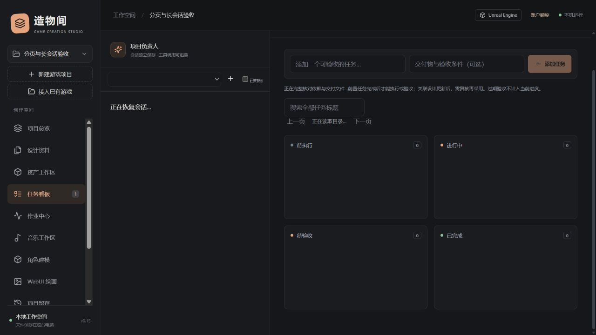

# 0.15 首屏、列表与长会话读取

日期：2026-10-27。适用：本机单用户工作台0.15.0。此版优化读取与交互，不增加模型、收费权限或Agent工具名称。资料包格式10、工程快照格式2、76项业务动作和21项应用工具保持。

## 使用变化

- **项目首屏**仅获取概览、计数与最近30条执行摘要；文档正文、全部资产和全部项目消息不随首屏加载。执行详情展开后再读取。
- **总览进度**显示“标记完成 / 全部任务”，不是重新核验后的有效完成数。打开任务看板后完整检查依赖、设计及交付文件，再显示全项目有效完成数。不要把两种计数混为已完成验收。
- **资产、设计和任务看板**每次最多展示48项；搜索面向整个项目，上一页/下一页继续浏览。设计正文只在选中文档后读取，切换文档时隐藏上一份可编辑正文；未提交草稿仍保存在当前浏览器。
- **关联与参考图**支持搜索和翻页；翻页不会清空已选设计、依赖或资产。任务交付仍固定版本与SHA-256；新增交付读取实际哈希，过期交付仍需明确采用和重新验收。
- **会话历史**每次读取最近30条，每条初始展示最多4000字符；点击“加载更早记录”继续。长消息可“分段查看完整原文”，每段最多6000字符，原文不删除。
- **原工程文件清单与整理面板**展开后读取。文件清单在SQLite中筛选分页，不再把整份JSON文件清单取到Python后截取。

首屏和工作区计数只描述已记录内容，不能代替引擎运行、资产质量或供应商计费核验。

## Agent调用与兼容

`list_assets`仍接受无参调用，现在返回分页对象，不再返回完整数组。自编客户端需改为读取`items`；AI应检查`next_before`，不能把第一页当成全部资产。

```json
{"query":"角色","kind":"image","limit":50}
```

后续页保留同一筛选，传入上次返回的`next_before`作为`before`。也支持旧式`offset`定位，但不能同时使用非零`before`和`offset`。默认50项，上限100项。游标按登记顺序排列；新插入不会挤动后续页，删除不会造成偏移跳页。目录是实时视图，改名、筛选条件变化或内容更新不提供不可变快照保证，刷新应从第一页开始。

`get_project`的文档与资产目录先从数据库限量读取，再应用原有字符预算；继续支持`section/query/offset/limit`。完整文档仍需`read_document`。正式文档优先，来源状态仍核对，最近Markdown留存入口单独检索，不依赖是否出现在首个目录页。

`read_history`新增`before/message_id/offset/limit`，参数均可省略。普通检索返回`{items,next_before}`，每项保留消息ID、原文字数和截断标记。按消息ID回查时返回`{content,total_chars,next_offset,...}`，只能读取当前已授权会话的记录。

```json
{"message_id":"当前会话的消息ID","offset":0,"limit":6000}
```

发送给模型的历史从最新记录逆序读取，SQL最多取100条，正文使用`substr`限长，再在18,000/40,000字符预算内选择。超长最新消息保留可用片段和原文回查说明；原记录完整留存。这是序列化字符预算，不是供应商实际token预算，也没有自动生成语义记忆。

全功能动作`project.get`改为有界工作区概览；资料回查使用`get_project`、资产使用`list_assets`、当前交付与验收令牌使用`task.get`。动作名称及授权检查不变，不新增业务执行权限。

## 开发接口

| 接口 | 返回或范围 |
| --- | --- |
| `GET /api/projects/{pid}/workspace` | 概览、计数、最近执行摘要；分类数组为空，由对应页面按需加载 |
| `GET /api/projects/{pid}/catalog/{assets,documents,tasks}` | `q/kind/category/offset/limit/before`；通用列表上限100，无文档正文或资产版本大字段 |
| `GET /api/projects/{pid}/documents/{did}` | 显式读取该项目文档，按ID检查项目归属 |
| `GET /api/projects/{pid}/assets/{aid}` | 单个项目资产元数据，不为选图提前计算哈希 |
| `GET /api/projects/{pid}/task-board` | 分页输出，内部仍完整核对任务依赖与交付文件；附全项目有效完成数 |
| `GET /api/conversations/{cid}/window` | `q/before`，最近30条片段和继续游标 |
| `GET /api/conversations/{cid}/messages/{mid}` | 按会话与ID取原文分段，默认6000、上限12000字符 |
| `GET /api/runs/{rid}` | 展开执行详情时读取单条完整审计 |

兼容用的完整项目接口`GET /api/projects/{pid}`、旧消息接口、备份和显式Markdown快照保留原完整资料语义。当前界面首屏与`project.get`动作不再调用完整项目接口。外部客户端若继续使用兼容接口，不会自动获得本版的有界读取效果。

数据库仅增加会话排序和项目目录索引，不删除历史或修改资料包格式。旧客户端需要重新读取工具定义和上述返回结构；服务升级仍按[运行指南](RUNTIME_AND_DIAGNOSTICS_GUIDE.md)正常停止并重启。

## 验证与剩余边界

隔离夹具包含300文档、300任务、10,000资产、20,000消息。一次本机测量：

| 入口 | 旧响应 | 新默认响应 |
| --- | ---: | ---: |
| 项目首屏 | 23,252,771字节 | 468字节 |
| Agent资产列表 | 568,890字节（全部） | 3,152字节（50项及继续入口） |
| 模型历史读入 | 20,000条完整正文 | SQL最多100条且正文限长，随后再按字符预算选取 |

这些不是相同内容完整下载的压缩比：新入口省略未请求正文，并提供后续读取路径。首屏样本没有原工程接入报告或运行记录；实际大小随概览内容变化。行数采样只覆盖`store.rows`封装，不代表SQLite扫描行数、磁盘I/O或全部游标读取。单次耗时不能当作真实工程性能承诺。

177项全量测试与末次49项定向回归、前端构建通过。浏览器验证了30→60条历史加载、11,008字符原文分段、48项资产/设计分页、全目录搜索、设计草稿保留、项目切换、参考图附加，以及跨筛选设计/资产关联与固定哈希。测试只使用自制素材；最终干净页面无控制台警告或错误。见[结构化记录](verification/bounded-reads-v0.15.json)。

任务图复核、相关外部文件哈希、来源状态检查仍可能扫描关联记录；目录搜索和JSON筛选也不是常量时间。真实大工程首屏/内存、任务图进一步优化、供应商实际token预算、语义摘要失效管理，以及目录重绑定和安装器仍需后续工作。此版没有新增真实推理、收费生成、引擎运行或GitHub远端发布验收。


