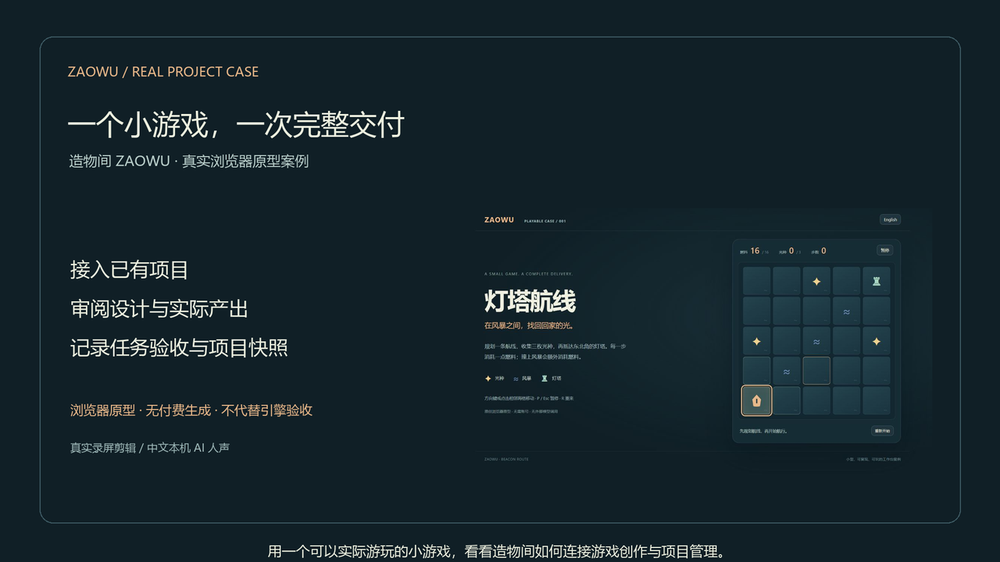
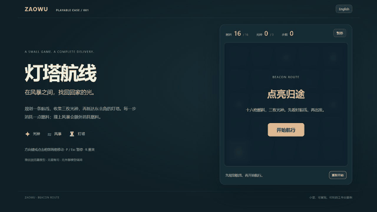
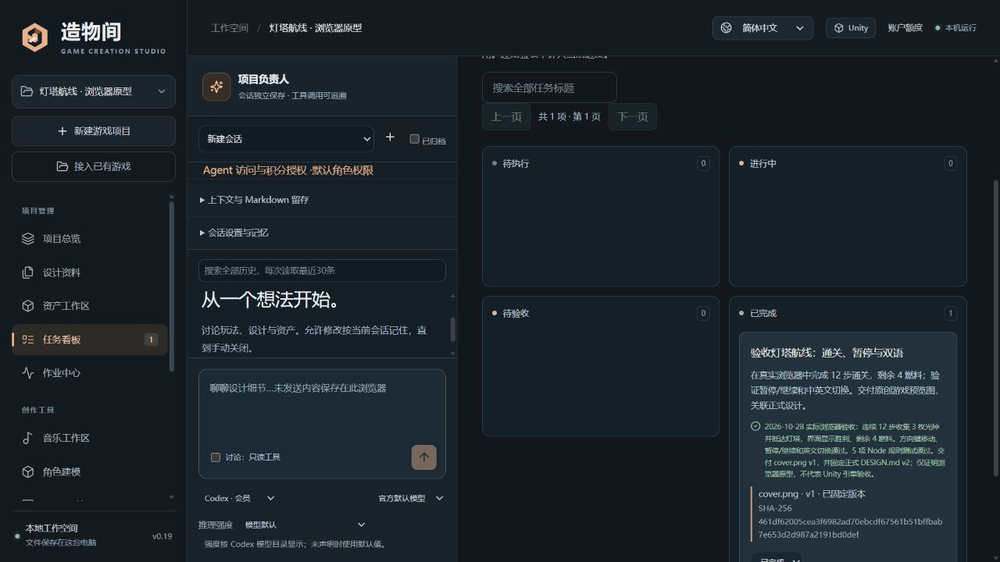
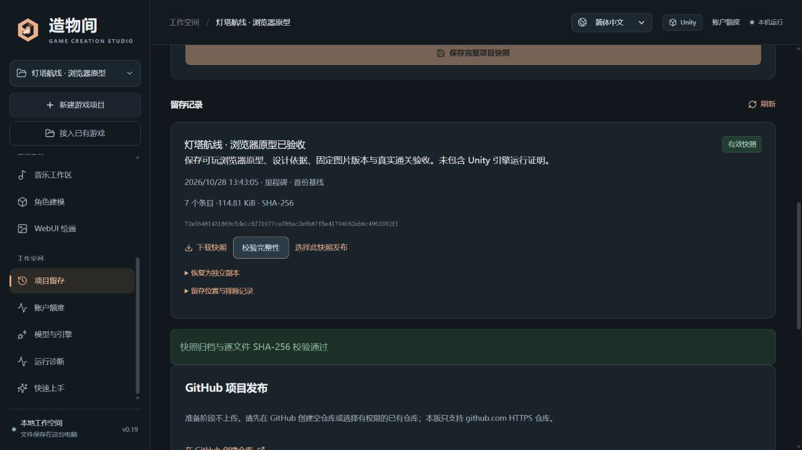

# 灯塔航线：一个小游戏，一次完整交付

[观看或下载完整视频 · 2 分 54 秒](../media/case-study/beacon-route-case-zh.mp4) · [20 秒 AI 人声试听](../media/case-study/beacon-route-voice-preview.mp3) · [中文字幕 SRT](../media/case-study/beacon-route-case-zh.srt) · [可玩源码](../examples/beacon-route)

视频、字幕和试听文件保存在 GitHub 源码的 `media/case-study/`，位于 Pages 的 `/docs` 发布目录之外；官网不展示或托管案例视频。

## 这个案例展示什么

历史演示使用更名前的 ZAOWU（现为游织工坊 Questweft）；视频、配音、截图及验证哈希按原始记录保留。

由 Codex 制作原创小游戏《灯塔航线》，再通过造物间的真实界面接入已有目录、审阅设计、建立验收任务、关联图片的固定版本、记录实际游玩结果，最后保存并校验项目快照。

完整视频为 **1920 × 1080、24 fps、约 174 秒**，由约 5 fps 的真实浏览器界面采样分段剪辑而成，部分章节保留阅读停顿。中文 AI 人声使用 MeloTTS 中文模型，通过 sherpa-onnx 在本机 CPU 离线生成，提供重新对齐的字幕；模型下载完成后不需要联网或 API Key，没有音乐、AI 回复替身或虚构的收费生成过程。

模型包来自 [sherpa-onnx 官方模型发布](https://github.com/k2-fsa/sherpa-onnx/releases/download/tts-models/vits-melo-tts-zh_en.tar.bz2)，包内采用 MyShell.ai MIT 许可，见[模型许可](verification/local-voice-license.txt)。本次使用 sherpa-onnx 2.0.1、单一预设中文女声、4 个 CPU 线程和 0.90 语速；模型权重保存在本机制作目录，不随工作台源码或上传包分发。英文专名采用读音替换，视频字幕保留原文。语音属于 AI 合成，音色与读音可通过试听审阅。

下面是实际游玩录屏的加速片段：

## 自己玩一局

获取仓库中的 `examples/beacon-route` 完整目录，用现代桌面浏览器打开 `index.html`。方向键或点击相邻海格移动；P / Esc 暂停，R 重来，右上角切换 English。

收集三枚光种后到达东北角灯塔，每步消耗一点燃料，撞上风暴消耗两点且原地停留。它是纯本地 HTML / CSS / JavaScript 游戏，没有第三方库或网络请求。自动化实际游玩使用本机 HTTP 服务；直接文件打开方式未在受限浏览器自动化中验证。

本案例是一份**浏览器原型**，不是 Unity 或 Unreal 工程。工作台接入时选择 Unity 仅表示未来迁移目标，设计与项目总纲均记录这一边界。

## 录制中的真实结果

| 项目 | 实际结果 |
| --- | --- |
| 已有目录接入 | 扫描 6 个文件，导入 2 份设计资料，登记 1 张原创图片 |
| 设计依据 | 审阅 DESIGN.md，保存正式设计 v2 |
| 可玩性 | 12 步收集 3 枚光种并抵达灯塔，界面胜利，剩余 4 燃料 |
| 实际交互 | 点击相邻格、方向键、暂停/继续、中英文切换通过；1280 × 720 桌面与 390 × 844 窄屏检查通过 |
| 自动规则检查 | 通关、非法移动、风暴扣燃料、失败、暂停和终点条件，5 项检查通过 |
| 任务交付 | 关联 DESIGN.md v2 与 cover.png v1，固定图片 SHA-256，填写真实验收依据 |
| 项目留存 | 创建里程碑快照，归档及逐文件 SHA-256 校验通过 |

游戏由当前 Codex 开发会话制作；本片不演示工作台内的模型请求，不消耗 SUNO 或 Tripo 积分，不证明云端生成、引擎运行或复杂工程兼容性。具体结果和文件哈希见[验收记录](verification/beacon-route-v0.19.json)。

## 如何复现

1. 打开小游戏并实际游玩；下载、录屏和测试是不同的验收证据。
2. 将完整游戏目录接入工作台。扫描只登记支持的图片和设计资料，HTML / JavaScript 仍作为源文件保留在工程目录与完整快照中。
3. 审阅设计，建立明确的验收任务，选择要交付的图片及固定版本。
4. 完成实际浏览器检查后，填写结果与范围，再标记任务完成。
5. 保存工程并暂停写入，创建里程碑快照，再执行完整性校验。

仓库根目录规则检查：`node --test tests/beacon-route.test.mjs`。工作台标准安装见[快速上手](QUICK_START_AND_SETUP.md)。视频、截图和游戏源码采用仓库 MIT 许可；旁白由本机语音引擎合成。

## English

Beacon Route is an original, playable browser puzzle created in this Codex development session. The real workbench UI imports the existing folder, reviews design revisions, links a fixed image version to a task, records playthrough evidence, and saves and verifies a milestone snapshot. The 2:54 video uses local MeloTTS Chinese neural narration through sherpa-onnx CPU inference, with retimed captions. No API key is needed after downloading the model. [Listen to the 20-second voice preview](../media/case-study/beacon-route-voice-preview.mp3), [watch/download MP4](../media/case-study/beacon-route-case-zh.mp4), or [get the playable source](../examples/beacon-route).

The verified route takes twelve moves, collects all three lights and wins with four fuel remaining. The workbench's Unity selection is a future migration target; no Unity/Unreal runtime or paid generation is claimed. Start the game and choose English in the top right.
