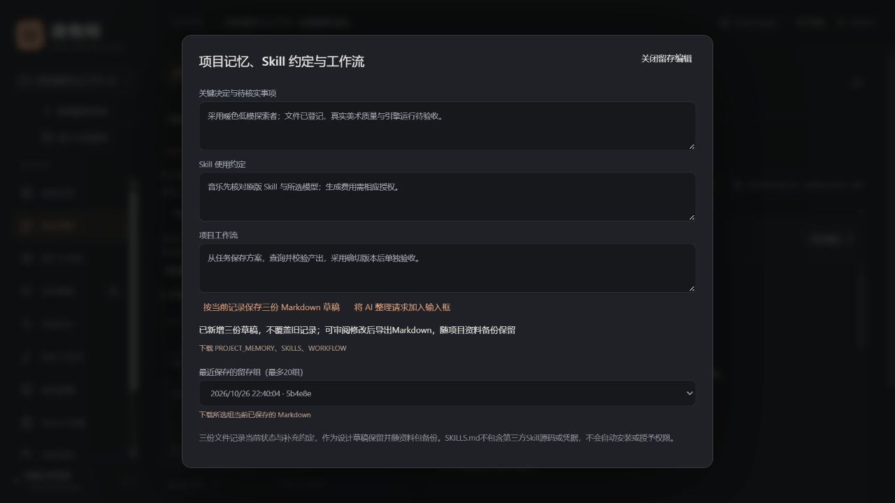
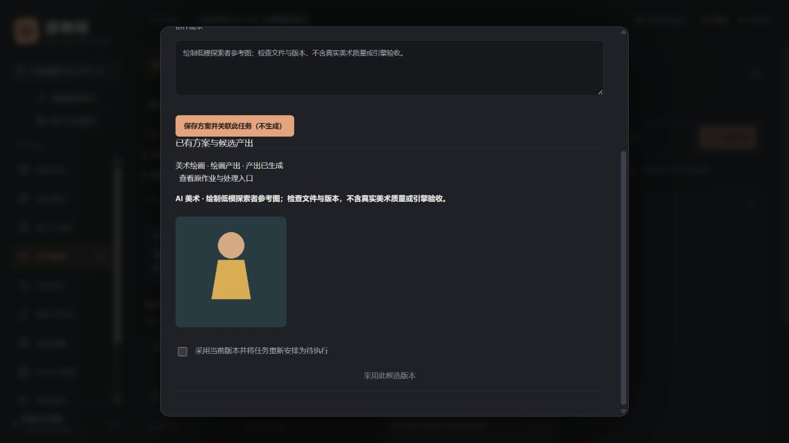

# 上下文、Markdown 留存与任务驱动创作

适用版本：0.13.0 本机实验版。日期：2026-10-26。

## 1. 上下文如何压缩

在对话栏展开“上下文与 Markdown 留存”，选择：

- **自动**：在容量内保留部分正文；目录较大时减少正文与列表数量，提供出处、总数和分页入口。
- **精简**：主要传递项目目录、当前状态与会话记忆，需要时再读取原文。

文档目录优先列正式设计。长文档、未直接提供的任务细节和较早交流均保留在本机；不因为压缩而删除，不把摘要自动升级为正式规则。`handoff_documents` 提示最近留存的三类文件，Agent需按需读取并核对权威状态。

点击“预览将发送的上下文”查看当前项目资料、会话窗口及未直接附带记录数量。预览不含尚未发送的消息；实际请求在执行详情中记录本次覆盖范围和字符统计。

| 项目 | 自动 | 精简 |
| --- | --- | --- |
| 项目目录选择预算 | 约48,000字符 | 约18,000字符 |
| 最近历史预算 | 约40,000字符 | 约18,000字符 |
| 会话记忆 | 另保留用户维护的记忆，最多12,000字符 | 同左 |
| 最新消息 | 至少保留最新一条，单条可能超过历史预算 | 同左 |

这些是字符预算，JSON元数据另有开销，**不是模型token上限或计费预测**。仍无精确tokenizer、向量检索或后台自动语义摘要。自动压缩是可回查的目录/窗口选择，不调用额外模型；语义整理可由当前模型在用户发起对话后完成。

## 2. 将关键信息、Skill 与工作流保存为 Markdown

1. 展开上述设置，点击“管理项目记忆与 Markdown 留存”，打开独立编辑窗口。
2. 补充关键决定与待核实事项、Skill使用约定、项目工作流。输入先作为本浏览器草稿保留。
3. 点击“按当前记录保存三份 Markdown 草稿”。本机会根据当前项目、会话记忆、设计与任务目录、已有Skill/工作流资料生成三份文件，不另行调用模型。
4. 在“设计资料”审阅或修改正文。每次留存新增一组，不覆盖旧组；需要成为正式规则时仍走原有人工审阅流程。
5. 在留存窗口下载本次或历史组，得到含三份 `.md` 的ZIP；重新打开工作台后仍可选择最近20组。下载的是该组当前已保存正文，未保存的编辑不包含在内。

| 文件 | 保存内容 |
| --- | --- |
| `PROJECT_MEMORY.md` | 当前统计、总纲摘录、关键决定/待核实事项、用户维护的会话记忆、设计版本出处、任务样本和目录覆盖 |
| `SKILLS.md` | 角色分工、工具读取方式、Skill使用约定、已有项目相关资料的出处和有限摘录 |
| `WORKFLOW.md` | 设计→任务→方案→生成→候选→采用→验收→留存的接续流程及项目补充、已有相关资料索引 |

Skill/工作流索引最多20项，每项摘录最多1,000字符。它不是完整第三方Skill安装包，也不复制凭据或自动安装工具。所有文件保持草稿边界；资料中的指令不能自行增加权限。标题的文件名前缀及组标识用于下载分组，编辑正文时请保留标题前缀。

需要模型分析、归纳长交流时，点击“将 AI 整理请求加入输入框”。它会追加到已有草稿，关闭编辑窗口，**不自动发送或开启执行**。确认内容后发送，计入当前对话服务的实际用量；执行模式下可保存整理后的Markdown草稿。早期记录仍须按需检索，不能把未经核对的完成陈述当事实。

导出的Markdown可能包含私有设计、交流或项目路径；分享前检查正文。未点击保存的浏览器补充不随项目备份迁移。

## 3. 从任务创作并回收产出

在任务卡点击“创作方案与候选交付”：

1. 选择SUNO音乐、美术绘画、Blender低模角色或Tripo文生模型。
2. 填写需求并保存。此步骤只创建免费方案，方案保留来源任务编号；已完成/取消任务需先重新安排。
3. 点击“查看原作业与处理入口”。音乐/建模仍到对应工作区审阅参数和模型、明确提交；角色建模页可切换Tripo。美术草稿可在作业详情确认执行一次，可能产生所选图像服务费用。
4. 原作业登记资产后，产出自动汇集到该任务的候选列表。SUNO须先查询并免费接入音轨，Tripo须接入模型；云端完成本身不会产生虚假的本地文件。
5. 查看候选图片或到资产区核对文件，确认采用当前版本。工作台固定版本/哈希，并将任务重置为待执行。
6. 实际检查后再单独验收。采用候选不自动验收，历史验收和变更复核继续遵循 [交付指南](JOBS_AND_DELIVERY_GUIDE.md)。

本版任务表单为基础方案：音乐默认纯音乐，Tripo为文生模型，Blender先保存现有参数模板和设计说明，美术使用基础尺寸参数。高级参数仍在原工作区处理或通过已开放参数调用；任务表单不等于完整专业编辑器。

Blender从关联方案派生新方案时继续保留来源任务。普通音乐/建模Agent的原有草稿工具新增可选 `task_id`，不需要额外全功能授权即可关联其本来允许保存的方案；不因此获得生成、收费或其他角色权限。

## 4. 分类增量与状态处理

任务页每2.5秒检查任务、最近执行及资产的分类指纹，只返回变化的数据；不再定时读取包含所有消息和正文的完整项目。交付文件的外部变化仍按原哈希核对触发复核。

作业列表、详情和候选列表使用ETag：未变化返回304，不重复传输相同正文。前端按分类保留已有数据，较早请求的响应不能覆盖较晚更新。仍采用本机定时检查，尚无事件订阅或跨服务并发调度。

异常详情提供原业务记录和对应工作区入口；缺失交付提供资产核对入口。队列操作与云端结果仍分别显示，未知结果先查原记录，不自动重提收费生成。工作台不提供虚假的远端取消或跨系统回滚。

## 5. 开发接口与留存

| 接口 | 用途 |
| --- | --- |
| `GET /api/projects/{pid}/context?conversation_id=&mode=auto/compact` | 预览当前选择、历史和覆盖信息，不推理 |
| `POST .../context/checkpoint` | 接收conversation_id、decisions、skills、workflow，新建三份草稿 |
| `GET .../context/markdown?ids=ID1,ID2,ID3` | 校验项目归属后导出固定三种文件名 |
| `GET .../updates?sections=tasks,runs,assets&since={...}` | 返回changes和各分类cursors；另支持documents/project |
| `GET /api/tasks/{tid}` | 当前任务与验收令牌 |
| `GET/POST /api/tasks/{tid}/creations` | 候选方案列表 / 保存kind及data |
| `POST .../creations/adopt` | `{asset_id, confirmed:true}`，采用本任务候选并重置todo |
| `POST /api/art-jobs/{jid}/generate` | `{confirmed:true}`，仅执行尚未处理的草稿 |

`get_project`工具支持section、query、offset、limit。section为overview/documents/tasks/assets/runs；读取完整任务或总纲时使用record及record_type、item_id、字符offset/limit。文档仍用read_document，较早交流用read_history。目录中的requires_read与分页游标不能当成“已经读完”。

新增7项业务动作：context.preview/checkpoint、task.get/creations/draft/adopt、image.submit_draft；共76项，应用工具名称仍为21项。`draft_music/draft_character/draft_tripo`增加可选task_id。全功能图像草稿执行沿用原图像生成授权；同描述已有未核对失败/中断时拒绝自动新建方案重提。

资料包升级为**格式10**，兼容1–10。`task_creations`保留任务→源作业关联，恢复时重映射；Markdown沿用文档与版本表保留，生成文件中已识别的文档/任务/执行ID引用会重映射。普通自由文本引用仍可能是历史编号，恢复后先按标题检索当前目录。权限、凭据和自动收费提交不随恢复继承。音乐恢复记录继续保留原有restored历史语义。

实现入口：`backend/context.py`、`task_creation.py`、`updates.py`；界面为`src/ContextPanel.tsx`、`TaskCreation.tsx`及原任务/作业页。验证见 [0.13记录](verification/context-task-v0.13.json)。本轮使用自制工程和模拟模型/美术服务，未新增真实扣费、音乐/Tripo生成或引擎运行验收。
