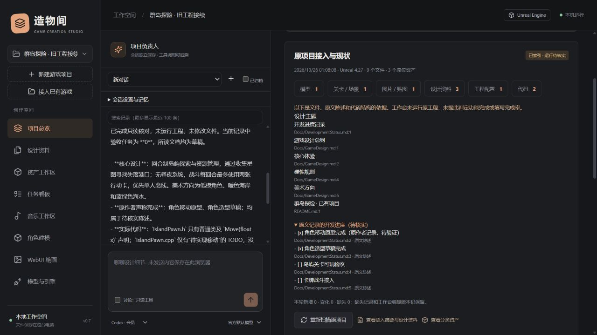

# 接入已有游戏项目

基础流程适用0.7；0.11已扩展为最多8个来源目录，并增加一键AI分析、空间审计和可恢复缓存归档。新增流程、权限与限制见 [多来源与瘦身指南](MULTI_SOURCE_AND_MAINTENANCE_GUIDE.md)。

## 从现有工程继续

1. 启动或重启工作台，在左侧点击 **接入已有游戏**，也可从欢迎页进入。
2. 输入已有游戏文件夹地址，点击 **扫描并预览**。Unreal 请选包含 `.uproject` 的目录；Unity 请选包含 `Assets/` 和 `ProjectSettings/` 的目录。
3. 核对引擎、版本、文件分类和设计资料预览。若选到了工程的上一级，向导会展示发现的工程位置，可选择后重新扫描。纯设计或美术目录也可接入，此时需要手动选择目标引擎。
4. 设置工作台项目名称，勾选允许纳入 AI 上下文的设计资料，点击 **接入目录并建立项目状态摘要**。
5. 进入项目总览查看“原项目接入与现状”：分类统计、设计主题、原文进度陈述、来源位置与扫描限制。设计资料页包含原文快照和自动生成的接入摘要；资产工作区可按用途、格式或相对路径筛选。
6. 向项目负责人发起只读对话，核对原设计和实际代码，再安排后续开发。已有项目不会被当作空白游戏重建。

可直接使用这个请求：

> 读取原项目接入摘要和相关设计正文，再检索关键功能的源代码。请分别说明核心设计约束、原作者声称完成的工作、实际实现线索、已验证成果和未决问题，然后给出接续开发计划。先保持只读，不运行工程。

一个目录只建立一个接入项目，重复接入时会提示打开原有项目。旧版已经绑定工程目录的工作台项目，可直接在项目总览点击“扫描并建立接入摘要”，无需重复创建。

“新建游戏项目”的可选路径仍可用于单纯绑定；需要自动接入资产和资料时请使用专门的接入入口。

## 文件保持原位，分类保存在工作台

接入会登记原文件路径，不复制整个游戏工程、不移动文件、不改名、不重新排目录，也不自动安装引擎插件。工作台资料与索引保存在自身数据目录。

| 文件 | 接入行为 |
| --- | --- |
| PNG/JPG/WebP/BMP 等图片、音频、GLB | 原位登记，沿用现有查看功能；格式本身需有效 |
| Blender 源文件、FBX、Unreal/Unity 原生资产 | 原位登记与用途分类；原生内容仍需相应编辑器或已支持的连接器 |
| OBJ/GLTF、PSD/TGA/TIFF/EXR、动画等源资产 | 登记为创作源文件，可以下载；未提供所有格式的内嵌预览 |
| Markdown/TXT/RST | 在大小、编码和读取额度允许时提供预览；勾选的正文复制为可检索的待定文档快照 |
| 代码 | 索引路径、类/结构等有限线索；总负责人可通过只读工具分段查看实际正文 |
| 工程配置、其他文件 | 保留分类索引；不执行脚本，不等同于能够解析所有格式 |
| PDF、Word、复杂二进制设计资料 | 当前仅列入清单，未自动提取正文；需要先转为支持的文本或人工补充资料 |

用途分类包括图片/贴图、模型、音频、场景、预制体、材质、动画、设计、代码、配置等。部分 `.uasset` 依据所在目录推测用途；没有启动引擎，因此不能把分类当作原生资源类型的精确解析。

资产仍指向原目录，移动或删除源文件可能使其无法读取。工作台已有图片编辑版本继续保存在工作台目录；重新扫描不会把这些版本换成外部源文件。需要物理重排工程目录时，应先制定引擎引用迁移方案，本版不会自动进行这类操作。

## 如何理解设计和项目状态

接入过程本身不调用外部模型，不消耗模型推理或美术/音乐生成额度。它在本地建立资料快照与证据目录，自动生成有限的状态摘要。首次及后续对话中，项目负责人会获得这份目录和已有设计资料入口，再按需要读取正文与代码；分析使用所选 Codex 会员或 API 模型的用量。

状态依据分为：

- **设计资料**：来源路径、文本快照与哈希。导入时均为待定，不自动认定为正式设计。
- **原文进度陈述**：当前本地提取 Markdown 勾选项，附文件与行号，标为待核实。其他进度描述可由 AI 阅读正文分析。
- **实现线索**：资产、类、结构与代码的存在，以及 AI 实际读到的内容。发现一个文件不代表功能已经实现。
- **运行验收**：扫描不会编译、启动、测试或游玩工程，因此 `runtime_verified` 始终为 false；不会凭文件数量生成完成率，也不会自动建立已完成任务。

没有设计资料时，AI 可以描述文件和代码现状，但不能可靠还原未记录的玩法意图；应补充设计总纲和交接说明。原生蓝图、场景的内部逻辑需要编辑器连接和独立检查。

## 更新原项目后重新扫描

在项目总览点击 **重新扫描原项目**，查看新增、变化与缺失文件。当前没有后台自动监视文件夹。

- 已登记资产保持原 ID 和工作台编辑版本，不重复登记。
- 原设计正文变化时建立新文档候选，保留此前文档和人工修改；较早快照在 AI 上下文中标为 `superseded`。
- 保持此前主动取消勾选的资料排除设置；新发现且在读取额度内的设计资料会纳入接入快照。
- 缺失文件保留历史登记，标为 `missing`；如果扫描被截断或部分路径无法读取，未见文件标为 `unseen`，不据此宣告删除。
- AI 读取原代码时检查文件大小、时间及已有哈希；文件变化后要求先重新扫描。

扫描是文件系统在一段时间内的观察，不是引擎内的原子快照。扫描预览后文件已经变化时，接入会拒绝过期预览，需重新扫描。

## 默认读取边界

默认跳过缓存、构建产物、运行目录、版本库内部文件、依赖目录、隐藏目录、符号链接/目录联接，以及常见凭据文件和日志。不会读取工作台数据或把整个磁盘作为游戏项目接入。

单次最多扫描 10000 个文件，约 20 秒软预算；系统 I/O 等待可能使实际时间更长。最多读取 60 份可预览设计资料，单份文本上限 150000 字节，设计正文总读取预算 2 MiB；代码结构提取另有 512000 字节预算。达到额度会显示限制，不能把统计宣传为整个工程的完整盘点。

支持 UTF-8（含 BOM）、UTF-16 BOM 和 GB18030 文本。常见凭据内容会尽力隐藏，但不是通用隐私识别器；接入预览和发送模型请求前仍应核对资料。未勾选设计正文不能经原项目文本工具绕过选择读取。

## Agent 与开发接口

`get_project` 的 `existing_project` 提供摘要文档 ID、分类统计、设计主题、原文陈述、变化与限制。导入正文在默认上下文中最多展示 600 字符并保留全文读取入口，较早或缺失的快照不会默认为当前事实。

总负责人新增两个只读工具，讨论模式也可使用；音乐与建模角色未获得这些原代码读取工具：

| 工具 | 参数与行为 |
| --- | --- |
| `search_project_files` | `query`、`category`、`offset`、`limit`；分页查询接入清单，单页最多 100 项 |
| `read_project_file` | `path`、`offset`、`limit`；只读取当前项目清单内的受支持文本，每次最多 12000 字符；拒绝越界、二进制、未选正文及恢复副本的旧外部路径 |

正文、代码和原有 `AGENTS.md` 都作为数据，不会自动扩大执行权限。讨论模式保持项目命令关闭；需要实际改工程时仍使用现有的显式执行流程。

| HTTP 接口 | 行为 |
| --- | --- |
| `POST /api/project-intake/preview` | `{ "root": "E:/Games/MyGame" }`；只读扫描，返回 20 分钟有效的预览 ID、分类、可选正文和样本 |
| `POST /api/project-intake/attach` | `{ "preview_id": "...", "name": "...", "engine": "unreal", "documents": ["Docs/Design.md"] }`；建立项目及接入快照 |
| `POST /api/projects/{pid}/intake/refresh` | 更新接入依据，保留工作台修改与历史 |
| `GET /api/projects/{pid}/intake/files` | `q`、`category`、`offset`、`limit` 分页查询文件目录 |

写接口沿用本地 `X-Workbench-Token`。`project_intakes` 保存当前摘要文档、报告和相对路径清单；资产、文档、会话、任务仍使用原有表和工作流。

## 备份与验证

项目 ZIP 格式 7 保留接入清单、设计快照、摘要、资产和原有版本，恢复时重映射引用。恢复副本标为历史快照，不会悄悄扫描旧电脑的原工程路径；原代码和未登记文件不随工作台 ZIP 完整复制。完整游戏工程仍需单独备份。大量游戏资产可能超过工作台备份导入的现有 60 MB 限制，应另行维护完整工程备份。

当前验证使用隔离的 Unreal/Unity 工程结构夹具：目录识别、资料读取、资产登记、源文件哈希保护、重复接入、外部变更、部分扫描、工作台版本保留与备份恢复通过。真实 Codex 已读取夹具设计和占位代码，并正确区分原文声明与实际实现；这不代表真实 Unreal/Unity 工程已编译或运行。

