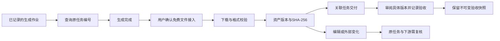
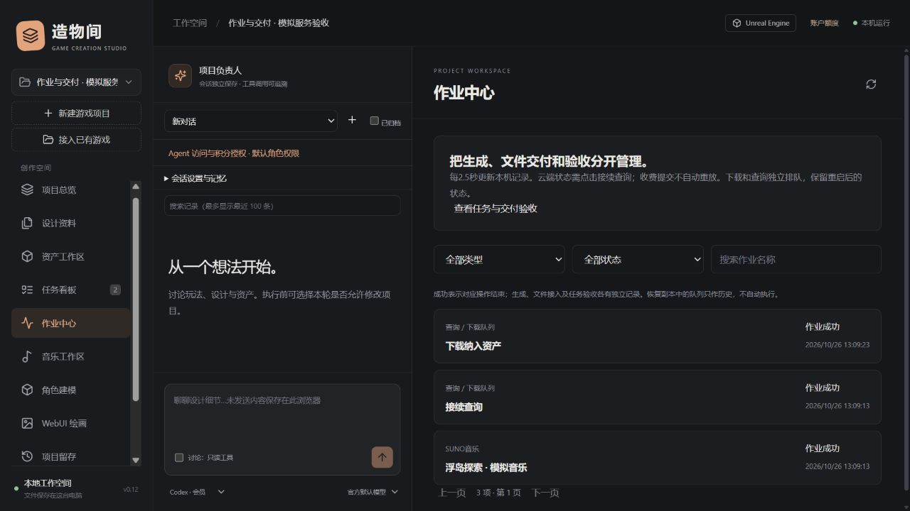
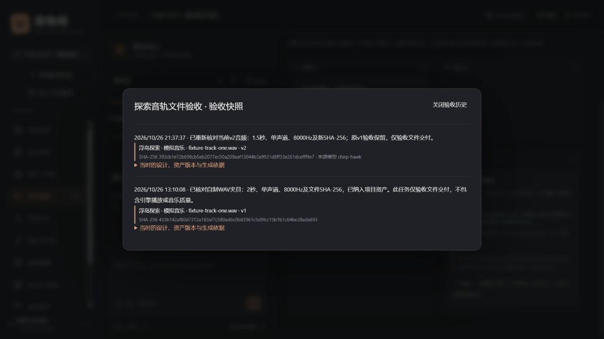

# 统一作业、资产交付与 SUNO 音频接入

适用版本：0.12.0 本机实验版。日期：2026-10-26。

## 1. 一条完整的交付流程

生成成功、下载成功和任务验收是三件事。工作台不会因为云端生成成功或文件存在，自动把任务标为完成。

## 2. 作业中心

在左侧进入“作业中心”，统一查看 SUNO、绘画、Blender、Tripo、工程快照、GitHub 发布、AI 对话及查询/下载队列。支持类型、状态、名称检索和分页，每页30项；界面每2.5秒刷新本机记录。

状态包括排队、进行中、成功、失败、结果未知、等待处理、取消和中断；同时保留业务原始状态。音乐云端完成但尚未全部登记音轨、Tripo 等待接入等情况标记为“等待处理”。图片请求中断且无法核对远端结果时标为“结果未知”，不会自动重发。

点击作业可查看参数、产出、状态和支持的操作：

- **接续查询已有任务**：用已记录的编号查询 SUNO/Tripo，不创建新生成任务。
- **排队下载并校验纳入资产**：确认具体已有产出后执行。SUNO可选成功音轨；Tripo使用已完成模型。不会生成、转换或提交收费后处理。
- **停止支持的本机操作**：停止查询/下载队列、工作台 Blender 生成、工程快照或当前进程持有的对话。云端生成不提供虚假的取消按钮；已保存文件也不会自动撤回。
- **查看原业务作业并手动接续**：查询/下载作业只是操作记录。即使查询成功，原生成仍可能失败或处理中，需查看界面中单独显示的原业务状态。

这是统一状态视图及查询/免费接入队列。生成、推送等操作继续使用各自明确确认的入口，未建立自动收费调度器，也不将每条普通执行日志都当作一个生成作业。

### 排队与重启规则

队列持久保存于本机数据库，按先后顺序串行执行，最多50项待执行/进行中操作；相同来源、动作和参数的活跃请求复用已有编号。

- 重启后，已排队的操作继续按原参数处理；执行前仍检查原 Agent 授权。
- 运行中断的**只读查询**可恢复为排队，用原编号继续查询。
- 运行中断的**文件接入**标为中断，用户到原作业核对并手动继续；不会把一个中断下载冒充已交付文件。
- 收费生成、图像请求和 GitHub 推送从不因该队列重启而自动重放。
- 关闭队列操作只停止本机等待/下载，不代表远端生成已取消。
- 资料包恢复出的活跃队列一律改为历史中断，清除授权上下文，不自动执行。

没有远端编号的未知结果，应先到服务网站核对；工作台不能凭猜测关联或重提。界面轮询读取的是本机状态，不会在后台高频查询收费供应商。

## 3. SUNO 产出进入资产库

可从音乐工作区或作业中心操作：

1. 用原任务编号查询，确认该音轨已成功。
2. 选择音轨，勾选下载确认，再排队接入。
3. 工作台通过原版 Suno.cn Skill 重新核对音轨编号及成功状态。授权与任务接口仍使用原 helper，不读取或复制其凭据。
4. 单独的工作台文件下载器只获取这次核对返回的公开音频地址：公网 HTTPS、固定已校验 IP、保持原 TLS 名称、拒绝跳转和压缩响应，限制体积；不向 CDN 发送 Skill 凭据。
5. 识别真实 MP3/PCM WAV，核对时长、声道、采样率及 SHA-256。临时文件成功后才登记资产和来源；失败或停止不会登记部分文件。
6. 在作业中心试听当前资产版本，并关联任务；或在资产工作区继续编辑。

同一方案/音轨编号只登记一份原始音频；重复接入会核对原始文件并返回同一资产，不覆盖其编辑版本。原始文件已缺失或被外部改写时，要求恢复备份或人工导入新版本，不悄悄覆盖。

原始接入的 MIME、时长、字节数和哈希与音轨来源一起保留。播放器使用资产当前版本；若之后剪辑，不能把原始时长/哈希当作剪辑后的元数据。

当前范围：每音轨最多50 MiB、最长1小时、单/双声道、8–192 kHz；仅 MP3 和非压缩 PCM WAV。不自动生成 WAV、不做收费转换，不自动写入引擎。MP3使用 [TinyTag](https://github.com/tinytag/tinytag) 读取格式和音频元数据，检查不能替代完整解码、听感、版权或引擎播放验收。

## 4. 任务与资产交付

### 关联方式

在任务看板“编辑与关联”中勾选资产，工作台读取当前版本与哈希。也可在作业中心选择某项已登记产出及目标任务，点击“关联此资产当前版本，并重置任务为待执行”。关联不会自动验收。

每项交付固定：资产ID、版本索引、SHA-256及登记时间。可追溯到 SUNO、绘画、Blender 或 Tripo 的源作业、模型和生成参数指纹；完整参数保存在原业务作业中。UI版本从v1显示，接口version_index从0开始。

### 验收与变更

在任务状态中选择“已完成”，先审阅页面展示的具体版本，再填写验收证据并确认。含资产交付的验收还检查当前review_token，避免打开页面后依据已变却误验收新内容。

验收快照保存当时的证据、资产名称/版本/哈希/来源、设计版本及前置任务，旧快照不会随新版交付改写。它记录验收声明，不自动证明人工质量、引擎运行或商业授权。

修改资产、切换版本、删除/移动文件或外部改写后，工作台核对当前文件与固定交付。原任务及下游会要求复核；即使改回原字节，也不能抹去已记录的复核要求。历史状态和证据保留，过期交付不计入当前有效完成数。

恢复工作流程：重新打开任务关联，核对已显示的当前设计与交付，确认采用并重置为待执行，然后重新交付和验收。任务看板每2.5秒刷新核对；验收期间仍应暂停其他程序写入，工作台不是文件系统锁。

## 5. 留存与 Agent 使用

资料包升级为**格式9**，仍支持导入格式1–8。新增任务交付、验收快照、音乐音轨/资产关系及队列历史；恢复时重映射任务、资产、设计、生成作业和执行编号。旧版验收证据仍保留，没有伪造历史结构化验收。

恢复不会继承会话权限或队列授权；运行中的生成/推送继续按各自未知结果规则处理。缓存归档等独立保全仍遵循原有留存边界。

全功能 Agent 增加7项业务动作，当前共69项，应用工具仍为21项：

| 动作 | 用途 |
| --- | --- |
| jobs.list / jobs.inspect | 筛选、分页、查看原始状态和产出 |
| jobs.enqueue | 对已有 SUNO/Tripo 编号排队查询或免费接入 |
| jobs.stop | 请求支持的本机停止 |
| music.outputs / music.import | 查看已登记音轨、排队接入指定成功音轨 |
| task.acceptances | 查看不可变验收快照 |

task.create/task.update可传deliveries列表，格式为`[{asset_id,version_index,sha256}]`；含资产交付的done操作须提供重新读取、审阅过的review_token及真实evidence。普通角色工具数量保持，create_task增加可选交付参数。

队列不接收任意URL、脚本、收费生成命令或调用者伪造的授权上下文。Agent发起的待执行/进行中操作会在撤销授权时停止，执行前和文件登记前重新检查授权。免费文件接入不需要SUNO/Tripo自动积分开关；实际收费提交仍分别受原积分授权控制。

## 6. 验证与边界

本轮使用模拟音乐服务和自制音频，验证查询、排队、停止、入库、任务关联、验收、修改后复核和历史保留；没有新增真实音乐生成、真实账号扣费或引擎播放验收。

自动测试覆盖下载地址/重定向/格式/体积、队列去重与重启、跨项目与授权撤销、版本固定与过期验收、备份恢复重映射。独立浏览器流程和证据见 [0.12验证记录](verification/jobs-delivery-v0.12.json)。

