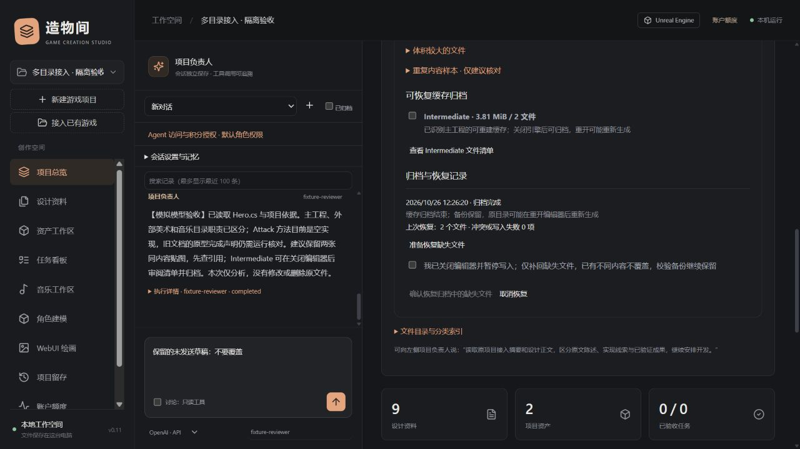

# 多文件夹接入、AI 分析与可恢复瘦身

适用版本：0.11.0 本机实验版。日期：2026-10-26。

## 接入多个文件夹

在“接入已有游戏”填写一个**主工程文件夹**，再在“附加资料 / 资产目录”中每行填写一个地址，合计最多8个。主工程用于 Unity / Unreal 连接，附加目录用于同一游戏的设计、美术、音频或参考资料。目录保持原位，不合并磁盘目录，不把多个独立引擎工程合成一个工程。

扫描后核对来源、分类、引擎与可读取的设计正文，勾选允许提供给对话模型的资料，再确认接入。已有项目可在“项目总览 → 原项目接入与现状 → 添加来源目录”补充来源。这里只增加目录，不支持直接移除或迁移已有绑定。

- 重复目录、相互包含的目录和不存在的目录会拒绝接入。
- 主工程保留原相对路径；附加来源用 `@source_标识/相对路径` 区分，同名文档或图片不会混淆。
- 分类依据扩展名与目录；正文、代码线索和原文进度分开记录。原文写“完成”不等于已运行验收。
- 附加资产可预览和派生编辑，编辑版本保存在工作台；使用引擎之前仍需实际导入对应引擎工程。
- 来源根目录改成链接或目标发生变化会拒绝读取；重新扫描不会静默扩大到新的位置。

## 让当前模型分析项目

1. 在项目总览左侧选择负责人会话、Codex / OpenAI / DeepSeek，以及要使用的模型。
2. 点击“让当前 AI 分析与制定整理方案”。工作台先刷新多目录索引，生成空间审计草稿，再将分析请求发送到当前会话。
3. 本次强制使用讨论模式，即使该会话已获全功能或整机授权，也不开放本轮写工具或命令。未发送草稿和附图保持。
4. 模型可按需阅读已选文档、检索目录、分段核对代码，输出设计意图、实现依据、各来源职责、待验证项、整理/瘦身候选与计划。结果保存为会话记录。

这会发送已接入的项目资料到所选对话服务，并计入相应会员/API用量。目录扫描与空间审计本身不调用模型、不提交 SUNO/Tripo 生成。模型的判断取决于实际阅读覆盖，工作台不会自动把分析结论改成已完成任务。

“分析完成”不代表每个文件都已阅读、原生资产引用已解析或工程能正常运行。导入资料中的指令不能授予权限。

## 整理与空间审计

展开“项目总览 → 项目整理与可恢复瘦身”，点击“扫描空间与重复样本”。可查看分类体积、较大文件、重复内容样本及可归档缓存，并分页审阅候选目录中的具体文件。

当前整理首先体现为**来源、类别和证据索引**。AI 可提出命名、分组和迁移计划，但不自动重排源码、移动原生资产或改写引擎引用。相同内容仍可能有不同 GUID、路径用途或授权，重复哈希只作为审查证据。

## 可恢复缓存归档

只有已识别的主工程开放以下缓存候选：

| 引擎 | 支持候选 | 前提 |
| --- | --- | --- |
| Unreal | 根目录 `Intermediate`、`DerivedDataCache` | 根目录有唯一 `.uproject` |
| Unity | 根目录 `Library`、`Temp` | 存在 `ProjectSettings/ProjectVersion.txt` |

附加目录不推断为可清理工程。Saved、Binaries、Git历史、工程源码和原生游戏资产不按“疑似无用”自动清理。缓存中若有受保护名称、链接、不可读条目或扫描不完整，也会阻止自动归档。

操作流程：

1. 先保存工作、关闭编辑器和其他写入程序。审阅候选目录、体积和文件清单。
2. 勾选要处理的缓存，再确认已关闭编辑器并同意归档，点击“归档所选缓存并移出原文件”。确认在页面内完成。
3. 后端重新核对清单，先将全部所选文件写入工作台数据目录下 `maintenance/项目ID/执行ID/cache.zip`，校验文件及整包 SHA-256，持久保存 `receipt.json`，随后逐文件核对并移除源文件。空目录保留，不进行递归删除。
4. 记录显示失败、部分完成或中断时，先核对备份和记录，不自动重试。服务中断后也不自动继续移除。
5. 在归档记录点“准备恢复缺失文件”，确认编辑器关闭，再确认恢复。仅补回缺失文件；已有不同内容、写入失败或路径变化会报告冲突，不覆盖新文件。恢复后显示实际恢复数与冲突数。

恢复使用已保存的目录绑定与备份校验。变更绑定、丢失回执或损坏归档时需要人工核对。恢复先写完整临时副本，再以不覆盖既有文件的方式落位；进程意外中断可能留下带 `.gameworkbench-restore-` 前缀的临时文件，备份继续保留。

这里展示的是**原目录移出的逻辑文件体积**。归档仍占工作台数据所在磁盘空间，不能承诺净释放相同空间；编辑器重开后可能重建缓存。归档完成前应保持工作台运行，关闭页面不保证立即停止后台文件操作。请另行备份工作台数据；项目资料包不会递归包含这些缓存归档。

## 留存与权限

格式8工作台资料包包含已登记资产的各版本，以及多来源历史清单；恢复副本不会继承原目录访问授权。真实来源列表保存在本机设置，备份中的路径描述不作为授权使用。

工程快照升级为格式2，仍可校验和恢复格式1：主工程位于 `game/`，附加来源位于 `sources/source_标识/`，工作台资料包位于 `workbench/project.zip`。快照过滤缓存、本机数据和凭据；备份目标、恢复父目录须位于全部来源目录之外。恢复到全新目录后，需要人工确认新的来源绑定。GitHub 预览也包含经过筛选的附加来源，上传之前必须审阅清单及公开权利。

全功能 Agent 增加 `project.audit`、`project.maintenance` 两个业务动作，总计62项；默认应用工具数量保持原样，全功能仍为21项。增加来源、缓存归档和恢复由用户在界面审阅确认，不提供绕过确认的业务动作。Codex 整机模式仍具有其原有的系统访问边界，无法用工作台网关约束任意外部命令。

## 范围与验证

- 多来源接入共用一万文件、约20秒预算；设计正文最多60份/2 MiB，单文件150,000字节，代码结构线索有单独限额。预算未覆盖的内容会明确标记。
- 空间审计最多两万文件、约20秒；重复哈希仅覆盖累计128 MiB、单文件32 MiB以内的样本。统计不包含所有隐藏、受保护或被跳过的目录，逻辑大小不等于实际磁盘分配。
- 单次缓存归档合计上限10 GiB，可能需要较长时间和额外备份空间；不是文件系统原子事务，不能在写入程序持续运行时保证一致性。
- 自制多目录工程、资产派生/资料包恢复、真实本地快照/Git预览、缓存归档恢复与中断保护均有自动测试。浏览器使用模拟模型核对了当前模型选择、只读工具、草稿保留和3来源流程，没有调用真实模型或真实游戏工程。

证据见 [0.11验证记录](verification/multi-source-v0.11.json)。

