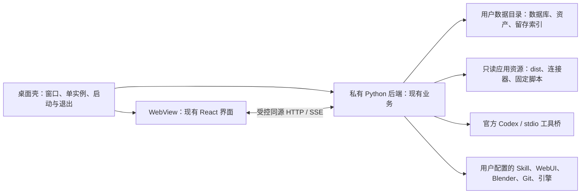

# 工作台设计进展与应用封装评估

评估对象：造物间 0.9.0 本地实验版。日期：2026-10-26。范围：当前源码、测试、文档、启动/打包脚本和已有脱敏验收记录；本轮不修改业务代码、不制作桌面安装包、不发起收费请求。

后续说明：本文件评估0.9；0.10已新增会话全功能授权、Codex整机开关、独立积分及生成模型选择，见 [Agent指南](AGENT_ACCESS_GUIDE.md)。本文的安装器、运行时和升级前置条件仍未因此完成。

## 1. 结论与适用范围

**适合立即开展 Windows 桌面内测版的封装开发；现有 ZIP 尚不具备面向普通用户的独立安装、升级与恢复能力。**

当前产品已经形成“已有工程接入 → 设计与会话 → 专职创作 → 任务验收 → 资产版本 → 快照与 GitHub 留存”的主要流程。它是可使用的本机创作及项目管理原型。实际控制权、收费确认和游戏验收仍由创作者承担。

| 判断对象 | 本次判断 | 条件 |
| --- | --- | --- |
| 继续源码/浏览器使用 | 适合个人及受控试用 | 保留数据，按照各功能的实测边界使用 |
| 开始桌面封装验证 | 适合现在开始 | 复用现有业务层，先验证运行时和进程链 |
| 分发 Windows 内测应用 | 基础条件具备，但仍有封装前置工作 | 通过本文 P0、干净机器安装和升级恢复检查 |
| 发布承诺全部集成可用的正式安装版 | 当前不适合 | 声明支持的功能逐项真实验收；未验收项应禁用或明确列为实验能力 |
| 公网服务、多人协作平台或全自动游戏开发 | 不在当前能力范围 | 桌面窗口封装不提供认证隔离、自动编排或游戏运行验收 |

“封装成应用”在本文指有独立窗口、安装包、自带基础运行依赖和持久数据目录的 Windows 单用户应用。仅添加桌面快捷方式可更快完成，但不能解决依赖和升级问题。暂以 Windows x64 为首个目标；这是建议范围，不是已通过的平台承诺。

## 2. 设计与功能进展

下表的“历史实测”表示已有独立验收证据，本轮没有重新运行供应商、引擎或 DCC 实测。自动测试通过仅证明其覆盖场景。

| 领域 | 当前实现及设计判断 | 证据与未完成事项 |
| --- | --- | --- |
| 项目与已有工程 | 绑定 Unreal/Unity 目录、预览接入、原位分类、设计快照、外部变化提示；可以接续已有创作 | 结构夹具、哈希保护和历史 Codex 只读分析通过；大型真实工程仍需规模验证 |
| 设计与任务管理 | 正式设计/历史版本、依赖无环、设计版本关联、持续复核、完成证据 | 已有测试；缺少任务与具体交付资产的统一结构化关联、工时/排期与自动化运行验收 |
| Agent 与会话 | 总负责人、音乐、建模三角色；独立会话、手动记忆、关键词搜索、流式回复与停止 | 同项目串行；角色按请求运行，尚无自动分派和并行团队调度 |
| Codex 与 MCP | 官方 App Server、单轮项目作用域、实际工具目录核验、日志与中断 | 历史真实推理和图片工具通过；不继承 Codex 桌面全部电脑操作工具；不是任意 MCP 服务器注册中心 |
| API 对话/图像 | OpenAI/DeepSeek 固定端点适配、用量、模型验证；图片编辑与迟到结果保护 | 模拟测试；两家真实 API 文本、OpenAI 图片仍待验收 |
| WebUI 美术 | 本机模型/LoRA 目录、固定参数生成、参考图/遮罩、输出导入与创作记录 | 历史真实小图与 LoRA 实测；不安装、训练或删除模型 |
| 音乐 | Suno.cn 原版 Skill helper、方案、授权、明确确认后提交、手动查询和未知结果保护 | 授权/账户只读历史实测；真实生成、自动纳入资产及高级音轨流程待完成 |
| Blender | 参数化低模方案、固定本机驱动、可编辑源文件/GLB/预览、派生版本 | 历史三模板真实生成、重开和导入通过；不是雕刻、绑定或动画系统 |
| Tripo | V3 文生/图生方案、区域/积分、单次提交、恢复与 GLB 接入 | 模拟验证；真实积分、收费任务和产出质量未验收 |
| 资产及引擎 | 图片/音频有限编辑、GLB 查看、版本保留、有限原生材质操作 | Unreal 4.27.2 历史运行通过；Unity 6000.5.3f1 仅独立编译，许可证阻断过运行验收 |
| 账户额度 | Codex 窗口、Suno/Tripo 积分、DeepSeek 现金；旧值与过期标记 | Codex/Suno 只读实测；其他余额模拟测试；OpenAI API 现金余额只提供官方账单入口，无预算预测 |
| 工程留存 | 全量过滤快照、父链、工作台版本、逐文件及归档 SHA-256、独立目录恢复 | 已有测试；不是 VSS 原子快照，无增量、定时、异地自动备份或外部快照索引重建 |
| GitHub | 冻结快照预览、敏感模式检查、独立根提交/分支、LFS 与未知推送核对 | 原生 Git 在本地 bare 仓库实测、LFS 指针实测；真实 GitHub Token/远端 Git/LFS 上传未验收 |

不能用一个未经定义的“完成百分比”代表以上领域。当前进度更准确的表述是：**创作和项目记录主流程已接通，运行环境产品化与若干外部链路仍待收口。**

## 3. 交互与管理设计评价

当前十个导航入口按项目、创作和留存划分；音乐与建模页切换专职负责人，连接、WebUI 管理、账户和留存页隐藏对话区。这种布局能让配置/审阅工作获得更宽空间。设计草稿、正式资料、已执行记录和人工验收分开，也有助于避免把 AI 建议误当成交付。

项目管理已经覆盖依赖、变更复核和留存，但尚不是完整的生产计划系统。负责人依赖已记录的项目证据汇报状态，不能凭目录扫描认定游戏已通过运行验收。

| 需要继续处理的交互点 | 对使用的影响 | 后续处理建议 |
| --- | --- | --- |
| 外部依赖分散在各页面 | 首次使用难以判断缺少什么 | 应用首次启动提供可选功能与环境诊断，缺失项显示安装/定位指引 |
| 讨论/执行开关会延续 | 用户可能忘记当前会话仍有写权限 | 保持发送前清晰的权限提示；封装不自动扩大权限 |
| 部分表单没有草稿恢复 | 切页或换桌面 WebView 可能丢失输入 | 第一版明确提示保存；后续只补必要表单，不把浏览器 localStorage 当作工程备份 |
| 多种备份名称容易混淆 | 用户可能把资料 ZIP 当成完整引擎工程 | 手册与界面持续区分资料包、完整过滤快照、GitHub 筛选分支 |
| 长任务状态分散 | 服务退出后难以决定查询还是重提 | 统一展示运行/等待/未知，保留按服务核对流程；收费任务不得自动重放 |
| 工程根目录缺少直接重绑定入口 | 恢复/搬迁工程后操作路径不便 | 后续提供带路径核验和资产重定位预览的重绑定；当前按手册重新接入 |

这些是设计改进建议，本轮只更新文档，未把建议计为已实现。

## 4. 本轮核验与证据边界

- 本机 Python 3.12.14、Node.js 24.20.0；重新运行后端测试和生产构建，结果为 **83 passed**、构建通过。
- 现有 3D 预览分块仍有超过 500 kB 的构建提示；测试仍有 Starlette/httpx 弃用提示。它们没有阻断本轮验证，也不应作为安装器已通过的证据。
- 当前包含 Windows/Ubuntu 源码验证 CI 配置，但本仓库尚无 Git 提交和远端；没有可核对的远端 CI、已签名安装器或安装器测试。
- 0.9 的脱敏证据见 [management-v0.9.json](verification/management-v0.9.json)，其他真实集成结论见 [开发状态](DEVELOPMENT_STATUS.md) 及各专项指南。
- 本轮没有重新查询真实账户、登录、生成图片/音乐/模型、推送 GitHub 或启动游戏引擎。此前的独立验收不等于当前所有服务仍可用。

发现并在手册中纠正的问题包括：首页测试总数仍为 71、导航未完整介绍建模/账户/留存页、主要技术索引和工具表未纳入后续模块、资料备份与工程快照在主章节的描述不够清楚。

## 5. 为什么不能直接包一个 EXE 就结束

| 代码依据 | 当前行为 | 对封装的影响 |
| --- | --- | --- |
| `backend/store.py` | 资源根由 `__file__` 推导，数据默认位于资源根下 `.workbench` | 安装目录可能不可写；单文件解包临时目录不适合作为持久数据目录 |
| `backend/chat.py: bridge()` | `sys.executable` 运行 `backend/mcp_bridge.py` | 冻结后不能假设该值仍是通用 Python 解释器，Codex 工具桥可能启动失败 |
| `backend/codex.py: thread()` | 关闭继承 MCP 时也使用 `sys.executable -c pass` 的占位配置 | 若改变运行时，需要连同工具核验配置验证，不能只替换桥入口 |
| `backend/app.py`、`modeling.py`、`engines.py` | 通过资源根读取 dist、Blender 固定脚本和引擎连接器 | 打包必须明确收集资源，不能只收集 Python 模块 |
| `backend/publishing.py` | 运行时导入 `scripts.check_release` 中的扫描规则 | 发布检查模块的运行时依赖也必须入包，不能把整个 scripts 目录视为纯构建资料 |
| `scripts/Start-Workbench.ps1`、`Setup.ps1` | 缺少虚拟环境或 dist 时调用 Setup；Setup 总会安装 Python 依赖并执行 npm ci/build | 已有预构建 ZIP 仍可能在首次双击时要求 Node/npm 和联网，不是独立运行包 |
| `backend/run.py`、启动器 | 默认 8765、回环监听；启动器按 product 标识复用服务 | 桌面版需验证实例身份、版本/数据目录、端口冲突以及谁拥有后台进程 |
| `backend/app.py: local_access()`、`src/api.ts` | 相对 `/api` 请求，校验本机 Host、Origin 与会话令牌 | 不能直接改为 `file://` 加载然后放宽所有来源；应设计同源或受控传输 |
| `backend/music.py`、`codex.py` | Suno helper 和部分 Codex 安装依赖 Node/PATH/用户目录 | 基础安装与可选功能依赖要分开；桌面运行时不一定与开发终端的 PATH 一致 |
| `backend/store.py: init()` | 按建表/检查列兼容迁移，无显式升级版本账本和回退流程 | 普通启动兼容不等于能安全跨安装包升级、回滚或处理中途断电 |

PyInstaller 官方说明，冻结程序的 `sys.executable` 指向打包后的启动程序，而不是普通 Python。上述 MCP 风险是据此结合源码作出的推断，尚未实际制作冻结包验证。[运行时说明](https://pyinstaller.org/en/stable/runtime-information.html)

## 6. 封装方案与取舍

| 路线 | 优点 | 额外成本/边界 | 建议 |
| --- | --- | --- | --- |
| 保留浏览器与现有启动器 | 改动最小，可继续使用当前能力 | 依赖安装、版本升级和进程归属问题仍在 | 保留为开发与排障入口 |
| Tauri 2 窗口 + 独立 Python 后端 | 复用 React/FastAPI，窗口与后台进程职责可分离，使用系统 WebView | 增加 Rust 构建链、WebView2 部署与权限配置；整包体积仍受 Python/依赖影响 | 优先做 Windows x64 验证样机 |
| Electron 窗口 + 独立 Python 后端 | 壳层可沿用 JS/TS，浏览器运行环境由应用携带 | 随包维护 Chromium/Node，额外安装体积和更新责任；Python 仍需独立部署 | 若团队不希望维护 Rust，可用同一验收标准替代 |
| 直接冻结 Python 成单文件 | 启动形式看起来简单 | MCP 解释器、资源和持久目录问题尚未解决；还没有独立窗口方案 | 不作为当前一步到位的发布路线 |

这是适配现有代码的工程判断，不是对安装包大小、启动速度或 WebGL 性能的实测结论。Tauri 官方提供外部二进制/sidecar 打包方式，Windows 安装器支持 WebView2 的下载或随包安装策略；选择离线方案会改变安装包体积。[Tauri sidecar](https://v2.tauri.app/develop/sidecar/)、[Windows 安装器](https://v2.tauri.app/distribute/windows-installer/)、[进程模型](https://v2.tauri.app/concept/process-model/)

Electron 官方要求隔离渲染器、限制导航和原生接口；用 Electron 也不能把第三方网站直接载入有本机权限的创作窗口。登录与供应商网站应交给系统浏览器，壳层只提供明确受限的应用操作。[Electron 安全说明](https://www.electronjs.org/docs/latest/tutorial/security)

建议第一版先随包提供**应用私有的真实 Python 运行时与锁定依赖**，保留后端和 stdio 桥的解释器语义，再评估冻结优化。不复制开发者的 `.venv` 或 Codex 缓存作为运行时。Python embeddable 包可用于应用内分发，但依赖需在构建阶段准备和验证，不能假定它支持首次运行 pip 安装。[Python 3.12 Windows 嵌入式分发说明](https://docs.python.org/3.12/using/windows.html#the-embeddable-package)

### 建议目标架构（尚未实现）

先由后端提供同源界面和 API，保留现有 `/api`、SSE 和媒体访问方式。壳只加载它自己启动且已核对身份的回环服务；单独浏览器模式继续可用。动态端口如引入，必须同时传给工具桥与环境设置，不可只改变窗口地址。更深的 IPC 改造放在后续，不必为了外壳重写所有业务接口。

## 7. 应用版开发顺序与可检查的完成条件

| 阶段 | 交付内容 | 通过条件 |
| --- | --- | --- |
| P0-A 路径与数据 | 区分只读应用资源、用户数据和外部工程；保留 WORKBENCH_DATA 优先级 | 安装到不可写目录、中文/空格路径仍可运行；数据不落在临时解包目录；卸载默认保留项目 |
| P0-B 运行时与工具桥 | 私有 Python、锁定依赖、完整资源；验证真实 stdio 桥 | 无系统 Python/Node 的干净环境能用离线资料/资产/任务/快照；安装可选 Codex 后讨论/执行两种工具目录均核验通过 |
| P0-C 进程与通信 | 单实例、健康检查、版本/数据目录/实例归属、退出与崩溃处理 | 双击不重复拉起；端口占用给出可处理提示；不关闭用户独立启动的引擎/WebUI/服务；后台退出可核对 |
| P0-D 升级与恢复 | 版本化迁移、迁移前一致备份、失败保护与回退规则 | 从至少一份旧版夹具升级；中断升级可恢复；备份/新目录恢复不覆盖原游戏；换账户需重新授权的凭据有明确提示 |
| P1-A 桌面体验 | 文件夹选择、可选依赖诊断、外链浏览器、持久 WebView 配置、窗口异常提示 | SSE、停止、图片编辑、GLB/WebGL、音频、文件下载、Codex/Suno 登录链逐项验收；草稿迁移边界清楚 |
| P1-B 集成范围 | 按承诺范围补真实服务和引擎验收，实验功能明确标记 | 至少跑通声明支持的真实创作链；缺失外部依赖不阻断核心项目管理；未知收费结果不重提 |
| P1-C 分发 | 可复现 Windows 构建、许可清单、安装/卸载、签名及更新来源策略 | 干净机器首次启动、覆盖安装、卸载保留数据、重新安装恢复通过；公开版本有与目标包匹配的验证记录 |
| P2 后续增强 | 签名自动更新、统一长任务中心、任务-资产交付关系、预算/更大项目检索 | 各自定义数据与失败合约后单独验收；不阻塞范围清楚的首个内测包 |

P0 是分发内测包前的基础条件，不意味着本轮已完成这些工程。自动更新不是首个内测版的必要条件，可以先采用校验过的手工更新；如果启用自动更新，必须额外处理签名验证、迁移和失败回退。

### 外部依赖分层

| 能力 | 建议安装包承担 | 用户提供/选择 |
| --- | --- | --- |
| 本机项目管理、预览、快照 | Python、锁定依赖、React dist、桌面壳及 WebView2 检测/安装策略 | 工程及备份目标空间 |
| Codex | 发现与定位、版本兼容检查、启动诊断 | 官方运行时、登录和会员；若该 CLI 安装需要 Node，按其实际要求处理 |
| Suno.cn | Node/Skill 是否可用的诊断；如随包分发须核对授权 | 原版 Skill、授权、积分；不能复制开发者凭据 |
| WebUI/Blender/引擎 | 路径设置、连接检查、连接器/固定脚本 | 软件安装、模型/LoRA、项目、引擎许可证 |
| GitHub | Git/LFS 检测和可定位路径；是否随包分发另核对许可 | 仓库、Token、素材上传权利、远端配额 |

不把引擎、模型权重、开发者缓存或第三方账号装进基础包。首次启动的核心项目管理应能离线工作，在线能力按用户显式连接启用。

## 8. 本轮文档交付

- [使用手册](USER_GUIDE.md)：同步当前功能/导航、三角色、额度与留存操作、首次运行依赖、备份与升级限制。
- [技术手册](TECHNICAL_OVERVIEW.md)：更新模块/工具/数据/接口索引，说明应用封装会影响的进程、路径和通信边界。
- [开发状态](DEVELOPMENT_STATUS.md)：保留历史证据，更新待完成事项及接下来应优先收口的工作。

本轮未更改运行代码或升级产品版本，也没有重打既有 0.9 ZIP；此前归档中的手册仍是归档当时版本。正式分发时应从目标提交重新生成带校验的包，而不是把文档更新当成安装器验收。
