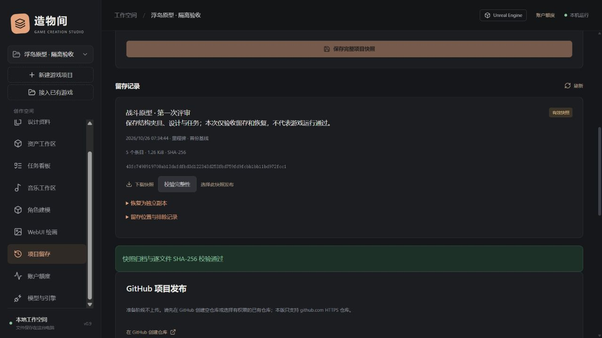
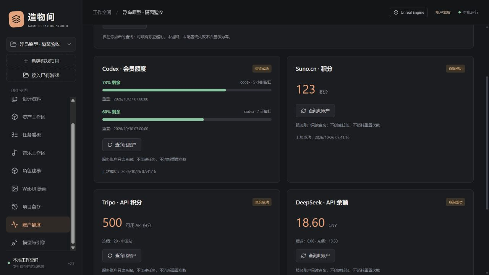

# 账户额度、工程快照与 GitHub 留存

0.10 补充：用户明确授予全功能的执行会话可经业务动作保存/查询/恢复快照和准备/上传 GitHub；原目标、清单与权利确认校验继续生效。默认角色仍沿用界面流程。详见 [Agent 授权指南](AGENT_ACCESS_GUIDE.md)。

适用版本：0.9.0 实验版。核对日期：2026-10-26。

工作台现在同时管理创作记录和项目留存。入口是左侧的“账户额度”和“项目留存”；操作留存前先选中项目。本文中的截图和工程验证只使用自制测试夹具。

0.11补充：工程快照格式2包含game/主工程和sources/source_标识/附加来源，GitHub预览也覆盖这些来源。备份和恢复目标必须在全部来源之外；旧格式1仍支持。缓存瘦身归档独立留存在工作台数据目录，不包含在项目资料包中，详见 [多来源指南](MULTI_SOURCE_AND_MAINTENANCE_GUIDE.md)。

## 账户额度

点击“查询此账户”或“刷新所有服务”。页面不定时轮询，也不提交生成任务或消耗额度重置次数。

| 服务 | 显示内容 | 来源与边界 |
| --- | --- | --- |
| Codex 会员 | 各限制桶的剩余百分比、窗口长度和重置时间；服务返回时显示 credits/月度限制 | 本机官方 App Server 的 `account/rateLimits/read`；账户共享限制，不是项目独占预算，也不估算剩余 token |
| Suno.cn | 积分 | 已安装 Skill 原版 helper 的 `auth status`、`account`；需在音乐页完成授权 |
| Tripo | 可用积分、冻结积分与中国/全球区域 | 已配置区域的官方 API；网站订阅额度不保证等于 API 积分 |
| DeepSeek | CNY/USD 总余额、赠送与充值部分 | 官方 `/user/balance`；使用已配置的 DeepSeek Key |
| OpenAI API | 官方账单台入口 | 本版没有接入通用现金余额查询，显示“未提供余额查询”；不会将请求用量当作余额 |

每项显示上次成功查询时间。失败保留旧值并明确标为参考；超过五分钟或切换 Tripo 区域后也标记过期。未知值显示空缺，实际零余额才显示零。不同服务的百分比、积分、credits、现金分别显示，不自动汇率换算。该页不提供跨服务精确预算、成本预测或余额预警。

Codex、Suno.cn 的真实账户只读查询已通过；公开证据只保留成功标记，不包含余额或账号身份。Tripo/DeepSeek 余额适配使用模拟响应验证，尚无新增真实账户余额验收。

## 保存完整工程快照

1. 保存工作台中的文档和浏览器草稿，保存引擎工程，暂停正在生成、导入或编辑资产的工具。
2. 进入“项目留存”，填写快照名称、留存类型和说明。说明应记录变更、验收范围、已知问题与外部依赖。
3. 可指定原工程以外的备份目录，例如另一块磁盘；留空使用工作台数据目录下的 `snapshots/项目ID/`。工程内部目录会被拒绝，避免递归备份。
4. 勾选已保存和暂停写入，点击保存。任务完成前不标记为有效；中断或失败保留记录及局部文件供核对。
5. 有效快照可下载、逐文件校验，也可恢复到工程以外的已有父目录下的新文件夹。

每份快照使用唯一 ID，保存工作台版本、命名、用途（检查点/里程碑/发布前）、说明、UTC 时间、父快照 ID 和父归档 SHA-256。它记录完整文件集而非增量差异，父链是追溯关系，恢复不依赖父包。

| 文件 | 用途 |
| --- | --- |
| `snapshot.zip` | `game/` 中的过滤后工程文件；`workbench/project.zip` 中的工作台资料、对话、任务、文档历史及登记资产版本；内含 `snapshot.json` |
| `snapshot.json` | 可单独检查的清单副本：各文件路径、大小和 SHA-256、父链、时间、排除样例及原 Git HEAD/分支/脏状态线索 |
| `snapshot.zip.sha256` | 整包 SHA-256 回执；校验时以本地登记的原始哈希为准 |

界面校验同时核对整包哈希和每个归档条目。恢复先校验，再写入全新目录，并校验写出的文件；不会覆盖或回滚原工程。工程位于恢复目录的 `game/`；工作台资料包位于 `workbench/project.zip`，可在原有“从备份恢复”入口另建副本，然后重新接入工程路径。**该资料包导入仍受原有 60 MiB 压缩包、500 MiB 解压量、10,000 条目限制**；大型包仍保存在快照中，可独立解压留存，但本版没有绕过该限制的数据库一键恢复器。

本版工程扫描上限为 100,000 文件、100 GiB 原始工程数据；内嵌工作台资料包另占空间。ZIP 压缩、校验和恢复都需要时间与磁盘空间，不提供增量去重。扫描前后和逐文件复制前后检查文件大小、修改时间；发现变化即失败。它不是 Windows VSS 或文件系统级原子快照，不能保证并发写入时的事务一致性。

默认跳过 `.git/.svn/.hg`、工作台运行数据、依赖安装、引擎缓存/构建输出、日志、常见密钥/数据库文件、`.env*`、Codex/Claude/Suno 账户目录，以及符号链接和目录联接。清单保留最多 200 个排除样例；完整纳入范围以逐文件清单为准。外部链接指向的资产、被排除的内容、引擎安装、WebUI 模型与 LoRA 需另行留存。这是**过滤后的工程快照**，不是整盘镜像，也不代表游戏功能通过验收。

快照索引和 GitHub 发布记录保留在本机数据库，不递归打入格式 10 的资料包；账户额度缓存和密钥也不导出。保管快照时同时复制 ZIP、清单和回执。即使丢失本机索引，仍可用独立 SHA-256 工具核对回执后解压文件；本版尚不支持把外部快照包重新登记到索引。快照不是加密包，可能含私有文档、对话与源代码；不要将完整快照直接作为公开附件。

## 发布当前项目到 GitHub

这里发布的是**所选冻结快照的独立分支**。与本仓库本身的源码发行流程不同；后者见 [GitHub 发布说明](GITHUB_RELEASE.md)。

1. 安装 Git；包含超过 1 MiB 文件时还需 Git LFS。在 GitHub 创建空仓库，或选择自己有写权限的已有仓库。建议首次使用私有仓库。
2. 在留存页展开 GitHub 配置，填写具有目标仓库 Contents 写权限的 Token。Windows 使用当前用户 DPAPI 加密保存；也可在启动终端设置 `GITHUB_API_KEY`。`.env.example` 仅是示例，服务不自动加载 `.env`。
3. 选择有效快照，填写 `https://github.com/所有者/仓库`，选择是否包含资产。可逐行填写额外排除文件的精确相对路径，例如 `game/Docs/Private.md`，不支持通配符或目录规则。
4. 点击准备，读取真实仓库身份和可见性，然后在本机生成文件清单和提交。这个阶段不上传。审阅包含/排除文件、大小、LFS 文件、分支和提交哈希。
5. 如检查未通过，处理源文件后另存快照，或调整排除清单重新准备。勾选上传权利与范围确认；公开仓库还需单独勾选公开确认。点击确认上传此提交。
6. 完成后打开 GitHub 快照分支。出现“结果待核对”时先只读核对远端，不自动重复推送；远端已是同一提交则确认成功，尚无该分支才允许再次人工确认。

| 规则 | 实际行为 |
| --- | --- |
| 保持原工程 | 使用工作台私有发布目录创建独立 Git 仓库；不改工程 `.git`、暂存区、历史或 GitHub 主分支 |
| 发布结构 | `game/`：过滤工程；`workbench/project.json`：当前设计和任务关联；可选 `workbench/assets/`：登记资产当前版本；附快照回执摘要和 README |
| 历史模式 | 每次独立根提交，分支 `codex/snapshot-…`；不复制原 Git 历史，非增量同步/合并工具，不自动创建 PR、标签或 Release |
| 资料最小化 | 不发布对话、运行日志、账号设置；排除 ThirdParty/vendor、工作流、Git 子模块配置、本机工具目录与原 `.gitattributes`。第三方目录识别不是许可审查，目录外的第三方内容仍需人工排除 |
| 大文件 | 大于 1 MiB 的文件使用新生成的精确 LFS 规则；预览清单包含该规则文件；普通 Git 文件总量上限 256 MiB。缺少 LFS 会阻止发布，不会静默漏文件 |
| 凭据保护 | 固定 github.com HTTPS；不把 Token 写进 URL、Git 配置或命令参数；禁用继承 Git 配置、凭据助手、签名和 hooks；通过子进程临时环境提供认证 |
| 发布核对 | 扫描常见令牌/密钥模式与个人路径；上传前核对文件哈希、实际暂存文件集、HEAD、工作区和远端 URL，以及仓库身份/可见性；禁止强制推送或覆盖不同提交 |

自动检查不能证明无秘密、无隐私或拥有资产再分发权。GitHub 上传包含第三方服务传输；普通 Git、LFS 存储与带宽均可能受目标账户政策限制。确认权利与内容后再上传。LFS 先上传对象再推分支，失败时可能留下暂未关联的远端对象；不会据此声称整体发布成功。

当前不支持企业 GitHub、自建 Git、SSH、界面自动创建远程仓库、同步原 Git 历史。远程仓库需要用户自己配置 Token 与权限；本轮验证使用真实本机 Git/Git LFS 和隔离 bare 仓库，**未向真实 GitHub 账户推送**。

## 建议的留存习惯

| 时机 | 建议 |
| --- | --- |
| 每个可继续工作的阶段 | 检查点，写明变更和未完成事项 |
| 评审、引擎升级、破坏性修改前 | 里程碑，并完成一次独立目录恢复检查 |
| 公开提交或交付前 | 发布前快照，保存测试结论、引擎/依赖版本和授权依据，再审阅 GitHub 清单 |
| 异地备份 | 至少保有多份副本、不同介质及一份异地副本；复制归档、清单和回执后重新计算哈希 |

本版不自动删除旧快照、不安排定时备份，也不自动将本地包上传云盘。GitHub 中的筛选发布分支不等于完整私有快照。恢复演练和实际引擎重开/运行是独立验收步骤，不能用“ZIP 创建成功”替代。

## 开发接口与证据

| 路由 | 用途 |
| --- | --- |
| `GET /api/accounts`、`POST /api/accounts/refresh` | 读取缓存、按 providers 数组刷新；服务隔离超时与旧值保护 |
| `GET/POST /api/projects/{pid}/snapshots` | 列出/启动快照；POST 必须含 label、note、saved_ack=true，可选 kind、destination |
| `GET /api/snapshots/{sid}`、`GET …/file` | 状态/下载；状态 pending → copying → ready 或 failed/interrupted |
| `POST …/verify`、`POST …/restore` | SHA-256 核对；恢复参数 parent、confirmed=true |
| `GET/PUT /api/github/config` | Git/LFS/配置状态；PUT key 或 clear_key，不返回凭据 |
| `POST /api/snapshots/{sid}/github/prepare` | repository、include_assets、exclude；blocked 或 prepared |
| `GET /api/projects/{pid}/publications` | 发布清单与状态 |
| `POST /api/publications/{jid}/push`、`POST …/check` | 确认上传/只读核对；push 需 confirmed、rights_ack；公开时 public_ack |

所有修改路由继续使用本机会话令牌。没有增加 Agent 的发布、收费提交、账户或文件系统权限。后台快照任务在退出时协作停止；再次启动把未完成快照标为中断、未确认推送标为未知，避免错误记为完成。

自动测试见 `tests/test_management.py`；公开结构化结果见 [0.9 验证记录](verification/management-v0.9.json)。供应商原始语义参考 [Codex App Server](https://learn.chatgpt.com/docs/app-server)、[DeepSeek 余额接口](https://api-docs.deepseek.com/api/get-user-balance/)；大文件限制参考 [GitHub 官方说明](https://docs.github.com/en/repositories/working-with-files/managing-large-files/about-large-files-on-github)。

## 0.12 留存补充

资料包格式9新增任务固定交付、不可变验收、SUNO音轨/资产关系和队列历史，支持导入1–9；快照外层格式保持2。导入重映射关联编号，不继承会话与队列授权；未完成操作按中断历史保留，不执行收费重放。保全的旧验收仍是历史声明，恢复后需核对当前文件与交付，不能用它代替引擎验收。详见 [作业交付指南](JOBS_AND_DELIVERY_GUIDE.md)。

## 0.13 留存补充

当前资料包格式10，兼容1–10，新增任务与创作方案来源关联。PROJECT_MEMORY/SKILLS/WORKFLOW以普通文档与版本保存，可单独导出Markdown组；未提交的浏览器补充不随包迁移。恢复重映射来源及已识别的文档引用，不执行Skill、不继承权限或重放收费生成。参见 [上下文与任务指南](CONTEXT_AND_TASK_WORKFLOW_GUIDE.md)。
