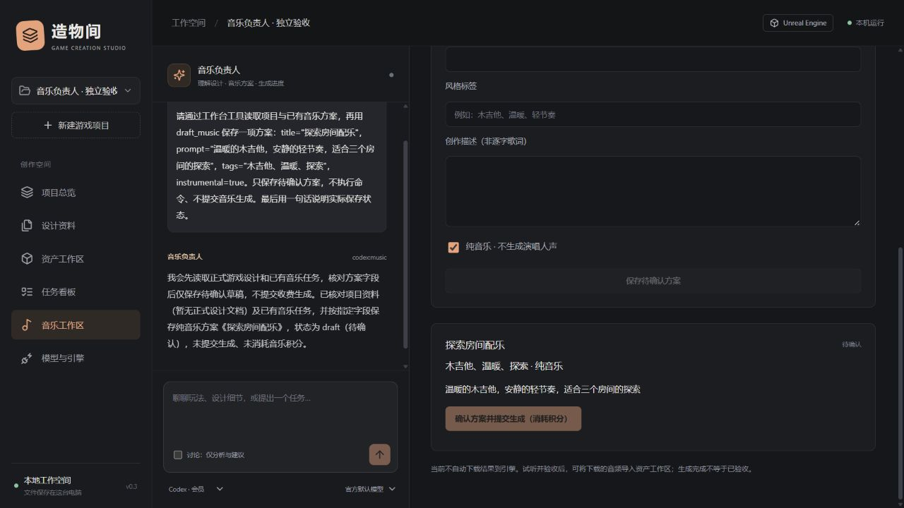

# Suno.cn Skill 与音乐负责人

> 0.19 更新：已提供自带 Python 的 Windows x64 安装候选、系统目录/文件选择、原版 SUNO Skill 装配和只读 WebUI 硬件预检。详细步骤与验证边界见[应用与装配指南](WINDOWS_APP_AND_SETUP.md)；下文旧版本验收记录保留其当时范围。

0.12新增：成功音轨可排队查询、受限下载、校验并幂等登记为版本化资产，再关联任务与验收。原版helper继续处理授权与任务查询，媒体下载由独立无账户凭据的下载器完成。详见 [作业与资产交付指南](JOBS_AND_DELIVERY_GUIDE.md)。本轮仅模拟验证，真实生成仍待验收。

0.10 更新：默认角色仍只保存方案；用户可按会话授予全功能及独立自动积分，Codex整机另行确认。两家模型可在对应工作区选择，方案创建时冻结，详见 [Agent授权与模型指南](AGENT_ACCESS_GUIDE.md)。下文原有手动确认流程继续可用。


0.3.0 新增专职音乐角色。它是由 Codex / OpenAI / DeepSeek 驱动的工作台角色，具有独立的对话记录、音乐工具范围和方案列表；Skill 提供音乐执行能力，本身不是大语言模型，也不会创建一个额外训练的模型。

## 安装与授权

在你的 Agent 中请求：

```text
请帮我安装苏诺音乐 Skill；需要登录授权时告诉我：https://mcp.suno.cn/mcp/skill/setup.md
```

本次按 [供应方安装说明](https://mcp.suno.cn/mcp/skill/setup.md) 安装 `suno-cn-music` 2.4.0，完整包位于用户 Codex skills 目录下。安装包的 SHA-256：`30983208ed2b8c4f8a90a0505159abf580b986384d19b032aa734c59d8bcb319`。该摘要只对应本次下载，未来更新会不同。

工作台从 `CODEX_HOME/skills/suno-cn-music`（未设置时使用 `~/.codex/skills/suno-cn-music`）查找原版 helper，通过本机 Node.js 调用它。原包没有随本仓库再分发；Skill 的服务规则与第三方授权独立于本项目 MIT 许可证。没有安装 helper 时，音乐工作区会明确提示，不能假装已连接。

在“音乐工作区”点击“登录授权 / 核验账户”。原版 helper 返回网页链接，用户亲自在 Suno.cn 登录并批准。授权链接只在当前界面暂存，不写入数据库、导出包或日志；授权码不是业务密钥。用户完成后再次核验，只有服务端返回 `authorized` 才显示已授权并查询账户。默认有效期和长期信任选项以授权页面为准，工作台不自动选择长期信任。

凭据由原版 helper 管理；工作台不读取凭据文件、不复制网站登录信息。该接入使用 **Suno.cn 账号与积分**，不等同于 `suno.com` 或 `platform.suno.com` 的账号接入，不推定它们之间的官方关系。



## 实际工作流程

1. 选择游戏项目，打开“音乐工作区”，在左侧选择驱动音乐负责人的模型。
2. 让音乐负责人读取正式设计，讨论音乐名称、场景、风格、创作描述和是否纯音乐。讨论模式不修改资料。
3. 开启本轮执行后，AI 可用 `draft_music` 保存待确认方案，也可以手动填写。保存方案不消耗 Suno.cn 音乐积分；对话模型仍可能使用其自己的额度。
4. 用户审阅完整方案，点击“确认方案并提交生成”，确认积分消耗后才调用 helper。默认角色工具集中没有付费提交；全功能会话另获SUNO自动积分授权后可通过业务动作提交。
5. 工作台保存远端 `serial_nos`，点击查询取得真实状态。提交成功、生成完成、人工验收分别处理；成功后可确认“下载纳入资产”，校验登记后在工作台试听；查询完成不等于生成或人工验收完成。

音乐角色的 MCP 工具限制为项目读取、资产目录、音乐方案/结果查询、保存音乐方案、设计草稿和待执行任务。不能修改图片或操作引擎。Codex 音乐会话的工程沙箱采用只读模式，写入方案通过单项目 MCP 权限完成；不向音乐角色提供 Skill 凭据或付费 helper 命令。

当前界面开放基础描述生成：名称、prompt、tags、instrumental 和 mv 模型选择。纯音乐时长、逐字歌词、自定义模式、双倍积分模式、翻唱、续写、音轨工具等能力虽然在供应方 Skill 文档中列出，本版工作台尚未开放这些高级参数或自动化流程。

## 故障与恢复

- 结果未知或超时：记录 `unknown`，不自动再次提交。请先到 Suno.cn 核对作品；没有任务编号时不能假装可自动恢复。
- 服务中断：正在提交的任务在下次启动转为结果未知。已有远端编号仍可手动查询。
- 积分不足：保留提示与供应方处理链接。需通过原版 Skill 的 `purchase status` 流程查看待恢复摘要，经用户明确确认后再恢复。工作台尚未接入该恢复按钮，也不会替用户购买或静默重试。
- 授权待完成/过期：按 helper 返回的原始链接操作，不自行生成凭据。撤销请使用原版 Skill 的 `auth logout` 或网站授权管理。
- 项目备份格式 3 保留音乐方案、编号与结果；恢复副本统一标记为历史记录，不能重新提交旧方案，避免重复扣费。有编号的历史记录仍可在当前授权范围内查询。

本版验证：模拟生成/轮询、确认约束、防重复提交、权限范围、重启和备份恢复通过；真实 Codex 音乐负责人已读取独立项目并保存待确认方案。网页授权、账户读取及真实音乐生成是否完成，以开发状态文件的当前记录为准。
