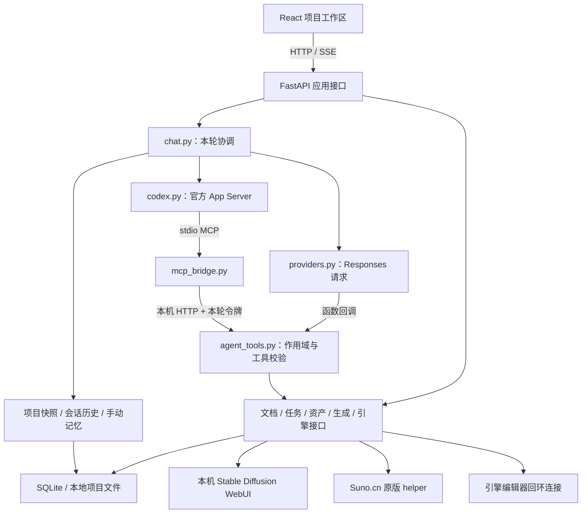
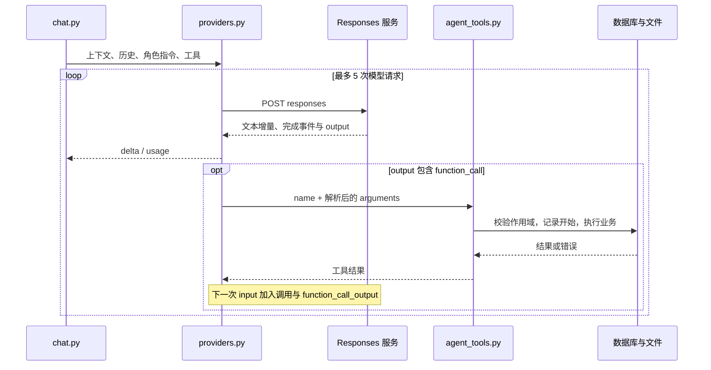
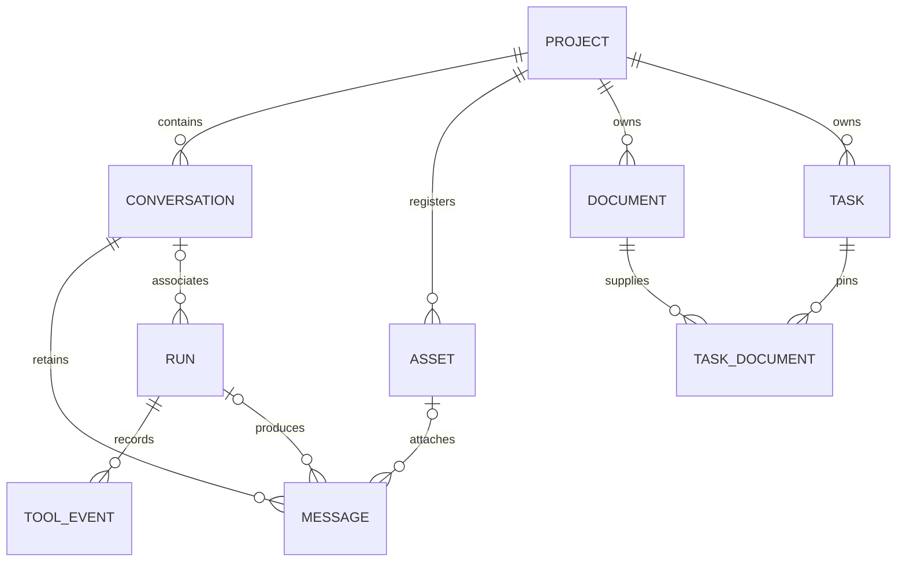

# 游织工坊：技术架构与开发接口说明

> 0.19 更新：已提供自带 Python 的 Windows x64 安装候选、系统目录/文件选择、原版 SUNO Skill 装配和只读 WebUI 硬件预检。详细步骤与验证边界见[应用与装配指南](WINDOWS_APP_AND_SETUP.md)；下文旧版本验收记录保留其当时范围。

适用版本：**0.19.0 实验版**

整理日期：2026-10-27

读者：接手开发者、集成开发者，以及希望理解 Agent、上下文和资产管理方式的使用者。

本文说明当前代码的实际行为。标注为“后续”的内容尚未实现；供应商和引擎的真实验收范围单独列出。操作入门见 [功能介绍与使用指南](USER_GUIDE.md)。

0.18阶段按当时源码复核，**202 项测试通过**，语言检查和生产构建通过；新增会话执行/推理偏好，业务动作和权限种类保持原范围。桌面封装判断见 [设计进展与应用评估](PROGRESS_AND_APP_READINESS_2026-10-26.md)；第26节保留历史封装边界；0.14仅补运行诊断和实例管理，安装器、私有解释器及升级回退仍未交付。

## 1. 实现定位与技术栈

本项目采用本地浏览器界面、Python 服务和文件存储，围绕“项目 → 会话 → 模型调用 → 工具执行 → 记录与交付”组织功能。

| 层 | 当前实现 | 职责 |
| --- | --- | --- |
| 界面 | React、TypeScript、Vite | 项目工作区、流式对话、设计/任务/资产/音乐操作 |
| 模型查看器 | Three.js、GLTFLoader、OrbitControls | 浏览器中的自包含 GLB 预览 |
| 服务 | FastAPI、Uvicorn、httpx | 本机 API、流式输出、外部服务调用 |
| 数据 | SQLite、项目文件目录 | 业务实体、版本、消息、执行与工具摘要 |
| 本地绘画 | A1111 兼容 WebUI HTTP + 只读目录扫描 | 主模型、LoRA、生成/编辑、产出导入与参数记录 |
| 本地资产处理 | Pillow、Python wave/array | 图片变换、PCM WAV 裁剪与淡入淡出 |
| 会员模型 | 官方 Codex App Server 子进程 | 身份、模型目录、推理、受控项目操作 |
| API 模型 | OpenAI / DeepSeek Responses 适配 | 模型请求和应用侧函数工具循环 |
| 音乐执行 | 用户安装的 Suno.cn 原版 Skill helper | 授权核验、人工确认后的提交、任务查询 |
| 角色建模 | Blender 固定脚本 / Tripo V3 API | 参数化本机草稿或云端模型方案、任务与资产关联 |
| 留存 | 流式 ZIP、SHA-256、原生 Git/Git LFS | 过滤工程快照、独立恢复与审阅后分支发布 |
| 引擎 | Unreal Python 插件 / Unity Editor C# | 编辑器内资产检查及有限修改 |

当前 Agent 是“角色指令 + 所选模型 + 项目上下文 + 工具范围 + 会话状态”的组合。项目未使用通用 Agent 调度框架，也没有为音乐角色训练独立模型。

系统面向本机单用户。它不是带租户认证的公网 API 服务，也不是自动分派、并行协作和自我验收的完整多 Agent 平台。

## 2. 总体架构



图中的领域接口是逻辑分组，不是一个独立微服务。图像生成、音乐收费提交、原生材质修改等界面 API 没有全部暴露为 Agent 工具，二者的能力范围需要分别理解。

## 3. 源码职责索引

| 文件 | 核心职责 |
| --- | --- |
| [backend/app.py](../backend/app.py) | HTTP 路由、本机访问检查、文档版本更新、资产及引擎接口、备份恢复 |
| [backend/chat.py](../backend/chat.py) | 角色指令、本轮上下文组装、提供商选择、SSE、取消与收尾 |
| [backend/conversations.py](../backend/conversations.py) | 持久会话、历史窗口、关键词搜索、复制、旧消息迁移 |
| [backend/codex.py](../backend/codex.py) | 官方子进程、请求/通知分发、工具隔离核验、turn 中断 |
| [backend/providers.py](../backend/providers.py) | Responses 流处理、函数调用往返、逐请求用量合计 |
| [backend/agent_tools.py](../backend/agent_tools.py) | 工具定义、角色白名单、参数检查、业务分发、工具日志 |
| [backend/mcp_bridge.py](../backend/mcp_bridge.py) | stdio JSON-RPC 与本机内部 HTTP 工具接口之间的适配 |
| [backend/store.py](../backend/store.py) | SQLite、初始化迁移、项目快照、设置、运行记录 |
| [backend/webui.py](../backend/webui.py) | 本机连接校验、模型/LoRA 目录、固定参数生成请求、产出浏览和导入 |
| [backend/assets.py](../backend/assets.py) | 路径检查、资产登记/扫描、哈希、本地编辑与版本 |
| [backend/image_jobs.py](../backend/image_jobs.py) | 单次图片 API 请求、结果落盘、迟到结果冲突保护 |
| [backend/tasks.py](../backend/tasks.py) | 依赖无环校验、设计版本关联、复核传播与验收条件 |
| [backend/music.py](../backend/music.py) | 原版 Skill helper 调用、授权、方案、提交状态和查询 |
| [backend/modeling.py](../backend/modeling.py)、[backend/tripo.py](../backend/tripo.py) | 本机 Blender 与 Tripo 的方案、进程/远端状态、产出校验和登记 |
| [backend/intake.py](../backend/intake.py) | 已有工程扫描、设计来源、原位资产分类、文件读取与变化检测 |
| [backend/accounts.py](../backend/accounts.py) | 服务原生额度规范化、只读查询、时间与旧值缓存 |
| [backend/backup.py](../backend/backup.py)、[backend/snapshots.py](../backend/snapshots.py) | 格式 10 资料导出、完整过滤工程快照、SHA-256 和新目录恢复 |
| [backend/publishing.py](../backend/publishing.py) | 固定 GitHub 仓库元数据、独立 Git 预览、LFS、确认上传与结果核对 |
| [backend/engines.py](../backend/engines.py) | 连接器安装/发现、目标路径绑定、编辑器命令转发 |
| [backend/secrets.py](../backend/secrets.py) | Windows DPAPI 密钥保存与环境变量回退 |
| [src/Chat.tsx](../src/Chat.tsx)、[src/api.ts](../src/api.ts) | 会话界面、请求头、SSE 读取、发送与停止 |
| [src/drafts.ts](../src/drafts.ts)、[src/RunDetails.tsx](../src/RunDetails.tsx) | 浏览器草稿、执行和工具记录展示 |
| [src/ProjectIntake.tsx](../src/ProjectIntake.tsx)、[src/Modeling.tsx](../src/Modeling.tsx) | 已有工程接入与建模来源切换 |
| [src/Management.tsx](../src/Management.tsx)、[src/Accounts.tsx](../src/Accounts.tsx) | 账户只读查询、快照进度/恢复、GitHub 文件审阅与确认 |

## 4. Agent、会话与运行记录的关系

### 4.1 三个角色

| 角色 ID | 名称 | 本轮职责 |
| --- | --- | --- |
| `director` | 项目负责人 | 理解设计、分析资产、起草资料、建立任务、依据记录汇报进度 |
| `music` | 音乐负责人 | 音乐需求与风格、方案草稿、已有音乐结果及状态 |
| `modeler` | 角色建模负责人 | 参数化低模/Tripo 方案、参考图讨论与已记录交付状态；默认关闭项目命令，显式整机授权除外 |

角色指令由 `chat.instructions(agent, write)` 生成，包含正式设计优先、资料不扩大权限、区分建议与已执行、需要完整文档时使用读取工具等要求。

角色切换会选择不同会话集合和工具范围。同一角色可以使用多个会话，每个会话保存自己的服务、模型与记忆。角色不是一条长期驻留的独立后台工作进程；它在收到对话请求后运行。

### 4.2 三种不同的身份

| 标识 | 生命周期 | 保存内容 |
| --- | --- | --- |
| 工作台 `conversation_id` | 持久化 | 角色、标题、模型偏好、手动记忆、消息归属 |
| 工作台 `run_id` | 一次调用及其历史记录 | 状态、模型、用量、权限核验、关联工具事件 |
| Codex `threadId` / `turnId` | 当前运行时交互 | 本轮推理、活动事件和中断目标 |

Codex 每轮创建 `ephemeral` 线程，传入从工作台恢复的上下文；结束后尝试归档。本版没有调用 `thread/resume` 恢复供应商原生隐藏状态，也没有把工作台的“复制会话”映射为官方 `thread/fork`。

因此，应用的持久记忆由工作台数据库负责。复制会话会复制消息及已保存记忆，生成新 ID，不复制执行副作用，也不重放原收费请求。

### 4.3 进程内控制结构

`chat.py` 使用三个内存结构：

- `ACTIVE`：当前正在对话的项目 ID 集合。同一项目的不同会话或角色也会互斥，冲突返回 HTTP 409。
- `RUNNING`：`run_id → {pid, task, cancelled}`，用于定位和取消当前协程。
- `AGENTS`：`临时令牌 → {pid, write, agent, conversation_id, run_id}`，提供工具调用作用域。

其中 `AGENTS` 是临时授权映射，不是 Agent 进程注册中心。它们不跨服务实例共享，重启后由数据库中的运行状态进行中断标记；不能据此开启多个 Uvicorn worker 实现分布式调度。

## 5. 如何通过接口调用 Agent

### 5.1 本机 API 会话

默认地址是 `http://127.0.0.1:8765`。调用前获取：

```http
GET /api/bootstrap
```

响应包含本机会话 `token`、项目目录及非敏感连接信息。后续 POST / PATCH / PUT / DELETE 请求应带：

```http
X-Workbench-Token: <bootstrap 返回的本机会话令牌>
Content-Type: application/json
```

服务同时检查 Host 和提供的 Origin；前端开发入口 5173 有明确允许项。这是本机访问检查，不是可用于公网用户认证的登录协议。不要把这个令牌当作供应商 Key。

### 5.2 创建会话

```http
POST /api/projects/{pid}/conversations
```

```json
{
  "agent": "director",
  "title": "核心玩法技术讨论",
  "provider": "codex",
  "model": ""
}
```

`agent` 取 `director` 或 `music`；`provider` 取 `codex`、`openai` 或 `deepseek`。Codex 的空模型表示在调用时解析官方目录中的默认模型；API 模式需要有效模型配置。

### 5.3 发起本轮对话

```http
POST /api/projects/{pid}/chat
```

```json
{
  "conversation_id": "<创建会话返回的 id>",
  "agent": "director",
  "provider": "codex",
  "model": "",
  "message": "读取当前资料，列出待明确的设计问题。仅讨论，不修改项目。",
  "execute": false
}
```

| 字段 | 行为 |
| --- | --- |
| `conversation_id` | 建议明确传入；必须属于当前项目和角色。省略时使用该角色最近的未归档会话，必要时创建 |
| `agent` | 默认 `director`；归档会话不能直接继续调用 |
| `provider` | 省略时采用会话服务 |
| `model` | 采用请求值或会话值；空值还会回退至该服务的全局模型设置，Codex 再解析目录默认值 |
| `message` | 非空文本，最多 30000 字符 |
| `execute` | 必须是布尔值，默认 false；不能用字符串 `"false"` 代替 |
| `asset_id` | 可选，只允许本项目图片，文件最多 12 MiB；按模型通道附加真实图像内容 |

### 5.4 SSE 返回格式

响应是 `text/event-stream`，每个数据帧形如：

```text
data: {"event":"run","run_id":"...","conversation_id":"...","model":"..."}

data: {"event":"delta","text":"正在分析……"}

data: {"event":"done","run_id":"..."}

```

事件类型写在 JSON 的 `event` 字段中；当前没有使用 SSE 的 `event:`、`id:` 或断线重放序号。

| 事件 | 含义 |
| --- | --- |
| `run` | 已建立本轮记录，可取得执行 ID。此时 Codex 模型名可能尚未解析完成 |
| `runtime` | Codex 运行时工具隔离结果，包括工具名、模型、角色、模式和命令权限 |
| `delta` | 文本增量 |
| `activity` | 工具或项目操作活动提示 |
| `runtime_action` | Codex 命令或文件变更的完成摘要 |
| `usage` | 某次上游请求的用量或账号额度说明 |
| `error` | 流开始后的错误；不能仅凭 HTTP 200 认定调用成功 |
| `done` | 模型流正常结束；后续可读取项目快照核对持久记录 |

客户端应检查 `error`、最终 `done` 及连接完整性。只有 EOF 而没有完成确认时，不能静默视为成功，也不应自动重发可能具有副作用的请求。

### 5.5 Python 最小调用示例

先启动工作台并完成 Codex 登录。以下示例会创建新的示例项目和会话，**实际运行会使用会员模型额度**；默认只讨论。本技术文档编写时没有执行真实推理。

```python
import json
import httpx


def run_demo(client):
    def checked(response):
        response.raise_for_status()
        return response.json()

    boot = checked(client.get("/api/bootstrap"))
    client.headers["X-Workbench-Token"] = boot["token"]

    project = checked(client.post("/api/projects", json={
        "name": "Agent 接口示例", "engine": "unreal", "root": ""
    }))
    pid = project["id"]
    conversation = checked(client.post(
        f"/api/projects/{pid}/conversations",
        json={"agent": "director", "title": "设计讨论",
              "provider": "codex", "model": ""}
    ))

    run_id, done = None, False
    with client.stream("POST", f"/api/projects/{pid}/chat", json={
        "conversation_id": conversation["id"],
        "agent": "director", "provider": "codex", "model": "",
        "message": "为三间房的探索原型列出需要明确的问题。仅讨论。",
        "execute": False
    }) as response:
        response.raise_for_status()
        for line in response.iter_lines():
            if not line.startswith("data: "):
                continue
            event = json.loads(line[6:])
            if event["event"] == "run":
                run_id = event["run_id"]
            elif event["event"] == "delta":
                print(event["text"], end="", flush=True)
            elif event["event"] == "error":
                raise RuntimeError(event["message"])
            elif event["event"] == "done":
                done = True
    if not done:
        raise RuntimeError("没有完成确认，请先核对执行结果")

    state = checked(client.get(f"/api/projects/{pid}"))
    run = next(r for r in state["runs"] if r["id"] == run_id)
    print("\n执行状态：", run["status"], "模型：", run["model"])
    return {"project_id": pid, "conversation_id": conversation["id"],
            "run_id": run_id}


if __name__ == "__main__":
    with httpx.Client(base_url="http://127.0.0.1:8765",
                      trust_env=False, timeout=300) as client:
        run_demo(client)
```

重复交流时复用 `pid` 和 `conversation_id`，不要每轮重新创建会话。切为音乐角色时，应先创建 `agent=music` 的会话，再用相同角色发起请求；这不等于调用音乐付费生成接口。

### 5.6 停止与读取证据

```http
POST /api/runs/{rid}/cancel
GET /api/runs/{rid}/tools
GET /api/conversations/{cid}/messages?q=关键词&limit=100
```

取消请求在另一个客户端连接或界面操作中发送。对话协程取消后保存已收到的文本、写入中断状态并清理临时令牌。已完成记录的取消会返回当前状态，不会撤销历史修改。

## 6. 一次 Agent 调用的内部生命周期

1. 校验项目、消息、角色、会话归属、归档状态、模型和附件。
2. 检查项目是否已有对话运行；同项目并发冲突返回 409。
3. 保存本轮会话模型偏好，创建 `runs` 和用户 `messages` 记录。
4. 创建临时工具作用域和取消控制结构，发送首个 `run` 事件。
5. 从数据库组装项目资料、当前会话历史及已保存记忆。
6. 生成角色指令和对应工具定义。
7. 选择 Codex 或 Responses 通道，读取模型事件，并执行允许的工具。
8. 逐请求累加 usage，保存运行时核验和工具事件。
9. 正常完成时发送 `done`；失败时发送 `error`；取消时进入中断收尾。
10. 在 `finally` 中保存助手文本、更新模型与会话时间、结束运行记录，并释放项目占用和临时作用域。

部分响应中断时会追加“此响应未完整结束”标记。如果连接未完整启动，响应的后台清理也会尝试解除占用，避免项目一直卡在运行状态。

数据库收尾发生在生成器退出阶段，不是跨供应商、文件和数据库的全局事务。模型文本的完成确认、文件是否交付、项目内容是否验收仍需分别核对。

## 7. 模型通道 A：官方 Codex App Server

`CodexClient` 通过本机 CLI 启动 `codex app-server --listen stdio://`，以换行 JSON 消息交互。连接初始化一次；请求 ID 对应待完成 Future，通知按 `threadId` 分发到当前流的队列。

每轮主要步骤是读取配置和模型目录、建立临时线程、核验工具目录、启动 turn、读取事件，未完成时尝试中断，结束时尝试归档。这些调用对应 [官方 App Server 的线程、turn 和事件接口](https://learn.chatgpt.com/docs/app-server)。

### 本版传入的关键策略

| 项目 | 当前值或规则 |
| --- | --- |
| `modelProvider` | 显式为 `openai`，避免本机其他默认服务影响会员通道 |
| `model` | 请求指定值，或官方模型目录默认项 |
| `cwd` | 所选项目的根目录 |
| `ephemeral` | true，每轮临时线程 |
| `developerInstructions` | 工作台角色与权限指令 |
| `sandbox` | 显式整机授权为 `danger-full-access`；否则总负责人普通执行为 `workspace-write`，其余为 `read-only` |
| `features.shell_tool` | 只对项目负责人执行模式开启 |
| 其他能力 | 关闭工作台本轮继承的外部 MCP、应用/插件，并关闭 js_repl、子 Agent 和网页搜索相关开关 |
| 工作台 MCP | 必须启动成功，`enabled_tools` 使用当前角色白名单 |

`approvalPolicy=never` 不代表工作台忽略自己的业务权限。当前实现对意外的命令/文件审批请求返回拒绝，对权限请求不给新增权限，对未开放交互返回协议错误或拒绝。

`item/agentMessage/delta` 转成文本增量；命令、MCP、文件活动转成活动提示。`turn/completed` 的失败或中断状态不会被当成正常成功。

会员通道当前只记录账号额度归属说明，没有完整 token 统计或精确金额。工具目录核验针对实际 MCP 目录，不构成针对任意本机进程的操作系统级安全证明。

## 8. 模型通道 B：Responses 与函数工具循环

`providers.BASES` 固定提供两个入口：OpenAI 和 DeepSeek；服务端使用 httpx，不依赖浏览器直接访问供应商。

请求包含 `model`、`instructions`、`input`、`stream=true`、`store=false` 和当前工具定义。当前代码使用应用持有的输入历史，不使用 `previous_response_id` 链续接。



每次完成后读取完整 `output` 中的函数调用，按顺序执行；将模型输出和带对应 `call_id` 的 `function_call_output` 加入下一次输入。图片工具结果可携带图像内容。这与 [官方函数调用的调用/结果往返方式](https://developers.openai.com/api/docs/guides/function-calling) 对应。

这里的“最多 5 次”是请求循环上限，不是最多 5 个工具。一个响应可能包含多个函数调用。参数或权限等可处理错误作为工具错误结果返回；连接失败、响应不完整或达到循环上限会结束本轮。

### 用量与能力验证

- 每次供应商完成事件的 usage 单独进入 `usage.requests`，数值字段递归累加；例如 15 与 20 合计为 35。
- 请求元数据保留模型和供应商响应 ID（若返回）；模型名以工作台传入/解析的 ID 为主，不等于独立校验了供应商后端部署版本。
- API 正常返回且有正文时写入 `model_checks` 的 text；直接附图时还写 vision；存在完成的工具事件时还写 tools。
- 这些是成功请求的操作记录，不是对视觉正确性、设计质量或全部工具的评测。保存新 Key 会清除该服务的旧验证结果。

目前 OpenAI / DeepSeek 真实 Key 联调仍待完成，不能用模拟协议测试代替真实账户验收。

## 9. 上下文管理

### 9.1 上下文由哪些内容组成

| 层 | 来源 | 进入模型的方式 |
| --- | --- | --- |
| 角色和权限规则 | `chat.instructions()` | Codex developerInstructions / API instructions |
| 项目资料 | 项目总纲、文档目录、任务与最近运行记录 | 有容量上限的目录及按需片段，明确作为数据 |
| 会话记忆 | `conversations.memory` | 放入项目资料的 conversation 部分 |
| 最近交流 | 当前会话持久消息 | 按字符预算选择后，按时间顺序重放 |
| 当前附件 | 本项目图片 | Codex localImage / API input_image |
| 按需补充 | 文档、历史和资产工具 | 模型发起工具调用后获得 |

用户本条消息先保存进消息表，因此历史读取已经包含它，不再额外复制一遍文本消息。API 有图片时会把最后一条输入替换成文本与图片的复合内容。

上下文不自动包含所有资产二进制、整个引擎工程或其他会话的完整交流。Codex 项目负责人执行模式另有工程操作能力，但这不等于这些内容已经装入每轮 prompt。

### 9.2 当前窗口与阈值

| 项目 | 当前规则 |
| --- | --- |
| 单条用户输入 | 最多 30000 字符 |
| 会话记忆 | 最多 12000 字符 |
| 历史窗口 | 自动约40000 / 精简约18000字符，按消息JSON长度选择，保留最新消息 |
| 文档初始片段 | 超过 4000 字符时只提供前段、元数据和 `requires_read=true` |
| `read_document` | 单次 1–12000 字符，通过 offset/next_offset 分段 |
| 项目目录 | 自动约48000 / 精简约18000字符选择预算，另加覆盖元数据和会话记忆；不再按10万字符直接中止 |
| 历史检索 | 工具默认最多 30 条；HTTP 历史接口最多 100 条，无分页游标 |
| 文档搜索 | 关键词子串匹配，最多返回 20 个文档结果，并提示是否截短 |

这些是应用字符限制，**不是供应商 token 上下文上限**。中文、JSON 和图片的实际计费与上下文占用需要另行核算。本版没有 tokenizer 预估或总 token 自动压缩。

历史从最新消息向前累计，再反转为时间顺序；达到窗口后更早部分不直接重放，并提供 `omitted_messages` 数量。为了至少保留最新消息，单条最新消息即使超过预算仍可能被保留，因此历史选择预算不是绝对硬上限。

### 9.3 长期决定与检索

`read_history(query)` 只搜索当前绑定会话，使用转义后的 LIKE 子串查询。它不能自动检索所有会话或整个工作区；查询过宽时只会返回最近一部分匹配记录。

`search_documents(query)` 搜索当前项目文档标题和正文，返回 ID、版本、权威状态、偏移与片段。`read_document(document_id, offset, limit)` 再校验项目归属并返回具体区间。

对历史附件，工作台在文本历史中保留资产 ID 提示，供有权限的角色再次调用 `view_asset`；不会每轮自动重传全部旧图片。音乐角色没有图片查看工具，这一提示不会扩大其权限。

`requires_read` 是给模型的阅读要求，当前没有服务端“已逐页读完”的证明机制。正式优先也是指令与文档状态约定：快照包含不同状态的文档，不会硬删除草稿或废弃资料。

### 9.4 尚未提供的上下文机制

没有向量数据库、embedding检索、后台自动语义摘要、自动决策抽取、知识图谱或供应商原生线程续接。已有可审查的目录压缩、按需读取及Markdown草稿留存；语义整理须经用户发起对话，记忆与正式设计仍明确维护。

`runs` 不保存每轮完整 prompt 和所有工具原始返回。当前日志与版本记录可帮助追溯，但不能宣称完整复现任意历史推理输入。0.13记录覆盖目录与字符统计、文档版本出处，并可预览当前选择；它们仍不足以完整重放任意历史模型输入。

## 10. 工具、MCP 与权限

### 10.1 两条工具执行路径

```text
API 模型 function_call
  → providers.stream 的 execute_tool 回调
  → agent_tools.invoke(scope, name, args)

Codex MCP tools/call
  → mcp_bridge.py 的 stdio JSON-RPC
  → POST /api/internal/mcp，Authorization: Bearer <本轮令牌>
  → 从 AGENTS 解析 scope
  → agent_tools.invoke(scope, name, args)
```

两条路径最终进入同一业务权限入口。浏览器本机会话令牌、内部工具令牌、供应商 Key 和引擎令牌是不同凭据，不能相互替代。

### 10.2 默认角色工具矩阵

“读”表示讨论/执行均可用；“写”表示仅执行模式开放；“—”表示该角色不开放。参数以 `definitions()` 返回的实际 schema 为准。

| 工具 | 总负责人 | 音乐负责人 | 建模负责人 |
| --- | --- | --- | --- |
| `get_project` | 读 | 读 | 读 |
| `list_assets` | 读 | 读 | 读 |
| `search_project_files` | 读 | — | — |
| `read_project_file` | 读 | — | — |
| `read_document` | 读 | 读 | 读 |
| `search_documents` | 读 | 读 | 读 |
| `read_history` | 读 | 读 | 读 |
| `get_music_jobs` | 读 | 读 | — |
| `get_character_jobs` | 读 | — | 读 |
| `get_tripo_jobs` | 读 | — | 读 |
| `engine_status` | 读 | — | — |
| `view_asset` | 读 | — | 读 |
| `create_document` | 写 | 写 | 写 |
| `create_task` | 写 | 写 | 写 |
| `draft_music` | 写 | 写 | — |
| `draft_character` | 写 | — | 写 |
| `draft_tripo` | 写 | — | 写 |
| `edit_image` | 写 | — | — |

本轮直接读取 `definitions()` 核对为：总负责人讨论/执行 **12/18**，音乐 **6/9**，建模 **8/12**。工具数量不包含 Codex 自身运行时工具；后者还需独立的运行时目录核验。

默认角色未开放图片/音乐/云端模型生成、验收状态更新、原生材质修改、账户刷新、快照和 GitHub 上传。0.10 中，全功能会话另有 workbench_actions/call/operation 三个工具，经目录接通业务动作；收费提交仍分别检查 SUNO/Tripo 授权。保存方案不会自动提交付费请求；界面 API 的存在也不表示模型具有相同权限。

### 10.3 参数与执行日志

`definitions()` 产生带 `additionalProperties=false` 的工具定义。当前除 `create_task` 的两个关联列表外，工具属性在 schema 中均列为必填，调用时应以实际定义为准。

`invoke()` 检查工具是否开放、参数是否为对象、必填字段、未知字段和顶层类型。更细的同项目引用、无环、范围、哈希等校验由业务层负责；这里不是通用的完整 JSON Schema 验证器。

有 run 作用域时，调用先登记 `tool_events` 为 running，然后更新为 completed、failed 或 interrupted。被拒绝的工具尝试也记入日志。参数/结果摘要过滤命名敏感字段和部分密钥形式，限制字符串、列表与对象长度；图片编码不进入摘要。

摘要脱敏不是对任意自由文本秘密的完整识别器。日志也不是完整命令录像或任意进程行为审计，不能替代操作系统权限控制。

### 10.4 MCP 协议与启动核验

工作台桥实现 initialize、ping、tools/list、tools/call，处理非法 JSON、无效参数、未知方法等错误；其协议适配方向参考 [Codex 的 MCP 接入方式](https://learn.chatgpt.com/docs/extend/mcp)。

当前桥支持的协商版本为 2024-11-05、2025-03-26、2025-06-18。它是作用域工具适配器，没有实现通用 resources、prompts、外部 OAuth 管理或服务器注册中心。

Codex 每轮先关闭继承的外部工具配置，再通过 `mcpServerStatus/list` 读取当前线程目录：工作台桥必须存在，工作台工具集合必须完全一致，其他服务器不能暴露工具。失败时阻止 `turn/start`，不以降级方式继续推理。

`GET /api/mcp/policy` 提供角色目录与进程内最近检查，`POST /api/projects/{pid}/mcp/check` 可独立核验并保存一条运行记录；此检查不发起模型推理，也不等于模型或引擎功能验收。

## 11. 数据模型与持久化

### 11.1 主要实体

| 数据表/组 | 关键数据与关系 |
| --- | --- |
| `projects` | id、name、engine、root、brief |
| `conversations` | project_id、agent、title、provider、model、memory、archived |
| `messages` | project_id、conversation_id、run_id、role、content、provider、model、asset_id |
| `runs` | project_id、conversation_id、kind、status、detail、usage、provider、model、agent、runtime |
| `tool_events` | run_id、project_id、conversation_id、tool、arguments、result、status、起止时间 |
| `documents` / `document_versions` | 当前正文、authority、revision，以及保存前版本 |
| `tasks` / `task_dependencies` | 任务状态、交付条件、验收依据及前置关系 |
| `task_documents` / `task_reviews` | 任务采用的文档版本、持续复核标记 |
| `assets` | project_id、name、source、active、kind、versions |
| `art_jobs` | run/asset 关联、provider、spec、status、result；包含生成及 WebUI 导入记录 |
| `music_jobs` | spec、status、serials、result |
| `character_jobs` | 参数方案、父方案、状态、运行及 Blender/GLB/预览关联 |
| `tripo_jobs` | 方案/区域/模型参数、远端编号、状态、产出资产；不保存短期签名 URL |
| `project_intakes` | 工程接入清单、分类/变化报告、设计来源与现状摘要关联 |
| `project_snapshots` | 命名、用途、说明、父 ID、位置、状态、原始归档 SHA-256、结果 |
| `github_publications` | 快照、仓库身份/可见性、独立分支/提交、文件报告、发布状态 |
| `model_checks` | provider + model + capability 的成功记录与时间 |
| `settings` | 模型配置及本机设置；含 Windows 加密后的服务 Key，不进入项目备份 |

以下为主要**逻辑关联**。旧表增补的部分 ID 列没有数据库外键约束，相应归属校验在业务层完成，图不表示所有关系都有 FK。



### 11.2 存储方式

默认数据库为 `.workbench/workbench.sqlite3`，文件目录按项目 ID 隔离。`WORKBENCH_DATA` 可以替换整个运行数据根；它在模块导入时解析，启动前应设置好。

SQLite 启用 WAL 和外键检查，每个 `store.db()` 上下文负责连接、提交/回滚与关闭。部分关键修改使用 `BEGIN IMMEDIATE`。当前没有 ORM、异步数据库连接池或分布式事务，多数数据库操作仍是同步调用。

初始化通过建表和检查列后 ALTER 的方式兼容旧库，不删除原数据。旧消息按项目与音乐后缀归入历史会话。重启时，running 的执行与工具事件标记中断，submitting 的音乐记录变为 unknown。

建模/Tripo、快照和发布也有对应的中断或未知状态保护，详见各状态机；这些处理不提供通用任务自动恢复。没有显式数据库迁移版本账本、安装包升级事务或自动回退器。

`store.snapshot(pid)` 是供界面/Agent 使用的当前项目 JSON 视图；`project_snapshots` 是工程归档记录。两者都使用“快照”一词，但前者不复制文件，不应当作恢复包。

### 11.3 浏览器草稿不属于模型上下文

`src/drafts.ts` 在 localStorage 中按项目/文档/会话保存未提交草稿。前端恢复草稿后，只有明确保存或发送才进入项目数据库和模型输入。

它不覆盖所有表单，不随 ZIP 导出，也不能跨浏览器自动恢复。当前没有后台服务将浏览器草稿自动同步为正式设计。

## 12. 项目资产管理

### 12.1 资产 ID 与真实文件分开

`assets` 表中的核心字段：

| 字段 | 含义 |
| --- | --- |
| `id` | 工作台资产标识 |
| `source` | 登记来源标识；同项目 source 唯一，用于重复扫描时复用登记 |
| `active` | 当前选中的实际文件路径 |
| `versions` | JSON 数组，保存各版本 path、label、created |
| `kind` | image、audio、model 或 native |

导入文件会复制到工作台自己的项目 assets 目录；扫描引擎工程则登记工程内的文件，并不复制整个工程。重复扫描返回已有 source 记录，没有建立自动文件监控或完整的来源追踪系统。

读取当前文件时，`file_for()` 使用 resolve 后路径，要求它处于绑定项目根目录或该项目工作台数据目录内，并验证文件存在。

### 12.2 扫描与分类

扫描优先选择 Unreal 的 Content 或 Unity 的 Assets；对应目录不存在时回退到项目根目录。扫描跳过常见构建/缓存目录和符号链接，按受支持后缀登记，单次最多处理 3000 个匹配文件，并返回截短标记。

PNG/JPG/WebP/GIF 等作为 image，WAV/MP3/OGG 作为 audio，GLB 作为 model，Blender 源文件作为 blender，FBX/uasset/prefab/mat/关卡等受支持文件作为 native。分类为 native 不代表任意原生格式都支持属性修改或预览。

文档上传走另一分支：Markdown/TXT 解码后创建 `documents`，不是把它登记为普通资产。

### 12.3 本地编辑与版本

图片与音频修改使用 `expected_hash` 对照当前文件的 SHA-256，发现版本变化则拒绝。成功后写入新的 UUID 文件，再追加版本并更新 active，原始文件保留。

图片后端支持 crop、resize、水平翻转；当前界面提供尺寸和翻转，没有裁剪选框，默认 Agent 工具也没有开放 crop 参数；0.10 全功能业务动作 asset.edit_image 可传入原有 crop 参数。音频只支持 16 位非压缩 PCM WAV 的区间裁剪，淡入淡出长度约为 50 ms，短片段会相应缩短。

恢复版本更新的是 active 指针，不是删除后续版本或覆盖源文件。普通编辑与文件/数据库之间没有完整原子事务；哈希检查也不是覆盖所有跨进程竞争的全局锁。

### 12.4 AI 查看与 AI 编辑的区别

`view_asset` 返回图片元数据、当前哈希和最长边不超过 1536 的 PNG 预览，模型接收到实际图像内容；这不是仅凭文件名分析。工具摘要会去掉图片编码。

AI 图片编辑由 `image_jobs.run()` 根据 provider 调用独立 OpenAI Images 或本机 WebUI；省略时保留 OpenAI 行为。以下固定 1024×1024 的说明针对 OpenAI：它校验同项目原图、哈希与可选遮罩，单次请求一张 1024×1024 PNG。遮罩要求同尺寸 PNG，含完全透明区域。

结果只接受可解析的 `b64_json` 图片，校验后落盘，不自动下载任意供应商远程 URL。

长请求返回后，在事务中重新核对 active 和哈希：未变化才追加到原资产；发生变化时把结果保存为独立候选。这样避免迟到的生成结果覆盖用户刚选择或编辑的新版本。

图像请求有独立的项目 ACTIVE 集合，与对话 ACTIVE 不是同一把锁；不能把它理解为所有项目文件操作都串行化。请求异常不自动重试，也没有通用远端任务 ID 恢复机制。

本机 WebUI 使用目录返回的 ID 校验模型与 LoRA，组装 txt2img / img2img 请求，拒绝任意脚本/override 透传。它独立限制同时进行的工作台 WebUI 请求，保存实际返回的 Seed 与 infotext；单次模型覆盖要求恢复原设置，不写 WebUI 配置。图生图把透明遮罩转换为白色重绘区域。详细端点及边界见 [WebUI 指南](WEBUI_GUIDE.md)。

`art_jobs` 将参数、结果、来源、run 与资产关联；不是原生模型文件管理数据库。已登记的 WebUI 产出导入会复制原图，保留 PNG parameters，并按项目、来源文件和内容指纹复用同版本。

### 12.5 GLB 与原生资产

GLB 在浏览器按需加载的 Three.js 查看器中显示，外部依赖 URL 被阻止，仅开放当前资源及 blob/data 资源。没有网格、骨骼或动画编辑工具。

原生材质修改走引擎连接器，实际在工程内修改并创建引擎内备份。它不会像图片编辑一样自动在 `assets.versions` 中追加一个可独立切换的工作台文件版本；需要分别管理引擎备份和工作台资产记录。

### 12.6 当前资产管理缺口

任务与资产尚无结构化采用关系；资产也没有统一的候选/已验收/已采用状态。任务 evidence 可人工记录资产 ID、文件和版本，但不能等同于完整来源、依赖引用或授权元数据管理。

## 13. 文档、任务与项目状态

文档更新必须携带当前 revision，在 `BEGIN IMMEDIATE` 中核对。冲突返回 409；成功则把旧内容写入 `document_versions`，递增 revision，并触发关联任务的复核传播。

任务依赖只允许同项目引用，建立关系时检查自身和循环依赖。`task_documents` 固定任务采用的文档 revision；后续文档变化、废弃或上游状态变化会影响当前交付依据。

`tasks.list_tasks()` 派生 issues、review_required 和 ready。上游未完成、设计版本过期、复核尚未解除时，不能进入相应执行/验收状态；done 还要求非空验收依据。

当前已验收数量按 `status == done and ready` 计算。复核标记会持续存在，不能仅靠上游重新 done 自动消除；需要明确重新安排与验收。

这些规则不验证游戏是否可玩，不自动运行引擎测试，也没有自动识别文档语义变化的能力。草稿关联不被一概禁止，正式优先需要由创作者和角色指令共同落实。

## 14. Unreal / Unity 引擎桥

后端与编辑器之间采用回环 HTTP。连接器启动后生成动态令牌并写入工程内连接描述；后端校验 project_root、engine 和端口后，携带独立 Bearer 令牌请求 `/command`。

| 引擎 | 连接信息位置 | 主线程执行方式 |
| --- | --- | --- |
| Unreal | `Saved/GameWorkbench/connection.json` | HTTP 线程入队，编辑器 tick 回调执行 |
| Unity | `Library/GameWorkbench/connection.json` | HTTP 线程入队，EditorApplication.update 执行 |

主线程队列避免 HTTP 线程直接调用编辑器资产 API。连接超时可能意味着编辑器繁忙，不能直接推断操作没有发生；重试修改前应先查看实际资产。

工作台界面接口当前允许 status、list_assets、inspect、preview、set_material_color。默认 Agent 的 engine_status 只读取状态；全功能会话可经 engine.command 动作调用原有有限操作，仍需版本和目标核对。

### 原生材质目标校验

修改前读取资产并核验项目与哈希，再根据实际文件推导目标：

- Unreal：工程 Content 下的 `.uasset` → `/Game/` 路径。
- Unity：工程 Assets 下的 `.mat` → `Assets/` 路径。
- 提交 path 必须与推导结果相同；工作台上传副本不在工程目标目录时拒绝。

连接器要求已有颜色参数/属性，修改前创建引擎内备份。Unreal 的贴图预览可先导出 TGA，再由后端转 PNG 登记为预览资产。当前不是任意蓝图、场景或 Shader Graph 编辑器。

哈希检查发生在向引擎发送前，不是与编辑器保存过程共享的原子锁。Unreal 4.27.2 有独立历史运行验收；Unity 6000.5.3f1 仅独立编译通过，运行验收尚未通过。详见 [引擎说明](ENGINE_CONNECTORS.md)。

## 15. Suno.cn Skill 与音乐任务

工作台从 `CODEX_HOME/skills/suno-cn-music` 查找原版 helper；未设置 CODEX_HOME 时使用用户默认 Codex skills 目录。`music.py` 通过 Node.js 子进程调用它，而不是由模型直接读取凭据或访问音乐生成端点。

```text
音乐 Agent → draft_music → 本地 draft 记录
用户审阅并确认积分 → 工作台 submit API → 原版 helper
helper 返回远端编号 → 保存 serials → 用户手动查询 → 保存结果
```

默认角色模型只获得方案工具。0.10 全功能执行会话可经业务动作提交和查询，SUNO 提交另需已保存的自动积分授权。原收费路由仍要求 `confirmed is True`，手动 UI 另提供确认弹窗；网关只在对应授权有效时注入确认。这是本机单用户约定，不是面向公网的独立支付审批凭证。

提交用事务将 draft 条件更新为 submitting；同一记录状态不再是 draft 时拒绝再次提交。通过授权核验后，helper 才发起实际生成请求。授权未完成可退回 draft；结果不明确进入 unknown，积分不足进入 needs_credits。

保存了远端编号后，查询结果还要核对返回任务编号集合。全部对应任务成功才标 completed；不完整或仍处理中则维持 processing 等状态。服务重启把 submitting 转为 unknown，不自动重发。

helper 子进程超时后会结束并提示结果未确认；这不表示远端生成已取消。授权 action 链接只按允许域名返回界面，不写入音乐结果；播放链接保留合法 HTTPS 地址供用户打开。

0.12 已提供成功音轨的受限下载与资产登记，须明确发起免费接入；没有自动导入引擎，也未实现高级音轨流程、预算预留及积分补充后的恢复按钮。账号授权与查询已有实测，真实音乐生成仍待验收。详见 [音乐 Skill 说明](SUNO_CN_SKILL.md)。

## 16. 取消、失败与审计边界

| 场景 | 当前处理 |
| --- | --- |
| 本轮参数无效/跨项目引用 | 请求前校验或工具业务层拒绝 |
| HTTP 流开始后模型失败 | 返回 SSE error，记录 failed，保留已有文本 |
| 用户停止对话 | 定位 RUNNING 协程并取消，尝试中断 Codex turn，保存部分响应 |
| 浏览器连接断开 | 在流的取消/断开处理与 finally 中收尾 |
| Codex 子进程断开 | 通知等待请求与订阅流，结束相关调用 |
| 图片请求异常 | 记录失败/中断，要求核对供应商，不自动再次生成 |
| 音乐提交结果不明 | unknown，核对远端编号或作品，不盲目重发 |
| 服务重启 | 数据库中的未完成状态转换为中断或未知 |

`runs.usage` 和 `tool_events` 是执行证据，不是计费账单、事务回滚日志或自动重放脚本。当前未提供通用 idempotency key；同一音乐记录的条件更新也不能阻止用户另建相同方案后再次提交。

Codex 命令/文件变更只记录有限摘要，工作台工具事件有开始和结束状态。任意本地编辑、引擎侧人工操作或供应商后台行为不一定都进入这些记录。

## 17. 资料备份、工程快照与数据安全

项目ZIP格式10新增任务创作来源关联，并包含 Tripo 任务与模型关联、已有工程的接入清单与状态依据、角色建模记录、父方案及产出关联和创作记录，以及项目、文档及版本、任务关系、资产登记及各版本文件、会话、消息、运行、工具事件和音乐记录。settings 不整体进入清单；0.10 只单独导出白名单内的 SUNO/Tripo 模型默认值，不导出会话授权和服务 Key。

导出资产版本时把文件路径改为包内路径；导入时创建全新项目，重映射文档、任务、资产、会话、执行等 ID，再恢复对应关联。工具参数和结果是原历史摘要，不重放也不承诺把自由文本中的旧 ID 全部改写。

格式10资料导入检查包大小、解压规模和路径越界，兼容格式1–10。恢复使用工作台独立目录，不恢复整个引擎工程；名义限制为 60 MiB 压缩包、500 MiB 解压量和 10,000 条目。浏览器草稿、供应商登录状态和第三方 Skill 凭据也不包含在包内。

工程快照当前采用格式2（兼容旧格式1）：流式保存过滤后的 `game/` 文件集及 `workbench/project.zip`，生成逐文件/整包 SHA-256、工作台版本、用途、父链与时间。工程扫描上限 100,000 文件/100 GiB，内嵌资料另占空间；暂停写入仍是必要前提。校验后只恢复到新目录；大型内嵌资料包再次导入受上述旧入口限制。快照/发布索引和账户缓存不递归导出。

GitHub 发布使用独立根提交和新分支，筛选工作台公开资料及可选当前资产，按大小使用 LFS。它不包含完整私有会话、资产版本历史和原 Git 对象库，因此与完整私有快照分别保管。完整清单、排除项、确认参数及未知结果处理见 [项目留存指南](PROJECT_RETENTION_GUIDE.md)。

Key 保存在 Windows 当前用户 DPAPI 加密的设置中；未保存时可读取对应环境变量。非 Windows 不开放界面持久保存 Key。`.env.example` 只是变量说明，程序不会自动加载 `.env`。

当前信任边界是个人电脑：本机应用、浏览器扩展和同账号进程仍需可信。不要通过更换监听地址、反向代理或多 worker 部署把这套会话检查当作公网认证与隔离。

## 18. 常用接口速查

| 类别 | 接口 |
| --- | --- |
| 健康/初始化 | `GET /api/health`、`GET /api/bootstrap` |
| 项目 | `POST /api/projects`、`GET/PATCH /api/projects/{pid}` |
| 会话 | `GET/POST /api/projects/{pid}/conversations`、`PATCH /api/conversations/{cid}` |
| 历史/复制 | `GET /api/conversations/{cid}/messages`、`POST /api/conversations/{cid}/fork` |
| Agent | `POST /api/projects/{pid}/chat` |
| 运行 | `GET /api/runs/{rid}/tools`、`POST /api/runs/{rid}/cancel`；运行列表在项目快照中 |
| 设计文档 | `POST /api/projects/{pid}/documents`、`PATCH /api/documents/{did}`、`GET /api/documents/{did}/versions` |
| 任务 | `POST /api/projects/{pid}/tasks`、`PATCH /api/tasks/{tid}` |
| 资产导入/扫描 | `POST /api/projects/{pid}/upload`（multipart）、`POST /api/projects/{pid}/scan` |
| 资产查看 | `GET /api/assets/{aid}/info`、`GET /api/assets/{aid}/file` |
| 本地编辑 | `POST /api/assets/{aid}/edit`、`POST /api/assets/{aid}/edit-audio`、`POST /api/assets/{aid}/restore` |
| AI 美术 | `POST /api/projects/{pid}/generate-image`、`POST /api/assets/{aid}/ai-edit` |
| 模型服务 | `PUT /api/providers/{provider}`、`POST /api/providers/{provider}/test` |
| Codex | `GET /api/codex/status`、`POST /api/codex/login` |
| MCP | `GET /api/mcp/policy`、`POST /api/projects/{pid}/mcp/check`；internal/mcp 仅供本轮工具桥 |
| 音乐 | `GET /api/music/connection`、`POST /api/music/authorize`、`GET/POST /api/projects/{pid}/music` |
| 音乐提交/查询 | `POST /api/music/jobs/{jid}/submit`、`POST /api/music/jobs/{jid}/refresh` |
| 引擎 | `POST /api/projects/{pid}/engine/install`、`POST /api/projects/{pid}/engine/command` |
| 资料备份 | `GET /api/projects/{pid}/export`、`POST /api/import-project`（multipart） |
| 已有工程 | `POST /api/project-intake/preview`、`POST /api/project-intake/attach`、`GET /api/projects/{pid}/intake/files`、`POST /api/projects/{pid}/intake/refresh` |
| Blender | `GET/PUT /api/blender/config`、`GET/POST /api/projects/{pid}/characters`、`POST /api/characters/{jid}/build`、`POST …/cancel` |
| Tripo | `GET/PUT /api/tripo/config`、`GET/POST /api/projects/{pid}/tripo`、`POST /api/tripo/jobs/{jid}/submit`、`POST …/refresh`、`POST …/recover`、`POST …/import` |
| 账户额度 | `GET /api/accounts`、`POST /api/accounts/refresh` |
| 工程快照 | `GET/POST /api/projects/{pid}/snapshots`、`GET /api/snapshots/{sid}`、`GET …/file`、`POST …/verify`、`POST …/restore` |
| GitHub | `GET/PUT /api/github/config`、`POST /api/snapshots/{sid}/github/prepare`、`GET /api/projects/{pid}/publications`、`POST /api/publications/{jid}/push`、`POST …/check` |
| 停止服务 | `POST /api/server/stop`，标准 backend.run 启动时可用 |

本机 `/docs` 可查看路由。多数请求体由代码手动读取 JSON，OpenAPI 不会完整描述这些字段，需要结合本文与实际处理函数；不要仅根据自动页面生成完整 SDK。

## 19. 扩展开发入口

### 新增模型供应商

先明确协议是否真的兼容，再实现请求、流事件、工具结果和用量适配，同时更新后端 provider 校验、会话配置、前端选项与密钥处理。当前不是仅填写任意 base URL 就能接入的通用配置器。

### 新增 Agent 角色

需要同时补充角色枚举校验、`instructions()`、工具过滤、会话入口与 UI 状态；不能只增加一段角色 prompt。若需要自动分派，还需设计任务/子执行关联、结果回收、并发与冲突规则。

### 新增工具

在 SPECS 定义 schema，在业务分发实现行为，更新写工具及角色白名单；保持 `invoke()` 作为统一入口，补充跨项目、权限与失败日志检查。收费动作不应仅靠模型同意就执行。

### 扩展资产和引擎能力

先定义文件类型、元数据、路径授权、版本与冲突策略，再实现预览/编辑和 UI。新原生操作还需扩展编辑器连接器，并在独立工程中验证修改、保存、重开和资源引用。

### 扩展上下文管理

0.13已有覆盖清单、受限片段、分页/分段读取、Markdown留存及出处。后续仍需精确token预算、全文/向量索引及模型摘要的版本冲突处理；不能把目录压缩称为完整语义记忆。

## 20. 验证方式与当前边界

开发环境中的常规检查：

```text
python -X utf8 -m pytest -q
npm run build
python -X utf8 scripts/check_release.py
```

新增行为测试使用隔离数据目录和模拟响应；引擎检查必须使用独立工程。真实模型测试会使用账号额度，真实音乐/图像生成还可能计费，不能混入默认检查或对未知收费请求自动重试。

本轮0.14.0重新验证：**166 项自动测试通过、生产构建通过**；三角色应用工具定义为 12/18、6/9、8/12。0.10曾核验增强会话的真实Codex工具目录；0.14使用模拟响应与隔离目录，没有调用真实推理、收费生成或引擎。

历史 0.6 验证：54 项自动测试、生产构建通过。建模角色两种模式的真实 MCP 目录核验通过；Codex 会员真实保存参数方案，界面触发 Blender 生成与 3D 查看、版本派生通过。三模板源文件重开、GLB 导入和项目备份恢复通过。此前音乐与总负责人目录、会员图片工具及 Unreal 部分操作仍以各自独立验收记录为准。

本机 WebUI 的文生图、图生图和 LoRA 组合已有独立小图实测，不能据此宣称所有基底、扩展与美术质量通过。

尚未完成的关键工作包括真实两家 API 与 OpenAI 图片联调、真实音乐生成、Unity 运行验收、通用窗口电脑操作、更广的长任务调度与恢复、精确预算和多用户隔离。

本文 Python 示例已在独立数据目录中通过真实应用路由与模拟模型检查，覆盖会话创建、SSE 解析、运行状态和工具日志；未发起真实推理。这类检查不能证明账号权限、实际模型质量或引擎运行结果。详细证据见 [0.4 修复记录](FIXES_2026-10-25.md) 与 [开发状态](DEVELOPMENT_STATUS.md)。

## 21. 相关资料

- [本机 WebUI 接入](WEBUI_GUIDE.md)
- [功能与使用指南](USER_GUIDE.md)
- [架构摘要](ARCHITECTURE.md)
- [引擎连接器](ENGINE_CONNECTORS.md)
- [Suno.cn Skill 接入](SUNO_CN_SKILL.md)
- [安全与数据边界](../SECURITY.md)
- [Codex App Server 官方接口](https://learn.chatgpt.com/docs/app-server)
- [Codex MCP 官方接入说明](https://learn.chatgpt.com/docs/extend/mcp)
- [OpenAI 函数调用官方说明](https://developers.openai.com/api/docs/guides/function-calling)

官方接口依据核对日期为本文件整理日期。项目行为仍以当前源码与可复现验收为准；供应商更新不表示工作台已自动适配全部新能力。

## 22. Blender 参数化建模（0.6）

`backend/modeling.py` 管理只含结构化参数的角色方案、本机进程和交付校验；`connectors/blender/build_character.py` 为固定几何驱动，AI 不提交脚本。`character_jobs` 关联方案父版本、运行和三份资产。新增 `modeler` 会话角色使用现有上下文组装与工具日志；默认不会因开启执行获得 Codex 命令权限；0.10 单独的整机授权可开放 Codex 命令。默认本机生成由用户审阅后触发，全功能业务动作可调用固定建模驱动。完整工具范围、状态机、参数、备份与 HTTP 接口见 [Blender 建模指南](BLENDER_GUIDE.md)。

## 23. 已有工程接入（0.7）

`backend/intake.py` 管理目录预览、引擎识别、原位登记、设计快照、部分扫描与外部变化提示。`project_intakes` 保存当前摘要 ID、结构化报告和相对路径清单；`get_project` 注入 `existing_project` 与文档来源状态。总负责人可以通过新增只读工具分页检索清单和读取已授权的文本；默认不扩大音乐或建模角色的源代码权限；0.10 全功能执行会话可跨角色使用既有项目读取工具。界面入口为 `src/ProjectIntake.tsx`，设计、资产与任务仍沿用原表。自动接入不调用外部模型、运行工程或重排文件；需要模型分析时使用已选择的对话服务。详细数据与 HTTP 合约见 [已有项目接入指南](EXISTING_PROJECT_GUIDE.md)。

## 24. Tripo V3 云端建模（0.8）

`backend/tripo.py` 实现官方固定区域端点、Key/余额、文生和图生方案、一次提交、手动查询与未知结果恢复、GLB 下载校验。`tripo_jobs` 记录任务、提交运行与产出资产；签名 URL 不持久化。界面为 `src/Tripo.tsx`，与 Blender 经 `src/Modeling.tsx` 切换，沿用 modeler 会话。新增 AI 工具只读本机记录或保存方案，0.8 默认付费提交和下载由界面操作；0.10 全功能会话可经动作目录调用，提交另需 Tripo 自动积分授权。当前真实 Tripo 付费生成未验收；详细参数、状态和 HTTP 合约见 [Tripo 指南](TRIPO_GUIDE.md)。

## 25. 账户与项目留存（0.9）

`backend/accounts.py` 直接复用 Codex 官方 RPC、Suno helper、Tripo API 与固定 DeepSeek 官方余额端点；按服务隔离锁和 35 秒超时，规范化各服务原生单位，保留带成功/尝试时间的本机缓存。过期、查询失败与 Tripo 区域变化不归零；OpenAI API 现金余额明确未适配。`src/Accounts.tsx` 仅主动查询时刷新，无定时轮询。

`backend/backup.py` 提取原有格式 10 资料导出并保留兼容行为；SQLite 只读事务捕获项目记录，资产复制前后检查大小/修改时间。`backend/snapshots.py` 的过滤文件清单、流式 ZIP 和 SHA-256 收据管理完整工程；`project_snapshots` 记录父链、状态、位置与原始归档哈希。后台线程任务有退出停止标记；扫描或复制期间变化则失败，不宣称文件系统原子性。恢复校验后只创建新目录，资料包可继续走原有导入流程及其大小限制。

`backend/publishing.py` 从有效快照生成独立 Git 仓库，导出最小设计/任务资料和可选当前资产，生成 SHA-256 文件清单与 LFS 规则，再创建独立根提交。`github_publications` 保存目标身份/可见性、清单、提交、分支及状态；Token 沿用本机凭据保护。上传经人工确认、清单/工作区/远端身份核对、LFS 上传、非强制推送、远端提交复核；未知结果不自动重试。两张留存表与账户缓存不加入资料包，避免绝对目录恢复和递归归档。

`src/Management.tsx` 为快照进度、校验/恢复和发布审阅页。现有修改路由 CSRF、Host 和来源保护继续生效。0.9 时新增操作仅供界面；0.10 全功能授权会话可经业务动作目录使用，不扩大默认角色工具范围。完整状态、HTTP 合约、限制与操作见 [项目留存指南](PROJECT_RETENTION_GUIDE.md)。

## 26. 桌面应用适配边界（规划）

当前没有 Tauri/Electron 外壳、冻结程序入口或安装器配置。建议以 Windows x64、现有 React/FastAPI 和应用私有 Python 进程进行验证；资源与可变数据分离、MCP 解释器语义、通信和生命周期是封装前置工作，不必重写领域模块。

| 边界 | 当前事实 | 需要适配和验证 |
| --- | --- | --- |
| 资源/数据 | `store.ROOT` 来自模块文件，DATA 默认 ROOT/.workbench | 只读应用资源、用户可写数据、原工程三者分开；WORKBENCH_DATA 在 import 前确定；迁移不修改原工程 |
| stdio 工具桥 | `chat.bridge()` 用 sys.executable 运行桥脚本；Codex 隔离配置亦有解释器占位命令 | 私有真实解释器，或专用桥入口；两种角色权限模式的实际目录必须继续核验 |
| 外部程序 | Skill、Node、Codex、Blender、Git/LFS、引擎有独立安装/身份 | 首次诊断和显式路径；核心管理离线可用，缺失可选软件只影响对应能力 |
| 界面/API | 相对 /api、SSE、媒体 URL、CSRF/Origin/Host 校验 | 优先保持同源回环页面；仅加载自有且已确认实例，不放宽成任意来源 |
| 进程 | 0.14已有源码/数据/实例归属协议、目录独占锁和正常停止 | 桌面宿主崩溃、安装版本切换及升级恢复仍需验证；只停止已核对的后台，不结束用户引擎 |
| 升级 | 兼容迁移存在，安装器级回退不存在 | 版本账本、一致备份、失败恢复、卸载保留数据；DPAPI/登录在换机后重新授权 |
| 浏览器存储 | 草稿在当前浏览器 localStorage | 桌面 WebView 使用持久配置；不承诺自动导入系统浏览器未提交草稿 |

完整选型对比、源码证据、P0/P1 阶段与验收门槛见 [应用封装评估](PROGRESS_AND_APP_READINESS_2026-10-26.md)。这里描述的是待开发目标，源码自动测试不覆盖桌面安装、WebView 登录、签名更新或升级回滚。

## 27. 会话授权、业务动作与生成模型（0.10）

`permissions.py` 在本机 settings 保存 agent_grant:会话ID 的 full/computer/suno/tripo 与版本。更新要求本机会话令牌、当前版本及显式确认，更新后取消旧会话/待完成动作。每次 invoke 都重新核对；角色默认目录保持，授权且执行才增加三项业务工具并跨角色开放 18 项基础工具。全功能共 21 项应用工具。复制/恢复不恢复授权，聊天输入不能自己声明 full 提权。

`workbench_actions.py` 定义76项固定路由动作和例子，绑定项目与对象归属，经 ASGI 复用原有业务校验。没有任意 URL/方法、凭据编辑、服务控制或权限更新动作。耗时调用创建独立 runs，runtime 保存父执行、授权版本、结果；返回 operation_id，查询可等待0–10秒。停止父对话或撤销授权取消等待中的动作；已经发生的副作用不能回滚，已派生后台作业按原业务处理。

`generation_models.py` 管理项目默认 SUNO mv / Tripo model，目录来源为 Skill/官方文档、不是账户实时目录。方案创建时冻结，SUNO 提交运行新增 provider/model 审计。格式8增加可选 generation_models 白名单字段，授权设置不导出。原有恢复流程仍不重放收费任务。

Codex 只有有效整机授权时设置 danger-full-access；仍核验实际 MCP 目录并关闭继承外部工具。其他 API Agent 不获得本机命令执行。整机模式的外部程序可以绕开工作台，因此积分开关只约束工作台入口。全功能 API 请求循环上限20、普通5；持久授权和操作查询不等于持久多Agent调度。

界面 `AgentPermissions.tsx` 展示授权/撤销/目录/本轮Codex核验；`GenerationModel.tsx` 提供模型选择；主界面在对话与动作期间刷新状态，执行详情显示授权和异步结果。完整合约、动作分组与真实验收范围见 [Agent 授权指南](AGENT_ACCESS_GUIDE.md)。


## 28. 多来源接入与维护（0.11）

`intake.source_roots()`合并projects.root与本机settings中的project_roots:项目ID。第一个根保留引擎语义，附加来源以规范化路径摘要生成source_标识。清单保存source_id与relative_path，对外使用@source_标识/路径；拒绝重叠根、重复路径及根链接变化。添加来源必须经人工预览和确认，版本检查防止并发覆盖；备份里的report.roots只是历史描述，不会恢复到授权设置。

`assets.authorized_path()`统一校验主工程、附加来源及项目私有产出目录，资产派生仍写工作台版本。`snapshots.inventory_sources()`对所有来源应用过滤，格式2使用game/及sources/source_标识/；校验仍兼容格式1。GitHub准备阶段复制经过筛选的两类路径，原Git与引擎关系不重写。

`maintenance.prepare_analysis()`先刷新接入索引、执行规则审计并保存待定报告，再返回自然语言请求。前端将请求发送给当前负责人会话的已选provider/model，明确execute=false，不附加用户未发送图片，不清空草稿；不是另起一个隐藏模型服务。get_project提供最新maintenance.document_id，仍由模型通过已有只读工具按需获取证据。

`maintenance.py`管理空间审计、受限重复哈希、明确缓存白名单、归档回执和冲突恢复；审计/历史通过project.audit、project.maintenance进入全功能动作目录（0.11时共62项，0.12共69项），新增来源和实际缓存归档/恢复保持人工确认。归档先校验全部ZIP条目并落盘回执，才逐个核对移出源文件；中断不自动接续，恢复逐项拒绝覆盖。归档记录使用project_cleanup运行，回执和缓存ZIP位于DATA/maintenance/项目ID/执行ID，不递归加入资料包。

HTTP入口：POST /api/project-intake/preview支持roots数组；POST /api/projects/{pid}/intake/sources/preview和/sources用于增加来源；POST /intake/analyze准备分析；GET /maintenance、GET /maintenance/files、POST /maintenance/audit、POST /maintenance/archive、POST /maintenance/{rid}/restore均位于/api/projects/{pid}下。继承本机CSRF/来源保护，不新增公网或任意路径执行入口。完整字段与运行限制见 [多来源与维护指南](MULTI_SOURCE_AND_MAINTENANCE_GUIDE.md)。

## 29. 统一作业、交付与音乐登记（0.12）

`backend/jobs.py` 对八种业务表做分页投影，统一状态但保留 raw_status；队列动作成功与其源作业是否完成分别返回。`work_jobs` 是上限50个活动项的单工作者持久 FIFO，仅允许已有 SUNO/Tripo 编号的 query/import。重启恢复查询，进行中的文件接入记为 interrupted；恢复资料包一律保留历史、不继承 scope。Agent 发起的队列保存父执行/会话及权限白名单，执行前、音乐登记前检查授权，撤权取消待执行与进行中操作。收费创建继续走原业务及独立积分授权，不进入自动重放队列。

`backend/audio_import.py` 对媒体 URL 检查 HTTPS:443、无凭据与公网 DNS，固定连接到校验后的 IP，保留 Host/TLS SNI，禁用重定向、环境代理与压缩响应；流式限制50 MiB。PCM WAV 检查帧完整性，MP3 使用 TinyTag 检查格式及音频元数据；限制单/双声道、8–192 kHz、时长≤1小时。这不是完整解码或音质验收。`music_assets` 以 job_id/serial_no 唯一约束关联原始 SHA-256、字节及资产，重复导入核对原文件并保留后续编辑。原版 Skill 只处理授权、生成与任务查询；下载器不获取其账户凭据。

`backend/deliveries.py` 将 task_deliveries 固定为 asset_id/version_index/sha256。任务查询核对当前版本及实际文件，变更写入持久复核状态并影响下游。含交付的完成请求必须携带当前 review_token；task_acceptances 保存设计、依赖、资产和来源的不可变验收快照。生成来源保留 job/run/output/model/spec_sha256，完整参数仍在源作业。验收只证明提交了相应声明，不能据此认定引擎运行或质量通过。

新增 API：`GET /api/projects/{pid}/jobs`（kind/state/q/offset/limit）、`GET .../jobs/inspect?kind=&id=`、`POST .../jobs/commands`、`POST .../jobs/stop`；`GET /api/music/jobs/{jid}/outputs`、`POST .../import`；`GET /api/tasks/{tid}/acceptances`。所有入口继续检查项目归属与本机会话权限。任务 create/update 增加 deliveries；含资产的 done 更新增加 review_token。

格式9资料包增加上述交付/验收、音乐资产和队列历史表，并重映射来源、父执行、会话及资产编号；不导出授权 scope，导入兼容1–9。快照格式仍为2，内部资料包使用9。新界面 `src/Jobs.tsx` 与任务看板每2.5秒刷新本机记录，没有事件订阅或自动轮询所有云任务。69项业务动作中的7个新动作及使用范例见 [作业交付指南](JOBS_AND_DELIVERY_GUIDE.md)。

## 30. 0.13 上下文、任务创作与增量协议

`backend/context.py`提供目录选择、字符预算、分页/记录分段和三份Markdown留存。`agent_tools.project_state`不加载所有消息，get_project默认有上限；history按独立窗口保留，read_document/read_history继续回查。prepare返回覆盖信息，chat发出context事件并合并保存到runs.runtime，供应商runtime不会覆盖此审计。checkpoint在一个数据库事务中新建三份draft文档，保留实际资料出处与有限摘录；原始第三方Skill不复制、不执行。文件经固定名称ZIP导出，恢复时重映射已识别ID，其他自由文本仍是历史资料。

`task_creation.py`及task_creations表关联当前项目任务、来源类型和业务job_id。四类方案只保存草稿；美术草稿执行复用image_jobs.run，条件更新确保同草稿只提交一次；未核对同描述失败/中断结果时拒绝Agent自动重提。候选从源作业实时投影，采用要求确认并固定当前版本，不自动验收。普通音乐/建模工具可带task_id，只沿用其原有角色写权限；Blender派生复制任务来源。

`updates.py`按白名单project/documents/tasks/assets/runs返回分类指纹和变化部分；任务仍执行外部文件哈希核对。作业/详情/候选接口使用ETag和304。前端按分类合并、保留未变化引用并拒绝较早响应覆盖较晚更新；不定时重取完整消息/正文，没有事件总线或跨服务事务。

资料包格式10增加task_creations；兼容1–10。76项动作及API、默认表单限制、字符预算、浏览器草稿与备份范围见 [专门指南](CONTEXT_AND_TASK_WORKFLOW_GUIDE.md)。规模验证只有合成接口夹具，不代表首次全量页面、真实资产哈希或引擎性能。

## 31. 0.14 诊断与运行实例

`instance.py`对规范化源码/数据路径生成指纹，提供协议、随机实例/启动编号、PID及时间；health不包含绝对路径。lifespan在store.init前持有平台文件锁，同数据目录不能因另一个端口启动而重置活动记录。锁随退出释放，锁文件保留且不进入工程快照；旧版不持有该锁，升级仍需先停止旧进程。指纹是防误操作标识，不是同用户恶意进程认证。

`launcher.py`是脚本与未来宿主可共用的标准库入口，固定回环地址、关闭环境代理，核对归属和版本、用启动编号确认就绪，并保留独立日志。停止从/api/server/session取得轻量会话及同实例证据，发送一次带instance_id的停止；连接重置只重查健康，不重复停止。超时结合独占绑定探测确认端口是否空闲，HTTP错误不当成退出；无强杀或收费重放。run.py在导入应用前处理数据目录与端口。

`diagnostics.py`可在服务未启动、Web依赖缺失时用命令行检查；API线程执行检查，GET不探测写入，POST严格要求write_probe=true并沿用本机令牌。只读取核心安装记录、已配置工具路径和数据库结构；临时文件探测不修改项目。配置/服务管理没有加入Agent业务动作目录，原76项动作、21项应用工具及授权范围保持。

本轮Windows原生PowerShell覆盖自制中文/空格路径、复用、跨目录拒绝、同数据跨端口拒绝、保留项目重启和正常停止。完整API、旧协议说明和未完成的安装器边界见 [运行指南](RUNTIME_AND_DIAGNOSTICS_GUIDE.md)与[当前状态报告](PROJECT_STATUS_AND_PLAN_2026-10-27.md)。

## 32. 0.15 有界读取

catalog.py提供workspace概览、元数据目录和rowid游标分页；文档正文及执行审计按ID另取。目录在SQL LIMIT前筛选，任务看板分页输出但仍完整运行依赖/文件校验。Agent get_project先分页文档/资产再压缩，list_assets不再调用完整snapshot；project.get动作使用workspace。conversations.model_history以索引和SQL substr/LIMIT限量读取，最新超长消息附原文分段入口；window为界面提供30条片段，read_message核对会话归属。只新增索引，不改资料包格式或权限。

前端Catalog封装目录请求取消、旧响应保护和继续游标；关联、参考图与设计编辑改按需读取，保持选中记录和浏览器草稿。完整快照接口、显式备份/Markdown快照仍保留。list_assets/read_history改为分页对象，外部客户端须更新解析。字段、迁移说明和性能测量边界见[有界读取指南](BOUNDED_READING_GUIDE.md)及[结构化记录](verification/bounded-reads-v0.15.json)。

## 33. 0.16 视觉与界面语言

`studio.css`作为原样式后的呈现层；`Logo.tsx`引用`public/brand/mark.svg`并复用于favicon。`i18n.ts`提供`t`/`serverText`、日期区域和偏好解析；24个已有前端模块接入翻译，两个英文目录保持占位符。语言切换重新载入以更新模块级标签，地址参数优先于浏览器偏好，切换前记录当前页面。仅明确的服务提示字段和少数默认方案文案进行呈现适配，不递归翻译项目资料或更改数据库。

`npm run build`先执行`check:i18n`；新增Python测试核对直接声明的后端异常模板。1874条映射、1296处源文案调用，178项测试及生产构建通过。实际浏览器覆盖12页和免费草稿保存，未发真实推理/付费生成。响应式CSS不等于实体移动端验收，目录首包及3D模块仍有分块体积提示。实现、约定和验证边界见 [界面指南](UI_AND_LANGUAGE_GUIDE.md)。

## 34. 0.17 会话执行与推理偏好

conversations.preferences/save_preferences通过settings保存execute与reasoning_effort，GET/PUT会话preferences路由只接受这两个字段。chat省略字段时沿用偏好，显式只读覆盖不保存；run.runtime记录强度。偏好不进入可继承授权的备份，格式10及76项业务动作、21项工具名称保持。Codex显式强度按model/list核验再传turn/start.effort，默认不覆盖；API每个Responses工具循环传reasoning.effort。不做不支持强度的静默降级或自动重试。

189项测试覆盖持久设置、只读覆盖、复制/恢复、非法值、RPC和模拟HTTP请求；语言检查运行真实草稿表达式及存储拒绝路径。实际服务支持仍待账号联调。详见[会话控制与官方接口依据](CONVERSATION_CONTROLS.md)。

## 35. 0.18 首次引导与工具装配

onboarding.py提供本机功能选择、10分钟且一次使用的固定工具预览、串行安装记录和幂等练习项目。只接受固定工具标识，不接受任意命令/来源/目录；没有加入Agent业务目录。安装失败停止依赖链，服务中断/超时记为unknown，不自动重放。正常停止在装配进行中被拒绝，用户确认系统安装器结束后才重新核对。

Codex使用数据目录中的独立npm前缀，executable发现该入口但优先保持现有全局入口。WinGet不传自动接受协议参数。build生成workbench-build.json的版本/逐文件SHA-256；Setup使用.NET校验，匹配时不要求Node，CheckOnly不创建运行环境或数据库。Install/Repair是装配入口，原Python轻量启动兼容保留。

202项测试与生产构建通过，Windows原生模拟缺少运行时、损坏界面和含中文空格路径均有覆盖；浏览器安装器为模拟，没有实际安装/升级或新增外部生成验收。接口、产品边界与下一阶段见[首次指南](QUICK_START_AND_SETUP.md)。

## 36. 0.19 私有运行时、路径选择与预检

`scripts/package_windows.py` 从 Git 公开文件及当前 dist 建立独立目录，校验官方 CPython 固定哈希，取得 requirements.lock 的 cp313/win_amd64 wheel，并在该解释器中导入实际后端、SQLite、SSL、Pillow 和 Pydantic 原生模块。`python313._pth` 使用相对路径，因此程序可以换目录；仍保留真实 python.exe，Codex MCP stdio 桥继续使用 sys.executable，不改为冻结宿主。C# 安装器/启动器源代码在 scripts/windows；新版本写入新目录，用户数据由 store 根据 packaged.json 标记分离，WORKBENCH_DATA 仍优先。

人用接口 `POST /api/system/path-picker` 接受固定 purpose 与 initial，调用自有 Windows Forms 选择程序；JSON 输出路径或 null。发行包带预构建程序；源码按固定 C# 源文件哈希编译到数据目录，编译有30秒上限。环境变量传初始路径，不拼接用户命令。窗口互斥、300秒超时；取消不改输入，选择不授目录权限。前端 PathPicker 复用于主工程/来源/WebUI/Blender/快照/恢复。接口保持 CSRF/本机保护，不进入 Agent 动作目录。

`skill_setup.py` 用固定 HTTPS 来源下载原版 SUNO 包，校验 SHA-256、五份文件、路径和大小，在同一磁盘临时目录核验后 rename 启用。onboarding 固定工具新增 suno 并排序在 Node 之后。music.installation 优先管理目录，再回退全局；helper 和凭据协议保持原样，安装过程不触发 auth/account 或生成。不覆盖现有安装，不自动升级未审阅原包。

`POST /api/webui/preflight` 是人用只读入口，接收 root/family/download_gib。hardware.py 使用系统内存接口、固定 NVIDIA 查询和受限 Windows CIM 回退；显存未知时不推测。探针超时12秒，不执行工程运行时或 torch。返回原始容量、建议检查项和起步参数，不改变 WebUI 配置。产品建议值及原始来源在[安装指南](WINDOWS_APP_AND_SETUP.md)说明，不代表驱动/模型兼容性或真实出图验收。
