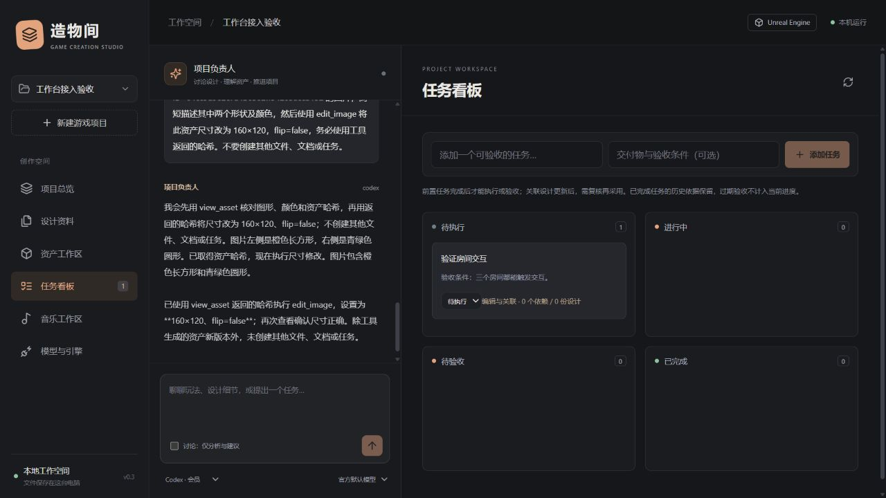

# 工作台现状、交互与 MCP / AI 对话管理审查

审查日期：2026-10-25（北京时间）。对象：造物间 0.3.0，本地单用户工作台。

## 结论

当前是已有真实可用能力的实验原型，尚未达到功能完备、可持续生产使用的游戏创作工作台。界面的分区方向合理，但草稿保护、会话管理、工具权限边界和交付闭环仍有明显缺口。

- **功能完备性：部分完成。** 项目资料、任务依赖、基础资产预览/编辑、会员对话与音乐方案已有实现；真实多供应商接入、双引擎验收和生成结果到引擎交付未形成完整闭环。
- **交互合理性：结构可用，日常可靠性不足。** 已实测文档未保存修改和聊天草稿会因页面/角色切换而丢失。
- **MCP：自有工具桥已可用，完整管理与运行时隔离不足。** 工作台自有 MCP 的项目/角色限制有效，但 Codex 会话仍继承其他工具服务器。
- **AI 对话管理：具备流式聊天基础，不是成熟的会话或多 Agent 管理系统。** 缺会话实体、长期上下文、工具执行账本、准确的模型验证状态和多轮用量合计。

本轮只审查和生成报告，没有修改功能代码，没有修改原工作区资料，也没有调用收费文本推理、图像生成或音乐生成。浏览器检查使用默认数据库的隔离快照；接口探针使用独立测试数据、模拟供应商和模拟引擎。

## 1. 当前工作区和任务

### 默认工作区 `.workbench/`

| 项目 | 引擎 | 当前情况 |
| --- | --- | --- |
| 工作台接入验收 | Unreal | 1 项待执行任务，包含会员与视觉工具的历史验收记录 |
| 工作台界面验收 | Unreal | 1 份设计文档，当前正式版本为 v2 |
| 虚幻连接器验收 | Unreal | 引擎连接器的历史验收项目，本轮实时连接检查未连通 |

汇总：**3 个项目、1 份文档、1 项任务、9 个资产、9 条消息、6 条执行记录**。执行记录为 5 次 completed、1 次历史 failed，没有正在执行的记录。

唯一的任务是 **“验证房间交互”**，状态为 todo，验收条件为“三个房间都能触发交互”。它还没有交互运行或实际游玩的验收证据；创建任务并不代表游戏交互已经实现。

### 独立测试数据

- `.dev/music-qa/`：1 个音乐验收项目、2 条消息、1 次完成的 Codex 音乐对话、1 份 draft 音乐方案；没有生成音乐。
- `.dev/github-qa/`：1 个示例项目、1 份文档、4 项 todo 任务、1 个测试图片。
- 以上是独立测试区，**没有自动合并进默认工作区**。打开默认工作台看不到此前音乐验收方案，是数据区不同，不代表方案已丢失。不能把测试区任务计入正式项目进度。
- 当前没有把工作台自身的产品开发待办系统地录入任务板，后续开发任务主要存在于说明文档中。

### 运行与连接

| 项目 | 本轮检查 |
| --- | --- |
| 工作台服务 | 审查前未运行；使用隔离快照启动后健康检查通过；审查结束停止测试实例 |
| Codex | 已安装，官方运行时返回 ChatGPT 登录类型和 7 个模型目录项；本轮没有调用模型推理 |
| OpenAI / DeepSeek API | 默认工作区均未配置 Key，verified 均为 false；不能声称这两条真实 API 已验收 |
| Suno.cn | 原版 Skill 已安装，服务端授权仍为 authorized；不读取或公开凭据 |
| Unreal | 历史 4.27.2 操作验收成立，但当前编辑器连接检查未连通；本轮未启动或修改引擎 |
| Unity | 只有历史编译通过证据，尚无编辑器运行验收；本轮未启动编辑器核验许可证 |
| GitHub | 本地 main 仓库已初始化，源码处于初始暂存状态；尚无提交和远程发布证据 |

## 2. 已确认的问题，按优先级排列

### P1-01：角色限制没有覆盖整个 Codex 工具环境

**证据：**`backend/codex.py:125` 建立每轮新线程，`:132` 只添加 `mcp_servers.workbench`，没有禁用继承的其他服务器。通过与工作台相同方式创建的只读、临时 Codex 线程，实际工具目录仍出现 `codex_apps`（66 个工具）、`cua_repl`（3 个）和 `node_repl`（4 个）。本轮只枚举目录，没有调用这些工具。

`backend/agent_tools.py:23` 的音乐工具白名单和 `:45` 的服务端检查，只约束**工作台自有 MCP**。它不等于 Codex 会话的工具全集白名单。音乐角色的文字要求也不能替代运行时工具隔离。

**影响：**不能向用户保证“音乐负责人只能使用音乐相关工具”。目录可见本身还不等于完成了越权利用验证，本轮也没有测试绕过沙箱；这里确认的是权限边界没有完整收敛。

**建议：**建立运行时工具白名单。按角色显式关闭未授权的继承服务器及不需要的内置执行工具，核验实际目录与配置一致；自有 MCP 启动失败时不能静默退化为“没有工具但仍继续执行”。

**验收：**音乐会话实际可见/可执行的工具与配置矩阵完全一致；模拟未授权工具请求被拒绝；测试不依靠提示词来阻止越权。

### P1-02：未保存文档与未发送聊天草稿会丢失

**浏览器复现：**

1. 在“设计资料”修改文档但不保存，切到“任务看板”，再切回设计资料：未保存内容消失，没有离开提醒。
2. 在项目负责人的输入框填写未发送内容，切到音乐工作区，再回任务看板：输入框清空。

**根因：**文档草稿只保存在 `Documents` 组件状态中，导航卸载组件后丢失（`src/main.tsx:116`）；聊天组件按角色重新挂载（`:54`），输入状态只保存在组件本身（`:72`）。

**建议：**按项目、角色、会话保留输入草稿；文档采用本地草稿保存和离开提示，明确“已保存 / 未保存”状态。保存冲突时保留两份内容供比较。

**验收：**在角色、项目、资料页之间往返以及刷新页面，未发送/未保存内容可以恢复，或用户明确确认放弃后才丢弃。

### P1-03：原生资产修改的目标与哈希校验没有绑定

**证据：**`backend/app.py:459` 检查 `asset_id` 对应文件的哈希，之后 `:467` 将另一份独立的 `path` 交给引擎。隔离探针使用资产 A 的 ID/哈希，传入另一个材质路径 B，接口返回 200，并把 B 传给模拟连接器。

**影响：**当前“版本未变才修改”的保证并未严格覆盖实际目标文件；不能通过检查 A 的版本来证明 B 未变化。本轮未调用真实编辑器，也没有修改任何真实材质。界面一般会传入同一资产，但服务端不能只依赖界面配对正确。

**建议：**由服务端根据已登记资产推导并验证引擎目标路径；检查的资产、备份的资产和实际写入目标必须一致。

**验收：**A 的 ID/哈希配上 B 的引擎路径必须被拒绝；正确的同一资产仍能保存、备份及重开验证。

### P2-01：会话与长期上下文管理不足

- 每轮 Codex 都创建 `ephemeral` 线程，结束后尝试归档，没有持久线程续接（`backend/codex.py:125`、`:173`）。临时线程配合消息重放能简化实现，但只能视为有限历史聊天，不能等同于长程会话续接。
- 项目/角色只有一条连续消息历史，没有会话列表、命名、分支、归档、搜索或消息级重试。
- 每次只重新发送最近 16 条消息，未生成摘要；探针中早期设计决定已经不在模型输入中（`backend/app.py:388`）。
- `get_project` 每次返回全部文档、任务和部分记录；总量超过 100000 字符时直接停止。探针用一份 100100 字符文档复现了“无法继续汇报进度”，没有检索或选择资料机制。
- 消息没有结构化保存模型 ID、附件、run 关联和工具结果；目前保存的是 user/assistant 文本。图片原始附件也没有作为会话附件实体持久管理。

**建议：**增加明确的会话与执行实体，支持恢复、分页、失败/中断状态；把正式设计记忆和聊天摘要分开，使用按需检索。工具结果应保存可核验摘要及相关文档/资产 ID，避免只有模型叙述。

### P2-02：多轮工具调用的用量被低估

**实测：**模拟两次真实格式的 Responses 请求，第 1 轮 total_tokens=15，第 2 轮=20，最终 `runs.usage` 只记录 20，而不是 35。

**根因：**`backend/app.py:413` 收到每一轮 usage 时覆盖前值；`backend/providers.py` 会在每个工具循环产生一次 usage。

**影响：**当前 usage 不能作为完整任务成本依据，更不能据此声称已有可靠预算控制。

**建议：**保存每次请求的用量、响应 ID、模型和时间，任务层面再求和。金额换算与账单核对另外处理，不猜测价格。

### P2-03：供应商“已验证”状态不是按模型记录

**实测：**配置中保存模型 A，在聊天中临时选择模型 B；B 的模拟对话完成后，供应商 verified 变为 true，而配置仍指向 A。执行记录中又没有结构化模型 ID，无法证明到底验证了哪一个模型。

**位置：**`backend/app.py:397`、`:416`，`src/main.tsx:170`。

**建议：**验证状态至少绑定供应商、模型、能力类型和最后成功时间；分别显示“已配置 / 已登录 / 目录可读 / 对话通过 / 工具调用通过 / 视觉通过”。

### P2-04：自有 MCP 的异常输入处理仍不健壮

**实测：**对 `backend/mcp_bridge.py` 的第一行输入发送非法 JSON，进程退出码为 1，错误处理分支又访问尚未赋值的 `message`，产生 `UnboundLocalError`。没有按 JSON-RPC 返回解析错误。未知方法目前返回空对象；初始化的 serverInfo 版本仍硬编码 0.1.0。

**建议：**明确解析错误、无效请求、未知方法和工具执行错误的返回；单条坏消息不能杀死桥接进程。只协商实际支持的协议版本，并同步版本信息。

### 代码审查发现、尚未专项复现的风险

- `src/main.tsx:27` 的项目刷新没有取消旧请求或验证响应所属项目；快速切换项目且响应乱序时，存在旧数据覆盖新页面的风险。需要延迟/乱序响应测试，不能将其写作本轮已复现故障。
- `src/main.tsx:89` 在重置 streaming 状态前先 await 刷新；若刷新失败，状态重置可能被跳过，应补异常路径测试。
- MCP 服务端请求目前统一回复 `decision=decline`（`backend/codex.py:90`），但不同审批/表单请求的响应结构不同；不能作为通用 MCP 授权/交互支持。

## 3. 功能是否形成闭环

| 能力 | 当前判断 | 尚缺内容 |
| --- | --- | --- |
| 项目与正式设计 | 基础可用 | 总纲版本、未保存保护、资料检索、设计决策追踪 |
| 任务管理 | 基础可用 | 执行调度、负责人/优先级、任务与资产/生成任务关联、自动验收证据 |
| 文档历史与冲突 | 后端基础较好 | 前端差异比较、离开保护、冲突合并 |
| 图片、音频、GLB | 有限编辑可用 | 更多预览与编辑、生成来源、验收/采用状态、引擎导入闭环 |
| 图像生成与 AI 编辑 | 接口与模拟通过 | 真实 Key/模型验证、成本限制、长任务恢复 |
| 音乐负责人 | 方案与授权可用 | 一次明确授权的真实生成、结果导入资产、关联验收、播放与质量评价 |
| Unreal | 特定能力有历史实测 | 当前工程连接、更多资产类型、任务驱动执行与验证 |
| Unity | 尚未完成运行验收 | 有效运行环境下的完整连接、保存、重开与引用检查 |
| 电脑操作 | 未交付受限窗口执行功能 | 窗口权限、动作反馈、暂停、恢复与审计；继承工具不等于已交付这一功能 |
| 多 Agent 协作 | 目前是两个专业角色 | 总负责人分派到独立执行者、产物回收、冲突处理、并发与状态汇报 |
| GitHub 分发 | 已有实验版源码与发布包 | 首次提交、真实远端 CI、修复 P1 后的小项目试用验收 |

任务“完成”现在仍以人工填写依据为主，不能证明资产已导入、引擎已运行或游戏可玩。音乐的 completed 也只表示生成结果返回，不是作品已经被项目采用。

## 4. MCP 管理评价

### 已具备

- 临时令牌、单项目作用域、讨论/执行模式、音乐角色自有工具白名单。
- 实际图片内容返回，哈希校验与跨项目资产拒绝。
- 原版 Suno.cn Skill 与其自身授权流程，不复制其凭据。

### 尚缺

- 服务器列表、启停、连接类型、认证状态、最近错误、健康检查与工具目录界面。
- 实际运行时工具白名单校验、每个角色/项目的授权配置与可解释拒绝原因。
- 工具调用的开始/结束、参数摘要、执行者、结果、耗时、错误与产物的持久记录。
- 正确处理需要用户输入的 MCP 交互、断线、启动失败与取消。

应区分三个概念：工作台自己的 stdio MCP 桥、由 Codex 继承的其他 MCP 连接、通过 Node helper 执行的 Suno.cn Skill。**Suno.cn 业务接入有效，不代表工作台已经是通用远程 MCP 管理器。**

Codex 官方运行时提供线程续接、取消和 MCP 状态查询能力；当前项目只接入其中一部分。这些是可以逐步利用的现有机制，而不是必须重新发明的协议。[官方 App Server 文档](https://learn.chatgpt.com/docs/app-server)

## 5. 对话交互评价

桌面端“项目导航 + 对话 + 工作区”的结构合理，职责入口清晰；讨论/执行开关及收费方案二次确认也值得保留。

主要不足：

- 缺少“当前会话、当前角色、当前模型、允许工具、运行任务”的统一状态条。
- 聊天内容直接显示为文本，Markdown、代码、文档/资产引用不能形成良好的可操作结果卡。
- 工具执行只有短暂活动提示，无法展开查看调用记录或定位失败步骤。
- 切角色、离开页面可能同时丢草稿、终止当前流，界面缺少解释。
- 模型选择由 App 共享状态保存，不能为各负责人配置稳定、独立的模型与权限档案。
- 移动端固定保留较高的聊天区域，任务/资产容易落到首屏以外；建议提供折叠聊天和工作区专注模式。
- 同项目用 ACTIVE 串行限制所有角色，不能把当前两个角色理解成可并行工作的多 Agent 系统。

基础取消验证通过：使用模拟上游和真实本机 HTTP 连接，断开后 run 变为 interrupted、保留带中断标记的部分回复，上游生成器也已关闭。但仍缺 run_id 级取消入口、重新连接到运行任务、页面刷新后恢复显示、错误步骤重试，以及对真实 Codex 中断的专项验收。

OpenAI 的工具调用本身包含调用与结果的往返过程，适合保存结构化执行证据；当前只保存最终文本不足以支撑项目负责人审计。[官方函数调用文档](https://developers.openai.com/api/docs/guides/function-calling)

## 6. 建议下一轮执行顺序与验收标准

### 第一批：先解决可靠性与权限边界

1. 运行时工具白名单：实际枚举结果与角色配置一致，禁止继承未授权工具；核心工作台工具不可用时明确停止。
2. 聊天/文档草稿保护：切页、切角色、切项目与刷新不会静默丢内容；项目响应乱序不会串数据。
3. 原生资产目标绑定：错误路径与哈希配对被拒绝，正确目标能备份、保存和读回。

### 第二批：补会话、执行和 MCP 管理

1. 会话、消息、run、工具事件、附件和模型 ID 独立记录；30 轮对话后早期正式决策仍可检索。
2. usage 按请求保存并正确合计，验证状态按具体模型及能力记录。
3. 增加运行任务列表、显式取消、失败原因、恢复/重试入口，避免把浏览器网络状态当作全部任务状态。
4. MCP 提供最小可用连接与工具目录页面，完成坏消息、未知方法、启动失败和作用域过期检查。

### 第三批：验证一个真实小项目的交付闭环

1. 配置有效 API Key 后分别验证文本、工具、视觉与图像能力，失败必须保留真实原因。
2. 用户明确确认一份音乐需求后，才进行真实音乐生成验收；将结果导入资产并关联任务。
3. Unreal / Unity 各完成一个受控资产的导入、修改、保存、关闭重开及引用检查。
4. 项目负责人能够根据结构化证据回答“做了什么、输出在哪里、哪些待验收、为什么受阻”。

目前适合继续以实验版公开源码和试用，不宜宣传为权限隔离完善、双引擎全流程验收完成的自动游戏制作平台。

## 7. 本轮验证与证据范围

- 原有自动测试：31 passed；生产构建通过。仍有 3D 分块较大和 TestClient 兼容提示。
- 浏览器复现：聊天草稿丢失、文档未保存修改丢失；检查默认项目、任务、角色、音乐与设计页面。
- 隔离接口探针：用量覆盖、历史截断、上下文容量、资产目标未绑定、模型验证错配。
- stdio 探针：非法首条 JSON 导致桥接进程退出。
- 真实运行时元数据：Codex 登录/模型目录与继承的 MCP 工具目录。没有调用外部业务工具；用于目录检查的 workbench 探针作用域故意无效，其 0 工具结果不作为工作台连接失败证据。
- 真实 HTTP / 模拟上游：取消状态回收通过；不等同于真实供应商端已成功取消或退款。
- 原默认数据库只读检查；页面操作在 SQLite 快照中进行，探针使用独立数据库。审查前后原数据计数不变。
- 本轮不重新调用付费模型、不生成音乐/图片、不启动游戏引擎，也不变更账号授权或全局配置。

本机可复现材料在 `.dev/audit-2026-10-25/`，包含探针与脱敏结果；该目录保持 Git 忽略。下图仅包含验收项目界面。

